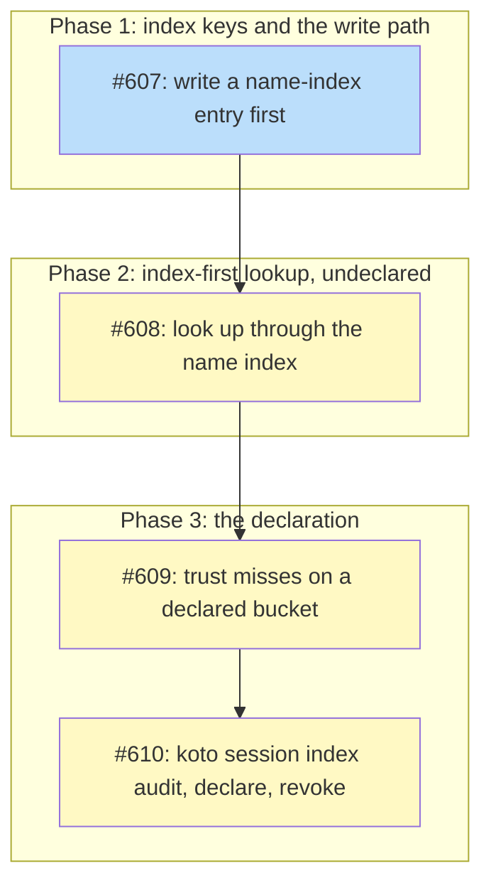

# PLAN: Cloud missing-session lookup

## Status

Active

## Scope Summary

Give the cloud backend a name-first index, `koto-names/<name>/<prefix>`, so
a lookup of a missing session name (koto#597) answers in 3 requests on a
bucket whose owner declares the index complete, while every reply on a bucket
nobody declares stays exactly what today's code gives. Four issues build it:
the index write path, the index-first lookup on undeclared buckets, the
declared lookup, and the operator command that audits, declares and revokes.

## Decomposition Strategy

**Horizontal decomposition.** The design's three phases are layered changes
to code that already exists (the write path, then `held_elsewhere`, then the
declaration that changes what an index miss means), and the design says each
can ship alone. There's no new end-to-end flow to build as a skeleton, so
each phase becomes its own issue and pull request, except Phase 3, which
splits in two.

- **#607 implements Phase 1.** Decision 2 puts an entry before every state
  PUT a copy hasn't indexed and never removes one from a session command.
  That has to be on hosts before any lookup reads the index, because an
  index miss only means something once every newer writer is known to leave
  an entry. Nothing reads the index yet, so no lookup changes; buckets start
  filling as hosts upgrade. The strict, 4 KiB-capped declaration parser lands
  here too, because the write path's 403 handling reads the declaration.
- **#608 implements Phase 2.** It rewrites `held_elsewhere` around the index
  while treating every bucket as undeclared. Decision 1 confirms every hit
  with the `<prefix>/<name>/` listing the sweep already makes, so a stale or
  forged entry costs a listing and changes no reply. A miss runs today's
  sweep. Decision 4 keeps a failed top-level listing as "can't tell" even
  with an index hit, Decision 3 leaves the retry policy alone, and Decision 5
  brings the host-wide declaration memo, `cloud-index.json`. The stderr hint
  after a slow undeclared sweep and an explicit 60-second request timeout in
  `create_bucket` (the value rust-s3 already uses) ride along.
- **#609 and #610 implement Phase 3**, split into the declared lookup and the
  operator command. #609 adds the declared branch of `held_elsewhere`: a
  missing name on a bucket carrying a valid `koto-names/_complete` reads as
  not-found after 3 requests in 2 round trips at any prefix count, with the
  memo's 10-minute carry limit, the per-name entry cap that falls back to the
  sweep, and the push failure on a declared bucket. Its tests plant the
  declaration by hand. #610 adds `koto session index audit`, `declare` and
  `revoke`, the only way a declaration gets written, and documents the
  command and the declared bucket's trade. The split keeps each pull request
  reviewable on its own: the declared lookup is proven against a planted
  declaration before any command can write one.

**What every issue keeps.** Each issue keeps the existing tests in
`tests/cloud_bound_dir_test.rs` passing with no edit to any existing test
function. Those tests plant state with a bare PUT and no entry, which is an
older writer's footprint on an undeclared bucket, so they exercise the
fallback exactly as written. No reply of `koto status` or any other command
changes in #607 or #608. The one reply change the design accepts comes only
with #609 and #610: on a declared bucket, a session that only older releases
have touched reads as not-found from other prefixes until the next audit
revokes the declaration. #609 brings that behavior, and it reaches users once
#610 lets an owner declare a bucket.

## Implementation Issues

| Issue | Dependencies | Complexity |
|-------|--------------|------------|
| [#607: feat(session): write a name-index entry before each session copy's first state object](https://github.com/tsukumogami/koto/issues/607) | None | testable |
| _Adds `src/session/name_index.rs`, `Stamp::indexed` and `ensure_indexed` in `put_state`, `put_state_over` and `push_staged`, so every push or import that puts a copy's state object under a new key first writes its empty entry, once per copy per host. A refused entry PUT warns and pushes on an undeclared bucket and fails the push when the declaration is present or unreadable; the guide gains the permissions hosts need under `koto-names/`._ | | |
| [#608: feat(session): look up other prefixes through the name index on undeclared buckets](https://github.com/tsukumogami/koto/issues/608) | [#607](https://github.com/tsukumogami/koto/issues/607) | critical |
| _Rewrites `held_elsewhere` to start the index listing, the declaration GET and the top-level listing together, confirm every index hit with the existing per-prefix listing, and run today's sweep on a miss. Adds the `cloud-index.json` memo, the stderr hint after a slow sweep, and the explicit 60-second timeout in `create_bucket`, with every reply unchanged on every bucket._ | | |
| [#609: feat(session): trust index misses on a bucket that carries the declaration](https://github.com/tsukumogami/koto/issues/609) | [#608](https://github.com/tsukumogami/koto/issues/608) | critical |
| _Adds the declared branch: on a bucket with a valid `koto-names/_complete`, a missing name is not-found after 3 requests in 2 round trips whatever the prefix count, and the lookup falls back to the exact sweep whenever the declaration can't be trusted. Pins the push failure on a declared bucket and the memo's carry limit, with the declaration planted in tests._ | | |
| [#610: feat(cli): add koto session index audit, declare and revoke](https://github.com/tsukumogami/koto/issues/610) | [#609](https://github.com/tsukumogami/koto/issues/609) | critical |
| _Adds the operator command: `audit [--prune]` backfills and checks the index and revokes on an older writer's session, `declare` refuses inside the 7-day probation or while an entry-less state object is newer than the audit, and `revoke` deletes the declaration. Validates bucket text before building keys, escapes it before printing, and documents the command and the declared bucket's trade in the cloud sync guide and the error-handling reference._ | | |

## Dependency Graph

**Legend**: Green = done, Blue = ready, Yellow = blocked, Purple = needsDesign, Cyan = needsPrd, Red = needsSpike, Violet = needsDecision, Orange = tracksDesign/tracksPlan

## Implementation Sequence

**Critical path**: #607, #608, #609, #610 (4 issues). The chain is linear and
each issue lands as its own pull request.

**Recommended order:**

1. #607, the write path. Nothing else can start before it.
2. #608 needs `name_index.rs` and the write path from #607.
3. #609 needs the rewritten `held_elsewhere` and the memo from #608.
4. #610's revoke and audit tests need the declared lookup from #609.

**Parallelization:** none. Each issue builds on the previous one's code.

**A name used before its command exists.** The stderr hint #608 adds names
`koto session index audit`, which only #610 adds. Until then the name doesn't
resolve against the CLI, so #608 adds a `tests/doc_names.allow` record for it
with the reason, and #610 removes that record when it adds the verb.

**Related issues outside this plan:**

- #605, the request timeout on the probe path, stays its own issue. #608 and
  #609 touch the same `create_bucket` and listing calls. #608 only sets the
  timeout rust-s3 already uses, explicitly, and neither changes its value, so
  whichever of these lands later works against the other's change.
- The design disagrees with itself on one push. Its write path (lines
  676-682) fails a push after a refused entry PUT when the declaration is
  present or unreadable; its Phase 1 (line 811) says a host whose
  credentials can't write under `koto-names/` only warns. The two differ for
  a host that can neither PUT under `koto-names/` nor read
  `koto-names/_complete`. #607 follows lines 676-682 as written. #606 asks
  the design's author to settle which reading holds; it isn't one of this
  plan's issues.
