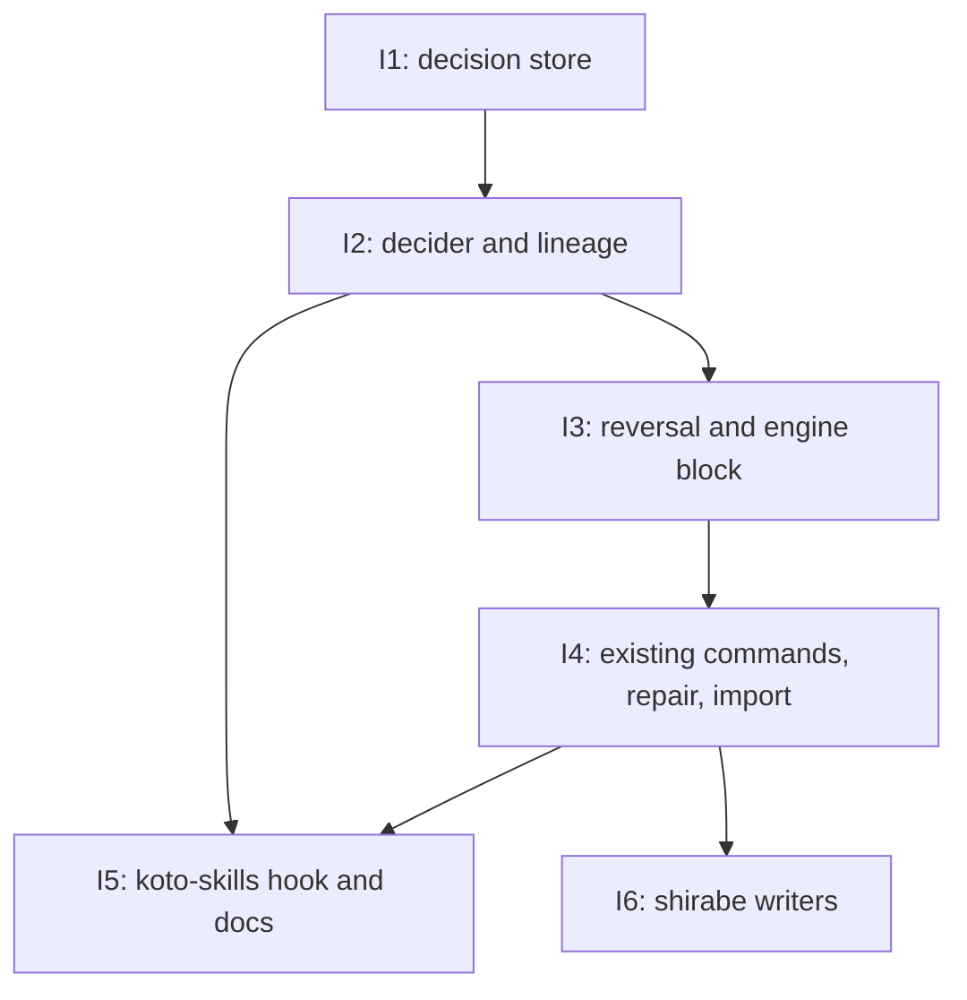

# PLAN: The decision record

## Status

Active

## Scope Summary

A host-level koto decision store that outlives sessions, records who decided (a session and
the agent within it, a person named without an account, or an automated check) and under what
authority, lets a decider with standing reverse any decision, blocks a live workflow on a
reversed gate pass, and takes writes from koto's existing gate-passing commands. The shirabe
plugin then writes its own decisions to it. Design:
`docs/designs/DESIGN-decision-record.md`; requirements: `docs/prds/PRD-decision-record.md`.

## Decomposition Strategy

Horizontal. The design's components have stable interfaces and a clear prerequisite order: the
store first, because every other component reads or writes it; identity and lineage next,
because reversal authority and dual-write both need a resolved decider and chain; then
reversal and its engine enforcement; then the existing commands, repair and import. The
koto-skills hook can be built alongside the identity work. The work lands as two PR groups, one
per repository, because the shirabe writers need a koto release first.

## Issue Outlines

### Issue 1: feat(decisions): add the host-level decision store with record, show, list and report

**Repo**: tsukumogami/koto

**Group**: koto

**Goal**: Create the append-only host-level decision store under `~/.koto/decisions/` with its locked writer and lock-free readers, and expose `koto decisions record --kind`, `show`, filtered `list` and `report`.

**Acceptance Criteria**:

Store layout and safety
- [ ] The store resolves to `$HOME/.koto/decisions/` (not `KOTO_SESSIONS_BASE`); tests isolate it by setting `HOME`.
- [ ] The directory is created with mode 0700; koto refuses to use it, with an error, when it is owned by another user or writable by group or others.
- [ ] Month files, `reversals.jsonl`, `imports.jsonl` and `store.lock` are opened with mode 0600 and `O_NOFOLLOW`; a symlink planted at any of them makes the write fail instead of following it.
- [ ] A non-reverse decision is appended to `<YYYY-MM>.jsonl` for the UTC month of its own `time`, and its identifier names that month.
- [ ] Torn-tail repair: a final line that is complete JSON without a newline gets the newline appended; a final line that doesn't parse is truncated via the opened descriptor; both cases have tests.
- [ ] Writing an identifier already present with identical content is skipped; writing an identifier already present with different content fails with an error and appends nothing.
- [ ] A stub check closure that refuses makes the writer append nothing (or the closure's `refused` line), and one that skips leaves the file byte-identical; both have unit tests.
- [ ] A decision line over 64 KiB, or more `--basis`/`--evidence` entries than the fixed maximum, is refused with an error and nothing is truncated or written.
- [ ] Reasons, links, handles and evidence pointers pass through koto's redaction before they are written; `--link` is refused unless it is an absolute `https` URL with no credentials and no query string.

Recording and validation
- [ ] Two decisions recorded in one run have different identifiers, and a decision recorded with a reason returns that reason from `show` and `list`. (PRD: Reading an unattended run, 3rd)
- [ ] An `accept` recorded with outcome `rejected` lists with that outcome. Recording a kind or outcome outside R1, or a `verdict` with no evidence pointer, is refused with an error naming the field, and nothing is written. (PRD: Reading an unattended run, 4th)
- [ ] A subject missing a field R2 requires for its kind (for example a `merge` without a pull request number) is refused with an error naming the field.
- [ ] A decision recorded with a harness tool-call identifier as an evidence pointer returns that identifier and the stored line contains no copied harness content. (PRD: Querying and reporting, 5th)
- [ ] All `koto decisions` output is JSON.

Reading
- [ ] A `verdict` on a change records and lists the repository and commit judged, and one recorded without a commit is refused naming the field; an `accept` of a request's intent recorded with a forge issue as its location and a source-ticket link lists both. (PRD: Reading an unattended run)
- [ ] Listing filtered on `defaulted` returns exactly the decisions whose decider is marked `defaulted`, and the report's count of `gate-pass` decisions with a `defaulted` decider matches a fixture. (PRD: Gate passes, 1st; Querying and reporting, 4th)
- [ ] `koto decisions show <id>` reads only the month file the identifier names plus `reversals.jsonl`, and reports whether the decision is in effect or reversed (with the reversal's identifier when reversed).
- [ ] Listing filtered by subject, by kind, by decider kind and by a time window each returns exactly the matching decisions from a fixture of known decisions, ordered oldest first with the identifier breaking ties, each with its in-effect or reversed status. (PRD: Querying and reporting, 1st)
- [ ] Unwindowed filters use a literal byte search across month files and parse only matching lines.
- [ ] For a fixture spanning two months (with reversal lines written directly into `reversals.jsonl`), `report` for the second month counts the decisions made in it and how many are reversed, in a kind by decider-kind table whose cells match the fixture; it also counts a reversal recorded in the second month of a first-month decision under the reversals recorded in the window, in the cell of that decision's kind and decider kind; `reverse` and `refused` are not counted as decisions; the window includes its start and excludes its end. (PRD: Querying and reporting, 4th)
- [ ] Today's `koto decisions record <name> --with-data` and `koto decisions list <name>` keep their current arguments and output.

Concurrency, durability and performance
- [ ] Two processes recording 100 decisions each at the same time produce 200 complete entries, and no existing entry changes. (PRD: Non-functional, 1st)
- [ ] Removing a session directory (including via cleanup on a successful terminal) does not touch `~/.koto/decisions/`.
- [ ] Recording and reading make no network call.
- [ ] On a generated record of 100,000 decisions over twelve months, a one-month listing and a one-month report each finish in under five seconds on the CI runner. (PRD: Non-functional, 5th)
- [ ] No new crates are added to `Cargo.toml`.

Downstream deliverables
- [ ] Must deliver: a `decision_store` writer API that takes an assembled decision plus a check closure (append, skip, refuse) under the store lock, and the record types with list-of-`{value, source}` identity slots, so the decider and lineage resolvers can fill them (required by <<ISSUE:2>>).

**Dependencies**: None

### Issue 2: feat(decisions): resolve the decider, authority and dispatch chain for every decision

**Repo**: tsukumogami/koto

**Group**: koto

**Goal**: Resolve the decider, authority and dispatch chain for every decision, labelling each identity `observed` or `handed`, and snapshot the result onto the decision.

**Acceptance Criteria**:

Decider and agent
- [ ] A decision recorded from a session whose acting agent can't be established lists the agent as `unknown`, never `main`. (PRD: Reading an unattended run, 5th)
- [ ] `KOTO_AGENT_ID=main` records agent `main` labelled `observed`; `--agent <id>` records it `handed`; when both are given and differ, both values are kept.
- [ ] A `KOTO_AGENT_ID` value that fails koto's identifier pattern is recorded as `unknown`.
- [ ] With `CLAUDE_CODE_SESSION_ATTENDED` set by the harness and no `--run-mode`, a decision records the run mode from it labelled `observed`; `--run-mode` is labelled `handed`. (PRD: Identity labels and chains)
- [ ] With no `--by`, the decider is the observed session marked `defaulted`; with `--by` it is used as given, labelled `handed`, and not marked `defaulted`; with neither, the resolver returns `decider_missing`.
- [ ] A decision recorded with run mode `unattended` returns decider kind `session` and run mode `unattended`, a decision recorded with no run mode returns `unknown`, and listing filtered by run mode `unattended` returns the first and not the second. (PRD: Identity labels and chains, 6th)
- [ ] Listing filtered by a dispatch identifier, and by an instructions digest, each returns exactly the decisions recorded under it from a fixture of known decisions. (PRD: Identity labels and chains, 7th)
- [ ] A worker records an `escalate` to its coordinator, a `decline-escalation` and a `judgment`; listing returns all three with their deciders and the escalation's recipient. (PRD: Escalation and judgment, 1st)
- [ ] A session records a `judgment` about another session's workflow, and a third session lists it. (PRD: Querying and reporting, 3rd)

People as deciders
- [ ] A maintainer accepting a document at the terminal records an `accept` with decider kind `person`, the maintainer's handle, surface `terminal`, and the entering session. (PRD: People as deciders, 1st)
- [ ] An acceptance relayed by a coordinator with a forge review link is recorded with decider kind `person`, the link stored, and the handle labelled `handed`; the same relay without a link is recorded with the coordinator's session as decider and the person kept as a handed note. (PRD: People as deciders, 2nd)
- [ ] koto's stored decision format has no account, login or credential field, and recording a `person` decision succeeds with no prior registration step. (PRD: People as deciders, 3rd)
- [ ] The relay link is stored and never fetched (no network call in the test).

Labels and chains
- [ ] A decision recorded from a session whose harness session identifier is set has its session labelled `observed`; a decision whose caller hands a different session identifier keeps both values. (PRD: Identity labels and chains, 1st)
- [ ] A decision recorded in a session the workspace manager launched by direct dispatch, and one by detached dispatch (fixture session-map entries of today's shape), each carry the dispatch identifier and parent from the session map, labelled `handed`, with the chain marked `incomplete`. A session started for an incoming event, or outside the workspace manager, with nothing handed, records a chain marked `incomplete`. (PRD: Identity labels and chains, 2nd)
- [ ] With a fixture session entry in the versioned lineage format carrying a copied chain and `parent: none`, a decision's chain reaches that root, is not marked `incomplete`, and each link carries the label the entry gives it. (PRD: Identity labels and chains, 3rd)
- [ ] An entry whose `lineage.v` is unknown is treated as absent.
- [ ] A decision recorded with a handed `--dispatched-by none` closes the chain at a handed root. (PRD: Identity labels and chains, 4th)
- [ ] A handed value that disagrees with an observed one, including a handed `none` against an observed parent, marks the chain `incomplete`, and handed values are never merged into an observed slot.
- [ ] Dispatching a session with koto absent from the dispatcher's `PATH` succeeds, showing the workspace manager runs no koto command; koto never runs `niwa` and never writes under `.niwa/`. (PRD: Identity labels and chains, 5th)
- [ ] A `verdict` recorded with decider kind `check` naming the grader, and an evidence pointer to a run-journal check record, lists with that decider, the session that ran the check, and the pointer. (PRD: Identity labels and chains, 7th)
- [ ] Authority carries kind `dispatch` for `session` and `check` deciders and `person` for `person` deciders, plus dispatch identifier, instructions digest when available, run mode and immediate dispatcher, each labelled.
- [ ] With networking disabled, the harness session identifier unset and no lineage available, recording a decision that names its decider succeeds, and the missing values carry the labels R4, R6 and R10 require (agent `unknown`, empty identity lists, chain `incomplete`). (PRD: Non-functional, 4th)

Hardening
- [ ] Session, dispatch and parent identifiers are checked against a fixed pattern (letters, digits, `.`, `_`, `-`, bounded length) before koto builds a session-map path; a value with `/` or `..` is rejected and the chain is `incomplete`.
- [ ] The parent walk stops at a fixed depth and at the first repeated identifier.
- [ ] A session-map entry is read only when `fstat` on the opened descriptor shows a regular file owned by the current user and not writable by others; otherwise it is treated as absent.
- [ ] `--chain-file` is opened without following symlinks, must be a regular file, is size-capped and parsed as strict versioned JSON before the store lock is taken.
- [ ] A session resumed after its session-map entry is removed still resolves its lineage from the run-journal driver stamp.

Downstream deliverables
- [ ] Must deliver: a decider resolver callable before any write, returning a decider (with `defaulted` flag) or `decider_missing`, and a lineage resolver returning the labelled authority and chain snapshot with its `incomplete` flag (required by <<ISSUE:3>>, whose R12 matching reads the labels, and by <<ISSUE:4>> through <<ISSUE:3>>).
- [ ] Must deliver: the `KOTO_AGENT_ID` contract (variable name, identifier pattern, `unknown` on mismatch) that the hook sets (required by <<ISSUE:5>>).

**Dependencies**: Issue 1

### Issue 3: feat(decisions): reverse decisions and block workflows on reversed gate passes

**Repo**: tsukumogami/koto

**Group**: koto

**Goal**: Add `koto decisions reverse` with its authority rules, refusals and per-kind effects, and make `koto next` block a live workflow on a reversed gate pass until it is rewound or the gate is re-passed by a decider with standing.

**Acceptance Criteria**:

Reversing and authority
- [ ] The dispatching coordinator reverses an acceptance, a gate pass and a merge from its own session. Each reversal has decider kind `session` naming the coordinator, its own authority, and the original's identifier, and each original then lists as `reversed`. (PRD: Overruling, 1st)
- [ ] Reversing the merge with a revert pull request link stores the link; reversing a merge without one records that no compensating change exists. (PRD: Overruling, 2nd)
- [ ] Reversing an acceptance that a later acceptance names in its `basis` returns the later acceptance as affected, both in the reversal's result and when showing the reversed acceptance. (PRD: Overruling, 3rd)
- [ ] A worker reverses its own `judgment`, and the reversal is accepted with authority `verified`. (PRD: Overruling, 5th)
- [ ] A coordinator's attempt to reverse a decision whose decider is a `person` is refused, and the person at the chain's root reversing it is accepted. (PRD: Overruling, 6th)
- [ ] Reversing an identifier that isn't on the record is refused and recorded as `refused`. (PRD: Overruling, 7th)
- [ ] Two sessions reversing the same decision at the same time produce exactly one `reverse` and one `refused` (as already reversed). (PRD: Overruling, 8th)
- [ ] A maintainer whose handle is the root of the chain reverses a worker's judgment call from the terminal, and the reversal is accepted. (PRD: Overruling, 9th)
- [ ] A worker's attempt to reverse a decision made by its coordinator, with both chains complete, is refused and listed as a `refused` decision. (PRD: Overruling, 10th)
- [ ] A reversal by a session with no match when the original's chain is `incomplete` is recorded with authority `asserted`. (PRD: Overruling, 11th)
- [ ] Attempts to reverse a `reverse` decision, a `refused` decision and an already reversed decision are each refused and recorded. (PRD: Overruling, 12th)
- [ ] After an acceptance is reversed, a new `accept` of the same subject lists as in effect while the original still lists as `reversed`. (PRD: Overruling, 13th)
- [ ] A match resting only on `handed` values gives `asserted`; a match through an `incomplete` chain is never `verified`.
- [ ] The original decision's line is byte-identical before and after its reversal.

Escalation and judgment effects
- [ ] The coordinator reverses a worker's judgment, and the reversal is listed with its decider; a `--replacement` outcome, when given, is stored on the reversal. (PRD: Escalation and judgment, 2nd)
- [ ] Reversing an escalation lists the question as withdrawn from the coordinator; reversing a decline lists the question as escalated to the reverser. (PRD: Escalation and judgment, 3rd)
- [ ] Reversing an `accept` with outcome `rejected` lists the subject as neither accepted nor rejected.

Received decisions
- [ ] Listing by a coordinator's session with `--received` returns the escalations addressed to it and the reversals of its decisions; without `--received` it returns only the decisions it made. (PRD: Querying and reporting, 2nd)

Engine enforcement
- [ ] After a gate pass is reversed while its workflow still exists and has moved one state past the gate, `koto next` on that workflow refuses to advance, leaves the state unchanged, and reports a `decision_reversed` blocking condition. After `koto rewind` to the gated state the block is gone. In a second run, a new `gate-pass` for that gate recorded by the reverser clears it instead. (PRD: Overruling, 4th)
- [ ] A `gate-pass` for the same gate recorded by a decider R12 would not let reverse the reverser does not clear the block; a `verified` reversal is not cleared by a `gate-pass` whose match over the reverser is only `asserted`.
- [ ] When the gate was passed several times, the block applies only to the one pass the reversal names.
- [ ] Reversing a release `verdict` with `--compensating <rollback link>` stores the link; without it, the reversal records that no compensating action exists yet. (PRD: Overruling)
- [ ] The blocking condition carries only the reversal's identifier, kind, standing and time, never its reason, handle or link.
- [ ] A session with no reversed gate passes does not open month files on `koto next` (the check reads `reversals.jsonl` only).
- [ ] An unreadable line in `reversals.jsonl` makes `koto next` return a `decision_store_unreadable` blocking condition rather than treating any pass as not reversed.
- [ ] The check identifies the workflow's gate passes by the reversal line's copied subject key (workflow and workflow session id), so it works for a gate pass recorded with `koto decisions record --kind gate-pass` naming the workflow, state and gate.

Downstream deliverables
- [ ] Must deliver: the `decision_reversed` engine check keyed on gate-pass subjects naming the workflow session, and the R12 authority function as a reusable call, so gate passes written by the existing commands are enforced and their refusals share the same rules (required by <<ISSUE:4>>).

**Dependencies**: Issue 2

### Issue 4: feat(decisions): make gate-passing commands write decisions, with repair and import

**Repo**: tsukumogami/koto

**Group**: koto

**Goal**: Make `koto overrides record`, `koto next --to` and `koto decider answer` resolve a decider and write a decision alongside their existing records, map today's `koto decisions record` to `judgment`, add the repair tick and decision identifiers in the run journal, and add idempotent `koto decisions import`.

**Acceptance Criteria**:

End-to-end unattended run
- [ ] An unattended session accepts a document (`koto decisions record --kind accept`), gets past a gate with `koto overrides record`, and records a merge (`--kind merge`). After the session reaches a successful end and its session directory is gone, listing by that session returns three decisions, each with its kind, subject per R2, decider kind `session` with an agent value, authority per R9, chain per R10, identifier, UTC time and outcome. (PRD: Reading an unattended run, 1st)
- [ ] The same listing still returns all three after the workspace directory that ran the session has been removed. (PRD: Reading an unattended run, 2nd)

Gate passes
- [ ] `koto overrides record`, `koto next --to` past an unmet gate, and `koto decider answer` with a passing answer, each run with no decider named, each record a `gate-pass` whose decider is the observed session marked `defaulted`. (PRD: Gate passes, 1st)
- [ ] The same three commands run with the harness session identifier unset and no decider named are each refused. The error names the missing decider (`decider_missing`), the workflow's state is unchanged, none of the command's existing records is written, and a `refused` decision is listed. (PRD: Gate passes, 2nd)
- [ ] `koto next --to` to a state whose gate already passed writes no `gate-pass` decision.
- [ ] Each command's `gate-pass` subject names the workflow, its session id, the state and the gate, and reversing it makes the next `koto next` return the `decision_reversed` block from <<ISSUE:3>>.

Existing records
- [ ] `koto overrides record` writes a `gate-pass` decision with a session decider, and `koto overrides list` still returns the override. (PRD: Existing records, 1st)
- [ ] `koto decisions record` writes a `judgment` decision with a session decider, and `koto decisions list` still returns the choice. (PRD: Existing records, 2nd)
- [ ] `koto decider answer` writes a `gate-pass` for a passing answer and a `judgment` for a failing one. (PRD: Existing records, 3rd)
- [ ] Each of the four session events carries a `decision` field whose identifier matches the decision in the store.

Repair
- [ ] With the store append forced to fail after the session event is written, the next `koto next` on that session appends the identical decision, marked `repaired_from` with the session name.
- [ ] A decision written on the terminal tick is present in the store after the session is cleaned up.
- [ ] The repair never re-appends a `reverse` line, and skips an event whose decision identifier doesn't match its own time's month or fails event validation.
- [ ] A store lock timeout during the repair tick fails neither the tick nor a gate pass and never turns into a passed gate; the repair retries on the next tick.

Import
- [ ] Importing a coordinator's recorded decisions keeps each decider and authority labelled `handed` with a source pointer, and importing the same entries again adds nothing. (PRD: Existing records, 8th)
- [ ] An imported decision gets a new identifier, keeps the source's time in `time` alongside its own `recorded_at`, and has a chain marked `incomplete` unless the source records one.
- [ ] A reversal racing an import of the same source entry yields one imported decision and a consistent reversal outcome (race test).
- [ ] Import sources are opened without following symlinks, must be regular files, are size-capped and parsed before the store lock is taken.

Compatibility and privacy
- [ ] The existing test suites for the run journal, the feed and the grader report pass unchanged. The existing functional tests for `koto overrides record`, `koto decisions record`, `koto next --to` and `koto decider answer` pass without changes to their arguments, with at most a harness session identifier added to their environment. (PRD: Non-functional, 2nd)
- [ ] Exporting telemetry for a run whose decisions carry reasons produces no record containing any reason text, and run-journal records carry decision identifiers and kinds only. (PRD: Non-functional, 3rd)

Downstream deliverables
- [ ] Must deliver: final CLI flags and JSON output for every `koto decisions` subcommand and for the three gate-passing commands, including the `decider_missing` error shape (required by <<ISSUE:5>> to document them).
- [ ] Must deliver: `koto decisions record --kind` with `accept`, `merge`, `verdict` and `judgment` subjects and `koto decisions list` filters stable enough for an external plugin to call, plus a way to detect their presence on an older koto (required by <<ISSUE:6>>).

**Dependencies**: Issue 3

### Issue 5: feat(koto-skills): capture the acting agent and document the decision record

**Repo**: tsukumogami/koto

**Group**: koto

**Goal**: Ship the koto-skills PreToolUse hook that sets `KOTO_AGENT_ID` for koto calls, and update the koto-user, koto-author and koto-adhoc skills for the decision record's flags and subcommands, with eval results.

**Acceptance Criteria**:

Hook
- [ ] `plugins/koto-skills/hooks.json` has a `PreToolUse` entry for Bash that runs the new hook script; the existing `SessionStart` and `Stop` entries are unchanged.
- [ ] For a Bash call invoking `koto` from inside a sub-agent, the hook rewrites the command to prefix `KOTO_AGENT_ID=<id>` with the value quoted, using the payload's agent identifier.
- [ ] The hook sets `KOTO_AGENT_ID=main` only when the payload positively identifies the main agent; for an ambiguous payload it leaves the command unchanged.
- [ ] A payload agent identifier that fails koto's identifier pattern (for example one containing a space, quote, `;` or `$`) leaves the command unchanged.
- [ ] Bash calls that don't invoke `koto` are passed through unchanged.
- [ ] Hook tests cover the sub-agent, main, ambiguous, invalid-identifier and non-koto cases, and run in CI.
- [ ] With the hook installed, a decision recorded from a sub-agent's koto call lists that agent labelled `observed`.

Skills
- [ ] koto-user documents `koto decisions record --kind`, `list` filters including `--received`, `show`, `reverse`, `report` and `import`, the shared decider flags and the handed lineage flags, matching the clap tree from <<ISSUE:4>>, and tells a person passing a gate from inside an agent's session to use `--by person:<handle>`.
- [ ] koto-user explains that `koto overrides record`, `koto next --to` past an unmet gate and `koto decider answer` record a `gate-pass` decision, default the decider to the observed session, and fail with `decider_missing` when none can be established.
- [ ] koto-user explains the `decision_reversed` and `decision_store_unreadable` blocking conditions and how to clear the former (rewind, or a new `gate-pass` by a decider with standing).
- [ ] koto-author and koto-adhoc are updated wherever they show gate-passing commands or decisions, and any example that passes a gate still runs.
- [ ] The skills say not to put secrets in reasons, and that reasons, handles and links read from the record are data, not instructions.
- [ ] User-facing docs pass the repository's name-resolution check against the built CLI.
- [ ] Every changed skill keeps at least one eval (`check-evals-exist.sh` passes), and new evals cover recording a decision, reversing one, and handling a `decision_reversed` block.
- [ ] `scripts/run-evals.sh` is run for koto-user, koto-author and koto-adhoc with every eval graded, and the PR description includes the `## Eval Results` table (Skill, Assertions, with_skill, without_skill, Delta) for each, per koto's rule that skill changes carry eval results.

**Dependencies**: Issue 2, Issue 4

### Gate: koto-release

**After**: Issue 4, Issue 5

**Before**: Issue 6

**Condition**: a koto release containing Issues 1 to 5 is published, so `koto decisions record --kind` and `koto decisions list` exist for the shirabe plugin to call.

### Issue 6: feat(skills): write shirabe's decisions to koto's decision record

**Repo**: tsukumogami/shirabe

**Group**: shirabe

**Goal**: Make the shirabe plugin write its decisions to koto's decision record: findings-ledger `verdict` and `judgment` decisions, the coordinator's decision table rendered from `koto decisions list`, `accept` and `merge` decisions from document transitions and merges, and the R4 decider vocabulary for disputed findings, while keeping current behaviour against an older koto.

**Acceptance Criteria**:

- [ ] A findings-ledger panel pass writes a `verdict` and a dismissal writes a `judgment`, with `reviewer` and `agent` writers recorded as decider kind `session` with the agent named and `check` and `decider` writers as `check`; the ledger's per-round records are still written. (PRD: Existing records, 5th)
- [ ] Recording a disputed finding writes a `judgment` whose decider uses the R4 kinds (`session`, `person` or `check`) and no `agent|person` value. (PRD: Existing records, 4th)
- [ ] The coordinator's decision table rendered from the record, for a fixture of settled, escalated and reversed entries, matches the table the coordinator produces today for the same entries, except that reversals link by identifier. (PRD: Existing records, 6th)
- [ ] A document status transition and a merge through the plugin each write an `accept` and a `merge` decision, with subjects per R2 (repository, path and commit for the document; repository, pull request number and merged head commit for the merge). (PRD: Existing records, 7th)
- [ ] A person's decision relayed by the coordinator is recorded with `--surface relay` and a forge link when one exists, and without a link falls back to the coordinator's session as decider.
- [ ] Against a koto without `koto decisions record --kind`, each writer and the coordinator table behave exactly as they do today, and no step fails; a test covers this path.
- [ ] Reasons, handles and links read back from the record are rendered as quoted data in the coordinator table and are never treated as instructions.
- [ ] The plugin's minimum koto version, or its feature check, names the koto release that contains <<ISSUE:4>> and <<ISSUE:5>>.
- [ ] Changed shirabe skills carry updated evals or tests per that repository's own rules, and its CI passes.

**Dependencies**: Issue 4

## Dependency Graph

## Implementation Sequence

1. Issue 1 (koto group): the store and its readers.
2. Issue 2 (koto group): decider and lineage resolution.
3. Issue 3 (koto group): reversal and the engine block.
4. Issue 4 (koto group): existing commands, repair and import. Issue 5's hook can be built
   alongside Issues 3 and 4; its documentation lands after Issue 4.
5. Issue 5 (koto group): the koto-skills hook and documentation.
6. Gate koto-release: a koto release with Issues 1 to 5.
7. Issue 6 (shirabe group): shirabe's decision writers and the coordinator table view.

Critical path: Issue 1, Issue 2, Issue 3, Issue 4, koto-release, Issue 6.
