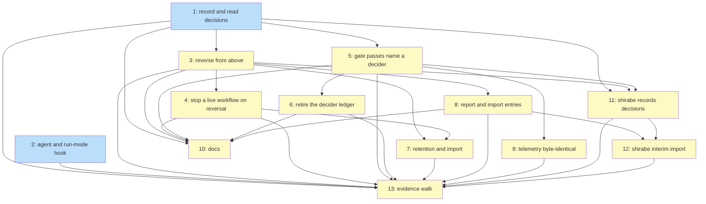

# PLAN: The decision record

## Status

Active

## Scope Summary

Every delegated decision kept as write-once keys in the session that made it, read and
reversed from above through session retention, with a live decider stopped by a reversal, the
decider ledger retired, telemetry left exactly as it is, and shirabe's decision points recording
through the same commands. Eleven issues land in koto and two in shirabe.

## Decomposition Strategy

Horizontal decomposition. The design's first decision makes the write-once store (one
create-only key per decision under `koto/decisions/` and `koto/aimed/<target-id>/`) the thing
every other behaviour stands on, so it lands first, together with the read path that makes it
useful: Issue 1 lets a coordinator read who decided what below it. Reversal (Issue 3) needs the
aimed area and the chain snapshot Issue 1 records; the live block (Issue 4) needs reversals to
exist; gate passes (Issue 5) need the store and the decider resolution; the ledger's retirement
(Issue 6) needs gate passes to carry their answers in sessions first, because the design's third
decision moves every ledger kind onto session events. The agent hook (Issue 2) is independent:
the design's second decision makes it the only source of an observed agent, and it only sets
variables koto already reads as optional.

Two pieces wait on outside work. The retention stop and import carry (Issue 7) change code the
session retention work owns, so they start once that work reads Done. The host-file check's final
verdict waits on koto removing its run journal (koto#545, not before 2026-11-16), because the
design's third decision leaves the journal and the telemetry sink untouched rather than
redesigning a record format for a file that is about to disappear. No issue's landing waits on
koto#545, so everything except that one verdict can land before 2026-11-16.

shirabe's issues (11 and 12) follow the design's fifth decision: shirabe calls the new koto
commands where it already decides, so Issue 11 needs a koto release carrying Issues 1, 3 and 5, and Issue 12 one that also carries Issue 8.

Each issue below names the PRD requirements and acceptance-criteria groups it serves. Those
groups carry the planning's evidence scenarios one to one: reading an unattended unit after it
finished (Issues 1, 5, 6, 9, 11), a person deciding (Issues 1, 5), reversing from above (Issue 3),
escalation and judgment (Issues 1, 3, 11), gate passes (Issue 5), three levels with a finished
middle (Issue 4), racing reversals (Issue 3), and import of the session above (Issue 7). Issue 13
walks all of them.

## Issue Outlines

### Issue 1: feat(decisions): record decisions as write-once keys and read them from above

**Goal**: A session records any decision kind as a create-only key in its own `koto/decisions/` area, naming its decider, authority and chain, and another session lists or shows it without changing the read session; this serves the PRD's "Reading an unattended unit after it finished", "A person deciding" and the reading half of "Escalation and judgment" criteria.

**Acceptance Criteria**:
- [ ] `koto decisions record <session> --kind <k> --outcome <o>` with each R1 kind and R2 subject writes exactly one key under `koto/decisions/` with a 12-digit id; an unknown kind, a disallowed outcome or a missing subject field fails naming the field and the session gains no key (R1, R2).
- [ ] Two processes recording 50 decisions each into one session from a shared barrier end with 100 keys, ids distinct, equal length, and byte order equal to commit order (R3, R32).
- [ ] `koto context add` and `koto context remove` on an existing decision key, from the deciding session and from another, are refused naming the key, the key is unchanged, and a template assigning one fails to compile (R5).
- [ ] Under the cloud backend a decision key appears as its own object under the session's bucket prefix; a second put of it is refused with 412, and a bucket that fails the one-time `If-None-Match` probe refuses decisions (R6).
- [ ] With `CLAUDE_CODE_SESSION_ID` and `KOTO_ANCHOR` set, a decision lists decider kind `session` with harness and anchor labelled `observed`, agent `unknown` with no `KOTO_AGENT_ID`, and `defaulted` false; with `--by person:<handle> --surface terminal` it lists the handle `handed` and the entering session; a `relay` without a valid `https` link records the relaying session as decider (R7 to R9).
- [ ] A decision lists authority `level` and `grants` copied from the anchor's recorded authority (or `null` and empty), `dispatcher` from the nearest dispatched-by link, run mode per R10, and a chain snapshot with link labels `leg`, `init`, `link`, `anchor` and `held-by` as the fixture's sessions were linked, marked `incomplete` when a chain session is missing (R10 to R12).
- [ ] In a fresh koto home with no user store of any kind, `--by person:<never-seen-handle> --surface terminal` records on first use with no registration step; the stored body's field set contains no account, login, password, token or credential key; and the handle is stored as given, not looked up (R8).
- [ ] With a workspace-manager session file planted at `.niwa/sessions/<id>.json` naming a different parent, the recorded chain is unchanged (R13).
- [ ] From a coordinator, `koto decisions list <worker>` returns the worker's decisions after the worker reached a success terminal and while the coordinator is live, as JSON with a format version, ordered by time then id; each R14 filter and one combination return exactly the fixture's matches; `--below <root>` lists through a finished middle session (R14, R15).
- [ ] The read session's keys and log are byte-identical before and after `list` and `show`, and no session between them changes (R16).
- [ ] A body over 16 KiB or a reason over 4 KiB is refused; a file in an area that is a symlink, a non-12-digit name, an id in both areas, or an unparseable body makes `list` report the session's affected decisions `unreadable`.
- [ ] With network access blocked and the local backend, record, list and show succeed (R35).
- [ ] A decision recorded with a harness tool-call identifier lists it, and the stored body holds no harness field beyond R30's three pointers; a `verdict` recorded with decider kind `check` naming the grader and a pointer to its session event lists that decider, the session that ran it and the pointer (R30).
- [ ] Under the cloud backend, a pull of the session onto a host with no local copy, and a `--workspace` read, both list the session's decisions, though decision files sit outside the manifest.

**Dependencies**: None

**Type**: code
**Files**: `src/decisions/`, `src/session/local.rs`, `src/session/cloud.rs`, `src/session/sync.rs`, `src/session/links.rs`, `src/cli/mod.rs`

### Issue 2: feat(koto-skills): report the acting agent and run mode to koto

**Goal**: A koto-skills PreToolUse hook sets `KOTO_AGENT_ID` and, when the harness reports it, `KOTO_RUN_MODE` on Bash calls that run `koto`, so a decision names the agent within the deciding session; this serves the agent half of R7 and R10 in the PRD's "Field-level checks" criteria.

**Acceptance Criteria**:
- [ ] Given a PreToolUse payload for a Bash call running `koto` from a sub-agent with id `sub-1`, the hook's rewritten command starts with `KOTO_AGENT_ID=sub-1` and is otherwise byte-identical to the input.
- [ ] Given a payload that positively identifies the main agent, the prefix is `KOTO_AGENT_ID=main`; given an ambiguous payload, or an id not matching koto's identifier pattern, the command is unchanged.
- [ ] A Bash call that doesn't invoke the `koto` binary is unchanged.
- [ ] The hook's tests cover compound commands, pipes, `env`-prefixed and quoted invocations, subshells, and payload values carrying shell metacharacters, and in each the only change is the validated prefix or none.
- [ ] With koto not installed, the hook exits 0 and changes nothing.
- [ ] The hook is registered in `plugins/koto-skills/hooks/hooks.json` and the plugin's validation passes.

**Dependencies**: None

**Type**: code
**Files**: `plugins/koto-skills/hooks/hooks.json`, `plugins/koto-skills/hooks/`

### Issue 3: feat(decisions): reverse a decision from a session above

**Goal**: `koto decisions reverse` records a reversal in the reverser's own session (or anchor) after checking standing against the original's chain, every reader settles racing reversals the same way, and the original reads `reversed`; this serves the PRD's "Reversing from above", the reversal half of "Escalation and judgment", "Racing reversals" and "Standing" criteria.

**Acceptance Criteria**:
- [ ] From a coordinator above a finished worker, reversing the worker's acceptance, gate pass and merge records three `reverse` decisions under the coordinator's `koto/aimed/<worker-id>/` with standing `verified`; listing the worker shows each original `reversed`, none of them `in-effect`, with the reversal's session and id; the worker's keys and log are byte-identical to before (R4, R17, R20).
- [ ] Reversing a merge with `--compensating <url>` stores the link and without it records that none exists; reversing a `verdict` with `--replacement fail` and a rollback link stores both; reversing an `accept` (`rejected`) leaves the subject with no `in-effect` accept; reversing an `escalate` lists the question withdrawn and a `decline-escalation` lists it escalated to the reverser (R21).
- [ ] Reversing an acceptance named in a later acceptance's `basis` lists the later one as affected on both the reversal and the reversed decision (R21).
- [ ] A person working in the coordinator's agent session reverses with `--by person:<handle>`; the reversal names the person and the entering session; a session alone reversing a person's decision is refused (R17).
- [ ] A worker reversing its coordinator's decision with complete chains is refused, and a `refused` decision appears in the worker's session; reversing a `reverse`, a `refused`, an unknown id and an already reversed decision are each refused and recorded (R17, R18).
- [ ] A reversal by a session not on the original's chain, where that chain is `incomplete`, is recorded with standing `asserted` and listings that scan the store show the original `reversed`; with neither the reverser's session nor its anchor on the chain and the chain complete, `reverse` fails with `reversal_refused` reason `not_on_chain`.
- [ ] A fixture writes two reversals of one decision from A and B with known times in both write orders: listings from A, B and C name the earlier one the winner and the other `refused`; with equal times, the one whose session name sorts first; C's keys and log are unchanged (R19).
- [ ] When `reverse` finds it lost, it exits non-zero and its own session holds a `refused` naming the winner; after a fault point hides the competitor until after the command returns, the losing session's next decision command records the `refused` (R19).
- [ ] After an acceptance is reversed, a new `accept` of the same subject lists `in-effect` while the original lists `reversed` (R20).
- [ ] A grader `check` reverses its own earlier `verdict` in the same session, and a worker reverses its own `judgment`; both are accepted. A person entering through the session where another person decided reverses that decision (R17).

**Dependencies**: Blocked by <<ISSUE:1>>

**Type**: code
**Files**: `src/decisions/standing.rs`, `src/cli/mod.rs`

### Issue 4: feat(next): stop a live workflow whose decision was reversed

**Goal**: Every `koto next` of a live session holding decisions lists what is aimed at it in each session on its chain, refuses to advance on a reversed decision until a rewind or a replacement from someone with standing, and fails closed; this serves the PRD's "Three levels, a finished middle, a live grandchild" criteria.

**Acceptance Criteria**:
- [ ] A dispatches B, B dispatches C (request legs). C records a `judgment` and keeps running; B finishes. A reverses it. C's next `koto next` refuses to advance, leaves C's state unchanged, and reports the `__decision_reversed__` condition naming A's reversal and decider (R22).
- [ ] In that run B's and C's keys and logs are byte-identical before and after A's reads and reversal, and A's and B's are byte-identical before and after C's `koto next` (R16, R23).
- [ ] `koto rewind` of C to the state the judgment recorded lets C advance; a rewind to a later state doesn't. A new `judgment` from C naming the reversal leaves C blocked; one recorded by A naming the reversal clears it (R22).
- [ ] With a gate pass in C (recorded through `koto decisions record --kind gate-pass`, so this issue doesn't wait on Issue 5) reversed by A (`verified`), a new pass by C alone doesn't clear the block, nor does one through an `incomplete` chain (`asserted`); a new pass recorded by A does (R22).
- [ ] A workflow that loops through the decision's state and records a new decision there is blocked only by the reversal of the decision that reversal names.
- [ ] With a reversal key in B holding malformed JSON while B exists, C blocks with `__decision_unreadable__` naming B; with B removed, C advances and its new decisions record the chain `incomplete`; a chain longer than 64 sessions blocks as unreadable (R23).
- [ ] A session not on C's chain made unreadable doesn't block C; a session holding no decisions makes no chain reads (verified by a read counter in tests).
- [ ] Under the cloud backend, a chain session whose listing fails with a permission error blocks C naming it, and a chain session migrated by import is read at the session it moved to (R23).
- [ ] The reserved condition names are refused when a template declares them.
- [ ] The aim ids include the session's own id and the id in `koto/imported-from` in today's single-source form, so a session imported before Issue 7 lands is blocked by a reversal aimed at its earlier id.
- [ ] A benchmark on the CI runner, median of five warm runs, measures the tick's added cost at chain depth five with 1,000 decisions per chain session and fails above 50 ms (R36).

**Dependencies**: Blocked by <<ISSUE:3>>

**Type**: code
**Files**: `src/cli/mod.rs`, `src/engine/advance.rs`, `src/template/types.rs`, `src/decisions/read.rs`

### Issue 5: feat(decisions): record every gate pass with its decider

**Goal**: `koto overrides record`, `koto next --to` past an unmet gate and `koto decider answer` with `pass` each record a `gate-pass` decision with a named, defaulted or refused decider, written in one critical section with their existing event; `koto decisions record --with-data` and `koto disputes record` write decisions too; this serves the PRD's "Gate passes" criteria and the gate pass in "Reading an unattended unit".

**Acceptance Criteria**:
- [ ] Each of the three commands run with no `--by` and `CLAUDE_CODE_SESSION_ID` set records a `gate-pass` whose decider is the session marked `defaulted`; listing filtered on `defaulted` returns exactly those three, and one recorded with `--by person:<handle>` is not among them (R24).
- [ ] The same three run with `CLAUDE_CODE_SESSION_ID` and `KOTO_ANCHOR` unset and no `--by` each exit non-zero with `decider_missing`, leave state and existing records unchanged, and list a `refused` decision marked `unestablished` with agent `unknown` (R24).
- [ ] `koto decider answer` with `fail` records a `judgment` (R25).
- [ ] `koto overrides record --by person:<never-seen-handle>` records a `gate-pass` whose decider is that person, `handed`, with no lookup or registration (R8, R24).
- [ ] For each command, a fault point in test builds stops the process after the event and before the key; the next `koto next` on that session finds both, and the repaired body passes the same validation as a fresh record (R24).
- [ ] `koto overrides list`, `koto decisions list <name>` and `koto disputes record --by agent|person` return what they return today, and `decisions record --with-data` and `disputes record` each also write a `judgment` with an R7 decider (R25, R33).
- [ ] The existing functional tests for the three commands pass with at most a harness session identifier or `--by` added (R33).
- [ ] The event payloads of `gate_override_recorded`, `directed_transition` and `decider_check_answered` keep every existing key at its existing path, with one added optional `decision` field.

**Dependencies**: Blocked by <<ISSUE:1>>

**Type**: code
**Files**: `src/cli/overrides.rs`, `src/cli/decider_answer.rs`, `src/cli/disputes.rs`, `src/cli/mod.rs`, `src/engine/types.rs`

### Issue 6: feat(decider): read decider answers from sessions instead of the host ledger

**Goal**: No koto code path writes or reads `~/.koto/_decider_ledger.jsonl`, and `koto decider report` rebuilds the same output from session events and decision keys; this serves the decider-ledger half of the PRD's "Reading an unattended unit" criteria (R26).

**Acceptance Criteria**:
- [ ] With `~/.koto/_decider_ledger.jsonl` replaced by a directory, a run that consults the grader, answers a check, overrides a gate and takes a directed transition succeeds at every step, and nothing under `~/.koto/` outside `sessions/` holds any of those answers apart from the run journal, which is unchanged (R26).
- [ ] `koto decider report` over that run returns the consultation, answer, override, directed exit and check from the session, matching the design's ledger mapping table row for row; with `--below <session>` it reads only that hierarchy.
- [ ] With the ledger file present holding a stale answer for another session, the report omits it.
- [ ] The existing decider report tests pass against fixtures expressed as session events instead of ledger lines, with the same expected output.
- [ ] A search of `src/` finds no reference to `_decider_ledger.jsonl` outside a comment saying it is no longer used.

**Dependencies**: Blocked by <<ISSUE:5>>

**Type**: code
**Files**: `src/decider/ledger.rs`, `src/decider/report.rs`, `src/cli/decider.rs`, `src/cli/decider_port.rs`, `src/cli/check_evaluator.rs`

### Issue 7: feat(decisions): keep decisions through retention scans and imports

**Goal**: Retention's walk stops at the three decision areas, and `koto session import` carries decision objects create-only and rebuilds `koto/imported-from`, so a session above moved to another workspace still reads and reverses the decisions below it; this serves the PRD's "Cloud and import" criteria. It changes code the session retention work owns, so it starts only once that work reads Done.

**Acceptance Criteria**:
- [ ] A retention scan over a store where sessions hold 1,000 decisions each reads no decision file (verified by a read counter) and returns the same components and verdicts as with the areas empty.
- [ ] A symlink or special file at an area root taints the component as today; a symlink inside an area makes the decision reader report the session unreadable.
- [ ] With the owner's per-command cloud configuration on one host, and the destination workspace holding no decisions beforehand, a coordinator above a finished worker is moved to another workspace with `koto session import`; from the imported session, listing below it returns the worker's decisions and reversing one records it in the imported session with standing `verified`; the worker's listing shows it `reversed`; the chain's rewritten link lists `import` (R6, R12).
- [ ] A decision recorded against the migrated source is refused with `session_migrated`, and the source still serves its decisions to readers (R6).
- [ ] A session imported twice keeps both earlier ids in `koto/imported-from`, and a reversal aimed at either earlier id blocks its live workflow; an archive carrying its own `koto/imported-from` has that copy discarded.

**Dependencies**: Blocked by <<ISSUE:3>>, <<ISSUE:4>>

**Type**: code
**Files**: `src/session/hierarchy/facts.rs`, `src/session/import_links.rs`, `src/session/cloud.rs`

### Issue 8: feat(decisions): report overrules and import interim entries

**Goal**: `koto decisions report` counts decisions and reversals by kind and decider kind over the sessions koto keeps, and `koto decisions import` records a coordinator's interim entries idempotently; this serves the PRD's "Reporting" criteria and the import criterion in "Existing records and shirabe" (R28, R29), and runs R36's listing benchmark.

**Acceptance Criteria**:
- [ ] For a fixture of sessions spanning two months, the report for the second month counts decisions made and reversed in a kind by decider-kind table matching the fixture, counts a second-month reversal of a first-month decision under the window's reversals, counts defaulted gate passes, excludes `reverse` and `refused` from the made counts, and states how many sessions it read (R29).
- [ ] A decision timed exactly at the window's start is counted and one at its end is not; `--below <root>` counts only that hierarchy (R29).
- [ ] Importing a JSON Lines file of three entries records three decisions labelled `handed` with their `source`, `source_id`, source `time` and import time; importing it again adds nothing; a line breaking R1 or R2 stops the import with its line number and records nothing (R28).
- [ ] An imported `reverse` naming an entry from the same file records standing `asserted`; one naming another session's decision is refused.
- [ ] A benchmark on the CI runner, median of five warm runs, over 1,000 sessions in one four-level hierarchy holding 100 decisions each, measures `list --below <root>` and the report and fails above five seconds (R36). If it comes within 20 percent of the limit, the PR says so and names the pack format follow-up.

**Dependencies**: Blocked by <<ISSUE:3>>

**Type**: code
**Files**: `src/decisions/`, `src/cli/mod.rs`

### Issue 9: test(decisions): keep telemetry records byte-identical

**Goal**: A test proves every run-journal record and every event-sink record koto produces is byte-identical with and without the new `decision` field, so the opted-in telemetry backend receives exactly what it receives today; this serves R34 and the telemetry clause of the PRD's first criterion.

**Acceptance Criteria**:
- [ ] For a scripted run covering a gate override, a directed transition past an unmet gate, a decider answer and a decider consultation, the run-journal lines are byte-identical whether or not the events carry `decision` (timestamps and ids pinned).
- [ ] The same run's records handed to the event sink, through the stub-sink harness, are byte-identical with and without the field; the test skips with a named reason until the sink's emit path exists on main and runs once it does.
- [ ] Exporting telemetry for a run whose decisions carry reasons produces no record containing reason text (R34).
- [ ] The existing run-journal, feed and grader-report suites pass unchanged (R33).

**Dependencies**: Blocked by <<ISSUE:5>>

**Type**: code
**Files**: `tests/`

### Issue 10: docs(decisions): document the decision record

**Goal**: A koto user can record, list, reverse, report and import decisions from the docs alone, knows the trust model, and no longer finds the decider ledger described as current; this carries the design's user-visible surface (R31).

**Acceptance Criteria**:
- [ ] `docs/guides/cli-usage.md` documents every `koto decisions` subcommand and flag in the design's command table, with one worked example each.
- [ ] A reference page documents the decision body fields, the three reserved areas, the statuses, the standing labels, and the error codes `decider_missing`, `decision_exists`, `invalid_decision` and `reversal_refused`.
- [ ] The docs state that decider identities are attribution, not authentication, what `observed`, `handed`, `verified` and `asserted` mean, that decision bodies travel with the session unscrubbed, and that `koto context list` doesn't show decision keys.
- [ ] `docs/workspace-layout.md`, `docs/guides/decider-authoring.md` and the koto-skills references describe `koto decider report` reading sessions and the ledger file as no longer used.
- [ ] The koto-skills `koto-user` references document the agent hook, the reversal block condition and how to clear it.
- [ ] Every command shown in the docs runs as written against a scratch session.

**Dependencies**: Blocked by <<ISSUE:1>>, <<ISSUE:3>>, <<ISSUE:4>>, <<ISSUE:5>>, <<ISSUE:6>>, <<ISSUE:8>>

**Type**: docs
**Files**: `docs/guides/cli-usage.md`, `docs/reference/`, `docs/workspace-layout.md`, `docs/guides/decider-authoring.md`, `plugins/koto-skills/skills/koto-user/references/`

### Issue 11: feat(shirabe): record shirabe's decisions through koto

**Goal**: In the shirabe repository, a document's acceptance, a merge, a review panel's verdict, a seat's dismissal and the coordinator's settlements, escalations, holds and reversals each record a decision in the session that ran the step, while every existing shirabe output stays as it is; this serves R27 and the acceptance and merge decisions the PRD's first criterion reads. It needs a koto release carrying Issues 1, 3 and 5.

**Acceptance Criteria**:
- [ ] `shirabe transition <doc> Accepted --record-in <session>` records an `accept` with repository, path and HEAD commit in that session; without `--record-in` it records nothing and behaves as today.
- [ ] Every skill that runs a status transition to Accepted passes its own session to `--record-in`.
- [ ] `skills/execute/scripts/merge-exec.sh` records a `merge` with repository, pull request number and merged head commit after a successful merge, and records nothing when the merge fails.
- [ ] `skills/work-on/scripts/panel-scope.sh` records one `verdict` per seat with `--agent <seat>` when it writes the panel verdict, and a `judgment` when a seat dismisses its own finding.
- [ ] `skills/coordinate/scripts/state-decision.sh` records `judgment` for `--settle`, `escalate` for `--escalate` and `decline-escalation` for `--hold`, and the reversal-row path calls `koto decisions reverse`; each row gains one field naming the decision's session and id.
- [ ] `record/decisions`, `record/reversals`, `verdict_ledger.json` and every script reading them return the same fields they return today; their existing tests pass unchanged.
- [ ] Every new call passes values as separate arguments, never through `eval` or string building.

**Dependencies**: Blocked by <<ISSUE:1>>, <<ISSUE:3>>, <<ISSUE:5>>

**Type**: code
**Files**: `crates/shirabe/src/main.rs`, `skills/execute/scripts/merge-exec.sh`, `skills/work-on/scripts/panel-scope.sh`, `skills/coordinate/scripts/state-decision.sh`

### Issue 12: feat(shirabe): import a coordinator's interim decision entries

**Goal**: In the shirabe repository, once a koto release carries Issue 8's import, a script converts the decision and reversal entries a coordinator recorded under the interim rule into the JSON Lines file `koto decisions import` reads, so those decisions join the record once it lands; this serves R28's fold-in.

**Acceptance Criteria**:
- [ ] Given a fixture of interim entries (a settled decision, an escalation, a verdict and a reversal of the verdict), the script writes four JSON Lines entries with `source` naming where each was recorded and a stable `source_id`, built with a JSON encoder.
- [ ] Importing the file records four decisions in the coordinator's session; the reversal names the verdict's entry and reads `asserted`; running the script and the import again adds nothing.
- [ ] An entry whose decider or kind can't be mapped stops the conversion with the entry named, and nothing is written.
- [ ] The script makes no `gh` write and changes no existing record.

**Dependencies**: Blocked by <<ISSUE:8>>, <<ISSUE:11>>

**Type**: code
**Files**: `skills/coordinate/scripts/`

### Issue 13: test(decisions): walk the decision record's evidence end to end

**Goal**: Every acceptance criterion in `docs/prds/PRD-decision-record.md` runs as a functional scenario against the first koto release carrying Issues 1 to 9 and the first shirabe release carrying Issues 11 and 12, once session retention reads Done; the result is the milestone's verdict.

**Acceptance Criteria**:
- [ ] A functional suite runs one scenario per PRD acceptance-criteria group ("Reading an unattended unit after it finished", "A person deciding", "Reversing from above", "Escalation and judgment", "Gate passes", "Three levels, a finished middle, a live grandchild", "Racing reversals", "Standing", "Write-once and concurrency", "Cloud and import", "Listing", "Existing records and shirabe", "Reporting", "Field-level checks", "Independence and the rest"), each carrying every assertion its PRD group states, and each passing; the agent scenarios include a decision recorded through the koto-skills hook listing agent `sub-1` labelled `observed`.
- [ ] Issue 9's event-sink parity test ran rather than skipped, against a koto whose emit path exists.
- [ ] The cloud and import scenario runs with the owner's per-command cloud configuration from the environment only; every other scenario runs with none.
- [ ] Every scenario runs with no workspace manager installed, and a session dispatched by one with koto absent from its path dispatches normally.
- [ ] The host-file check of the first criterion runs in an isolated koto home with `run_journal.enabled = false` and is reported as interim; its final verdict is recorded only on a koto release without the run journal (koto#545), and no host is told to switch its journal off.
- [ ] The run reports which criteria passed, which are interim, and which wait on an external release.

**Dependencies**: Blocked by <<ISSUE:1>>, <<ISSUE:2>>, <<ISSUE:3>>, <<ISSUE:4>>, <<ISSUE:5>>, <<ISSUE:6>>, <<ISSUE:7>>, <<ISSUE:8>>, <<ISSUE:9>>, <<ISSUE:11>>, <<ISSUE:12>>

**Type**: task
**Files**: `tests/`

## Dependency Graph

**Legend**: Green = done, Blue = ready, Yellow = blocked

## Implementation Sequence

**Critical path:** Issue 1, then Issue 5, then Issue 11 (after a koto release), then Issue 12,
then Issue 13. Issues 3 and 8 feed Issue 12 through the release.

**Start immediately:** Issues 1 and 2.

**After Issue 1:** Issues 3 and 5 in parallel.

**After Issue 3:** Issues 4 and 8 in parallel; after Issue 4, Issue 7, once session retention reads Done.

**After Issue 5:** Issues 6 and 9 in parallel.

**After a koto release carrying Issues 1, 3 and 5:** Issue 11 in shirabe; then Issue 12, once a release also carries Issue 8.

**Docs:** Issue 10 once Issues 1, 3, 4, 5, 6 and 8 have landed.

**Last:** Issue 13, once session retention reads Done. Its host-file check is interim until a koto
release without the run journal (koto#545, not before 2026-11-16); every other criterion it walks
is final when it passes.

**External dependencies:**
- Session retention reading Done: Issues 7 and 13.
- koto#545 shipping in a release: the final verdict on Issue 13's host-file check only.
