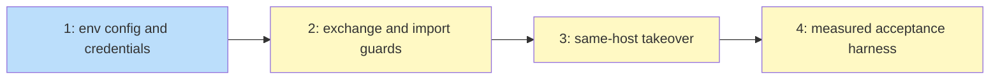

# PLAN: Cloud session config and same-host import

## Status

Active

## Scope Summary

koto reads its session backend, cloud location and a koto credential pair
from `KOTO_SESSION_*` variables, reports each session setting's origin in
`koto config list`, and keeps a session's name on a same-host import by
marking the source first and exchanging directories in one call.

## Decomposition Strategy

Horizontal, in two PR groups in this repository. The config group (Issue 1)
is the environment layer, the credential pair, the origin report and their
refusals and redaction. The import group lands the exchange primitive and
the import guards (Issue 2), then the takeover (Issue 3), then the harness
for the measured acceptance run (Issue 4). The import code needs nothing from
the config group; its tests enable the backend through the environment, so
the import group merges after the config group.

## Issue Outlines

### Issue 1: feat(config): read session backend, location and credentials from KOTO_SESSION_* variables

**Repo**: tsukumogami/koto

**Group**: config

**Goal**: koto takes `session.backend` and the cloud location from `KOTO_SESSION_*` variables above both config files, takes the bucket key from a koto-prefixed pair that replaces the AWS pair as a whole, reports every session setting's origin in `koto config list`, and refuses unusable values, half pairs and project-file destinations for the pair in `build_backend`, so one workspace can be put on the cloud backend through its environment alone.

**Acceptance Criteria**:
- [ ] `apply_session_env` in `src/config/resolve.rs` reads `KOTO_SESSION_BACKEND`, `KOTO_SESSION_CLOUD_ENDPOINT`, `KOTO_SESSION_CLOUD_BUCKET`, `KOTO_SESSION_CLOUD_REGION` and `KOTO_SESSION_CLOUD_PATH_STYLE` through a lookup closure, trims values, treats empty or whitespace-only as unset and a non-Unicode value as set and invalid, and wins over the project and user files per setting; tests cover each setting over both files, project over user with the variable unset, the default with neither file, `""` and `"  "` falling through, and a mixed run with three origins (PRD R1-R3).
- [ ] `load_config` never fails on a bad environment value; with `KOTO_SESSION_BACKEND=s3`, `=Cloud`, or `KOTO_SESSION_CLOUD_PATH_STYLE=yes`, `koto init` and `koto next` exit non-zero with an error naming the variable and the capped, escaped, redacted value, and create no session directory; `koto config list` exits 0 showing the value with origin `env`, and `koto config get session.backend` prints `s3`; `KOTO_SESSION_BACKEND=" cloud "` selects cloud (R4).
- [ ] With `KOTO_SESSION_CLOUD_MARKER_RETAIN_DAYS=1` set, `session.cloud.marker_retain_days` keeps its user-file or default value and `config list` reports that origin (R5).
- [ ] With both koto credential variables and both AWS variables set to different values and user-file credentials present, the request the fake endpoint receives is signed with the koto access key; with exactly one koto variable set a cloud command exits non-zero naming the missing one and the fake endpoint receives no request (both halves tested), while a local-backend command succeeds; koto variables set to `""` fall through to the AWS pair; with neither set, the AWS pair wins over the user file and an exported empty `AWS_ACCESS_KEY_ID` behaves as today (R6-R8).
- [ ] With the koto pair supplying the credentials, a cloud command refuses when `session.cloud.endpoint` or `session.cloud.bucket` came from the project file, naming the setting, and the fake endpoint receives no request; with `KOTO_SESSION_CLOUD_ENDPOINT` also set the command succeeds (R7a).
- [ ] `ENV_SECRET_NAMES` lists the two koto names before the AWS pair; `SecretSources` records the supplying variable; a command printing both koto values read from a file shows `[REDACTED:KOTO_SESSION_CLOUD_ACCESS_KEY]` and `[REDACTED:KOTO_SESSION_CLOUD_SECRET_KEY]`, including with a user file that fails to parse, both set and trimmed spellings are redacted, and the koto name labels a value equal to the AWS one; `config list` prints `<set>` (R9).
- [ ] `koto config set session.cloud.access_key x` without `--user` is refused as today (R10).
- [ ] The two credential variables are removed from every command environment koto builds (legacy included, through `src/action.rs`'s spawn path) and from the `hostname` call in `src/session/version.rs`, and `pass_env` naming either is refused; a test asserts a command printing `$KOTO_SESSION_CLOUD_SECRET_KEY` prints nothing in both a legacy and a default session (R10a).
- [ ] `koto config list --json` gains a top-level `origins` object with all eight settings, each `{"source": "env"|"project"|"user"|"default"|"unset"}` plus `"variable"` for `env` (and `"invalid"` for an invalid path style); tests cover each source including `env` with `AWS_ACCESS_KEY_ID`; the TOML form appends one `# origin:` comment line per setting and, parsed, equals the parse of today's output for the same configuration; a user or project file with a `[session]` table and no `backend` key reports `default`, and a top-level dotted `session.backend` key reports that file (R11-R13).
- [ ] With none of the seven variables set, every existing config, credential and redaction test passes; the only existing-test change adds `origins` to the exact-key-set assertion in `tests/decider_config.rs` (R22).
- [ ] The new tests run in the default `cargo test` job, and every test that spawns koto removes `KOTO_SESSION_*` and `AWS_*` from the child environment first (R24).
- [ ] `docs/guides/cloud-sync-setup.md` lists the seven variables and their settings, states the precedence and the credential-pair rule (including the project-file refusal), and shows an origin report; `docs/designs/current/DESIGN-config-and-cloud-sync.md` gains a dated status note naming this feature's design; `cargo test --test doc_names` passes (R21).
- [ ] `plugins/koto-skills/skills/koto-user/SKILL.md`, `references/command-reference.md` and `references/error-handling.md` mention the seven variables, the origin report and the new `build_backend` errors wherever they document config, credentials or cloud errors; `koto-adhoc` and `koto-author` are checked and stay unchanged unless they document session config.

**Dependencies**: None

**Type**: code
**Files**: `src/config/resolve.rs`, `src/config/mod.rs`, `src/cli/mod.rs`, `src/engine/command_env.rs`, `src/action.rs`, `src/session/version.rs`, `tests/session_env_config.rs`, `tests/decider_config.rs`, `tests/redaction_test.rs`, `docs/guides/cloud-sync-setup.md`, `docs/designs/current/DESIGN-config-and-cloud-sync.md`, `plugins/koto-skills/skills/koto-user/`

### Issue 2: feat(session): add atomic directory exchange and import guards

**Repo**: tsukumogami/koto

**Group**: import

**Goal**: `atomic_fs` gains a one-call directory exchange and a support probe, and the cloud backend gains the three local guards the same-host takeover relies on (local migrated check, takeover pending, identity-checked pull), so a command run from either side of an import can never read, pull over, clean up or resolve the other side's local copy.

**Acceptance Criteria**:
- [ ] `exchange_dirs(a, b)` in `src/engine/atomic_fs.rs` uses `renameat2(RENAME_EXCHANGE)` on Linux and `renamex_np(RENAME_SWAP)` on Apple and reports unsupported elsewhere; a unit test exchanges two populated directories and checks each holds the other's content, and another shows an error (not a partial move) when one side is missing.
- [ ] `exchange_supported(dir)` refuses a directory not owned by the invoking user, exchanges two empty scratch directories inside it, and removes them; unit tests cover the supported path and the ownership refusal.
- [ ] The local migrated check runs in `check_not_migrated` before the remote listing (with its own per-process cache, never populating `migration_checks`) and in `cleanup` and `resolve`: when the local log's latest `session_imported` names this backend's prefix and this session name as its source, the command exits 2 with `session_migrated`. A test shows `koto next`, `koto session cleanup` and `koto session resolve` from A refusing after an import into the same `HOME`, with the marker listing made to fail at the fake endpoint, and B's local files byte-identical before and after.
- [ ] While `<sessions>/.takeover-<name>` exists, reads and writes of `<name>` on the cloud backend refuse with a message naming the import to re-run; tests cover a `koto status` and a `koto context add`, each leaving the directory and the session unchanged.
- [ ] `sync_pull_state`, the context pull and the force pull refuse, as a hard error, to overwrite a local copy whose header session id differs from the bucket's when one log is an import of the other; a test covers each pull path and checks the local file is unchanged.
- [ ] The cross-host carrier test in `tests/session_migration_test.rs` passes unchanged and its recorded request sequence at the fake endpoint is unchanged (R23); none of the guards makes a remote request.

**Dependencies**: Blocked by <<ISSUE:1>>

**Type**: code
**Files**: `src/engine/atomic_fs.rs`, `src/session/cloud.rs`, `tests/session_migration_test.rs`

### Issue 3: feat(session): keep the session name on a same-host import

**Repo**: tsukumogami/koto

**Group**: import

**Goal**: `koto session import <name> --from <A>` run in workspace B on the same host, with no `--as`, takes over the source's own local copy by writing the marker on A's prefix first and then exchanging `.takeover-<name>` with `<name>` in one call, so the replacement keeps the name every caller looks it up by and continues from the stopped session.

**Acceptance Criteria**:
- [ ] `ImportRequest` gains `explicit_as`; the takeover branch runs only with no `--as`, a local directory at the name whose non-empty header `session_id` equals the source's, and a `--from` prefix different from the importing workspace's; every other case behaves as today (R14, R17, R20).
- [ ] With one `HOME`, the backend enabled only through `KOTO_SESSION_*` variables and a fake bucket, a session created in A and advanced into a state waiting for evidence, with three context keys, is imported in B with no `--as`: exit 0, `name` equal to `<name>`, the same JSON fields as a cross-host import; every key reads back byte for byte; `koto next` in B with the evidence moves it to the next state; `koto next`, `koto status` and `koto context get` from A exit 2 with `session_migrated` naming B; B's log is the bucket's events plus one `session_imported` (R14, R15, R19).
- [ ] Refusals, checked in this order, each exit 2 with A's local files, prefix and marker unchanged: another process holding the state-file lock or `ctx/manifest.lock` -> `import_source_running`; A's copy ahead (log longer, forked at a shared seq, or a context key added locally and not pushed, each tested) -> `import_source_unpushed` with the `koto session resolve <name> --keep local` hint; a local child naming `<name>` as parent -> `import_source_has_children` naming the child. A local copy one event behind the bucket imports successfully with B's log holding the bucket's events (R16).
- [ ] A different local session at `<name>` refuses `import_name_taken` naming `--as` with nothing changed; `koto session import <name> --from <A>` run in A itself with no `--as` exits 2 with `import_name_taken` and changes nothing (R17, R20).
- [ ] The pre-write probe refuses, exiting non-zero with an error naming `--as`, in three cases, each leaving no `.takeover-<name>`, no object pushed under B's prefix, no marker on A's prefix, and A's files unchanged: `KOTO_TEST_IMPORT_FAULT=exchange-unsupported`; a symlink at `<name>` pointing at A's real directory; and `KOTO_TEST_IMPORT_FAULT=name-other-device`, which makes the same-device check fail (R14).
- [ ] `KOTO_TEST_IMPORT_FAULT` set to each of `after-push`, `after-mark`, `exchange-error`, `after-exchange` and `after-journal`, followed by the same command without it, ends with the import complete; at every intermediate point the local store holds exactly one directory at `<name>` and never holds the new session while A's prefix lacks its marker; a definite marker failure (an injected PUT failure at the fake endpoint) takes back the push and leaves A unchanged (R18).
- [ ] A post-marker re-run reads S' from the marker's `target.session_id`, re-stages from A's bucket, and refuses rather than overwrites when B's prefix copy has moved past its `session_imported`.
- [ ] After a successful exchange, `.finished/<name>.json` is removed and `.takeover-<name>` (A's old copy) is deleted only when its session id, last seq and context manifest match what was checked under the lock; otherwise it is kept with a warning naming the path; a test covers the kept case, and the removal refuses a symlink.
- [ ] A same-host import makes no more requests at the fake endpoint than a cross-host import of the same session (R23).
- [ ] `docs/guides/cloud-sync-setup.md` shows a same-host import without `--as` and describes the new refusal codes, `.takeover-<name>` and the re-run rule; `docs/designs/current/DESIGN-session-migration.md` gains a dated status note naming this feature's design; `cargo test --test doc_names` passes (R21).
- [ ] `plugins/koto-skills/skills/koto-user/references/error-handling.md` and `references/command-reference.md` list `import_source_running`, `import_source_unpushed` and `import_source_has_children` and say a same-host import keeps the name without `--as`; `koto-adhoc` and `koto-author` are checked and stay unchanged unless they document import.

**Dependencies**: Blocked by <<ISSUE:2>>

**Type**: code
**Files**: `src/session/cloud.rs`, `src/engine/atomic_fs.rs`, `src/cli/session.rs`, `src/cli/mod.rs`, `tests/same_host_import_test.rs`, `docs/guides/cloud-sync-setup.md`, `docs/designs/current/DESIGN-session-migration.md`, `plugins/koto-skills/skills/koto-user/references/`

### Issue 4: test(session): serve the fake S3 endpoint for a measured same-host import

**Repo**: tsukumogami/koto

**Group**: import

**Goal**: an ignored test starts the in-process fake S3 endpoint, prints its address and bucket, and serves until a stop file appears, so a release build of koto can be measured through the whole same-host import with a disposable `HOME` and no secrets.

**Acceptance Criteria**:
- [ ] An `#[ignore]` test (for example `serve_fake_s3` in `tests/session_migration_test.rs`) starts `FakeS3`, prints one line with its endpoint and bucket, and returns when a stop file named by an environment variable appears; without that variable it fails fast with a message rather than serving forever; it never runs in the default job.
- [ ] The measured run, on macOS (so the `renamex_np(RENAME_SWAP)` arm runs) against a release build with a disposable `HOME`, two workspace directories and only `KOTO_SESSION_*` variables, records exit codes and timings and meets these expectations: init and advance in A exit 0; the import in B without `--as` exits 0 with `name` equal to the original name; `koto next` in B with evidence exits 0 and moves to the next state; `koto next` from A exits 2 with `session_migrated`. The results go in the pull request body, and the run never reads or writes the host's own `~/.koto`.

**Dependencies**: Blocked by <<ISSUE:3>>

**Type**: task
**Files**: `tests/session_migration_test.rs`

## Dependency Graph

## Implementation Sequence

The critical path is 1, 2, 3, 4, with no parallel work: Issue 2's
integration tests set the backend through the variables Issue 1 adds, Issue 3
builds on Issue 2's exchange and guards, and Issue 4 measures Issue 3. The
config group's pull request merges first; the import group's pull request
carries Issues 2 to 4 and merges after it, and the coordination pull request
merges last.
