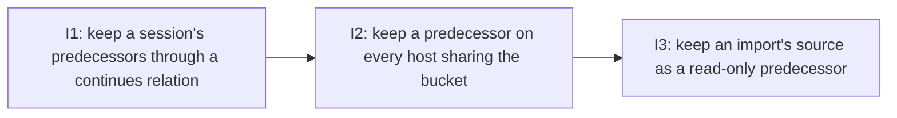

# PLAN: A session names the session it continues

## Status

Active

## Scope Summary

A directed continues relation held by the successor, counted by retention as
a one-way, per-member keeper at every removal and on every host sharing the
bucket, with `koto session import` keeping its source as a read-only
predecessor.

## Decomposition Strategy

**Walking skeleton.** Issue 1 lands the relation end to end on one host: the
`--continues` verb, the directed overlay in the retention engine, every
removal point and the report fields. Issue 2 refines it for the cloud backend
with back-references and the bounded bucket walk, and issue 3 refines it for
import. Each keeps the issue 1 flow working, and each lands in its own pull
request in order.

## Issue Outlines

### Issue 1: feat(session): keep a session's predecessors through a continues relation

**Repo**: tsukumogami/koto

**Group**: relation-local

**Goal**: Create the walking skeleton for the continues relation: a successor records the session it continues with `--continues` on `koto init` or `koto session link`, and every removal by rule on the local store keeps the earlier members while a later member is pinned, alive or within its own retention, naming the keeper.

**Acceptance Criteria**:
- [ ] `koto init <name> --continues <PRED> [--continues-from <WORKSPACE>]` records the relation in the command that creates the session, after the header is written and before the first push, so the successor never exists without it (R1)
- [ ] `koto session link <SESSION> --continues <PRED> [--continues-from <WORKSPACE>]` records it on an open session; `--dispatched-by` and `--continues` are an exclusive pair on `link`, one of them required (R1)
- [ ] `--continues-from` takes an absolute workspace path or a 16-hex workspace id and defaults to the successor's own workspace
- [ ] The verb reads no `KOTO_ANCHOR`, `KOTO_AUTHORITY`, request leg or dispatcher: a coordinator's successor, an operator by hand and an unrelated agent session record the relation the same way, including when nothing links the successor to the predecessor's anchor or dispatcher (R1, R20)
- [ ] The relation is stored as `LinkKind::Continues` at `koto/links/continues/<PRED>`, with `LinkBody` gaining optional `prefix` and `holder_session_id` beside `session_id`, `workspace` and `at`; `v` stays 1 and the body records the predecessor's name, session id and workspace path (R2)
- [ ] The verb exits 2 and writes nothing for: an invalid name or the successor's own name; a name found nowhere; an anchor or an anchor's close record; a second, different predecessor (R3)
- [ ] Recording a relation the successor already holds changes nothing and exits 0; naming a running, finished or pinned predecessor succeeds (R3)
- [ ] A session holds at most one relation, and a predecessor can have many successors (R4)
- [ ] Under the cloud backend the verb refuses with exit 2 and writes nothing when it would need a back-reference it can't yet write (a cloud session or `--continues-from` another workspace), with a message naming why
- [ ] `Graph::build_edges` keeps continues links out of the undirected loop and the session-id-hint loop, and puts them in a separate `directed` list resolved by recorded session id first and then by name; a same-name peer is accepted only when its prefix differs from the holder's, and such a link adds no edge in this store
- [ ] `Judge::relation(name)` walks the reverse of `directed` breadth-first with a visited set, returns each keeper with its `standing` (`pin` over `alive` over `retention`), `retention_passes_at` and `path`, and judges each later member from that member alone (R7)
- [ ] `Judgment::relation_of(member)` exists and `keeps(member)` is `pin || verdict.is_kept() || relation keeps member`
- [ ] A pin on the newest member keeps every earlier member, shown as `standing: pin` with the pin's reason, setter and time; a pin on the oldest keeps only the oldest; an earlier member that is alive, pinned or within retention never keeps a later one (R7)
- [ ] With the relations removed from the same store, every hierarchy's members, keepers and release instant are identical to those with the relations present (no join) (R7)
- [ ] Once no later member has standing, each earlier member is kept or released by today's rules alone, and the first removal that judges it afterwards removes it, none before (R8)
- [ ] With two successors of one predecessor, the predecessor is kept while either has standing and each keeper with standing is named, ordered by name
- [ ] These keep a session the relation keeps, judging standing at the moment of each removal, including the re-judgment `--apply` makes before it deletes: the terminal tick with and without `--no-cleanup`; the parent sweep; the same-name replace, which moves the kept session aside to `<name>_r<N>` with its session id intact so it stays the one kept; `koto workspace prune` with and without `--root`, `--force` and `--yes`; `koto session prune` with `--all`, `--execution-dir`, `--older-than` and `--apply --plan` (R9)
- [ ] Sites move from the verdict to `keeps`: `first_rule` (new rule `r`) and `apply_component` (per-entry `keeps`, no group gate) in `src/cli/session_prune.rs`; `judge_subtree` and `reclaim` in `src/cli/workspace.rs`; `predecessor_disposition` in `src/cli/init_entry.rs`; `terminal_retention` in `src/cli/mod.rs`; `live_members` in `src/cli/session.rs`
- [ ] The terminal tick uses a new `relation_probe` beside `edge_of` and judges only when a continues link names the session, so a session no relation names costs what it costs today (Decision 5)
- [ ] A preview with the successor running lists the predecessors as kept; after the successor stops and its retention passes, `--apply --plan` on that token refuses to remove sessions the preview kept (exit 4, as today) and a fresh `--apply --all` removes them
- [ ] `koto session cleanup` and `koto cancel --cleanup` remove a session the relation keeps, exit 0, report `relation_keepers` in JSON and the text lines on stderr; a pin still refuses them with exit 2 and code `pinned` (R10)
- [ ] An unparseable body (`unparseable`), a body over 4 KiB (`too_large`), a recorded session id that differs from the session found (`mismatch`, including a new session that took a removed predecessor's name) and a cycle (`cycle`, keeping every session on it) each keep the session and are reported in `relation_unreadable` with `holder` and `reason` (R11)
- [ ] A session whose relations can't be listed (`unlistable`) keeps everything the removal would delete (R11)
- [ ] A kept entry carries `kept_by_relation: true` and `relation_keepers`, one object per keeper ordered by name, with `keeper`, `standing`, `retention_passes_at` (retention standing only), `pin` (pin standing only) and `path` (R12)
- [ ] The text form prints `kept: continued by <keeper> (<standing>)` with `via <path joined by ", ">` appended when the path isn't empty; `kept_by_pin`, `pin` and a hierarchy's `keepers` keep their meanings, and a session kept for its own standing and by the relation carries both reports (R12)
- [ ] `koto session hierarchy <name>` reports `predecessor` and `successors` in JSON and text, and `relation_keepers` when the relation keeps it (R13)
- [ ] New fields are omitted where empty or false, and a store with no relation gives the same keeps, removals and output as before (R23)
- [ ] Names printed in keepers and unreadable reports go through the retention reports' existing `sanitize`/`display_text` rendering
- [ ] Property tests: `reference()` in `src/session/hierarchy/tests.rs` skips continues links in its adjacency, a second directed reference checks the overlay, and the hint test runs for continues links
- [ ] Tests cover the chain (v1, v2, v3 with v3 running), release timing with `retention.keep`, both pin directions, two successors, the same-name replace, cleanup and cancel, the refusals, and no authority change (`koto session unpin`, anchor display and epoch fence answer the same with and without relations) (R20)
- [ ] CLI guide (`docs/guides/cli-usage.md`) documents `--continues` and `--continues-from` on `koto init` and `koto session link`
- [ ] Session retention guide (`docs/guides/session-retention.md`) has a section on what the relation keeps: one direction, standing of the keeper alone, how to read the report fields
- [ ] E2E flow works: create a chain with `--continues`, run each removal command and see the predecessors kept with the keeper named, then see them removed once the last member loses standing
- [ ] Stubs are named: the cloud-backend relation refusal is the only deliberate gap
- [ ] CI green
- [ ] Must deliver: relation body fields `prefix` and `holder_session_id` written and read by `LinkBody` (required by <<ISSUE:2>>)
- [ ] Must deliver: `Judge::relation`, `Judgment::relation_of` and `keeps` with the `RelationVerdict`, `RelationKeeper`, `Standing` and `Unreadable` types public to the crate (required by <<ISSUE:2>>)
- [ ] Must deliver: report rendering (`relation_json`, `relation_text`, `kept_by_relation`, `relation_keepers`, `relation_unreadable`) that a merged bucket verdict can reuse unchanged (required by <<ISSUE:2>>)
- [ ] Must deliver: a named hook point at each removal site (`apply_component` and preview, `judge_subtree`, `reclaim`, `predecessor_disposition`, the terminal tick, `cleanup` and `cancel`) where a bucket answer is merged after `keeps` returns false (required by <<ISSUE:2>>)

**Dependencies**: None

**Type**: code

### Issue 2: feat(session): keep a predecessor on every host sharing the bucket

**Repo**: tsukumogami/koto

**Group**: bucket-walk

**Goal**: Under the cloud backend, make a successor write a back-reference beside its predecessor, and make every removal walk and verify those back-references within a counted request budget before it deletes, so a host that never pulled the successor keeps the same sessions and names the same keepers.

**Acceptance Criteria**:
- [ ] E2E flow still works (do not break the skeleton): the local chain v1, v2, v3 from the skeleton keeps v1 and v2 under every removal point with the same entries, and a store with no relation behaves as before.
- [ ] A successor under the cloud backend writes one standalone object `<Pp>/
/ctx/koto/continued-by/<Sp>/<S>` whose body is only `{"v":1,"holder_session_id":"<id>"}`: no workspace path or other local data is copied into another workspace's prefix.
- [ ] The pointer is written by a direct, checked cross-prefix PUT (`put_backref`), never through the context store, so it is never in a manifest, no push deletes it, and it sits outside `koto/links/` so no scan reads it as a link.
- [ ] Write order is pointer first: look the predecessor up (exit 3 when the bucket can't be listed), PUT the pointer (exit 3 and nothing written on failure), write the relation, push strictly. If the push fails, remove the local relation key and the pointer and exit 3.
- [ ] Unconfirmed write (R19): with the stand-in refusing PUTs, the verb exits 3, the successor holds no relation key locally, and the bucket lists no pointer or relation object for it; with PUTs allowed again the same command exits 0 and the relation and pointer are present.
- [ ] Recorded fields (R2): after the chain is built under the cloud backend, the successor's relation records the predecessor's name, session id, workspace path and bucket prefix, and the relation and pointer are in the bucket when the verb exits 0.
- [ ] Another workspace: a successor created in workspace W2 continuing a session in W1 writes its pointer under W1's prefix, and prunes in W1 keep the predecessor and name the successor. Without write access to the predecessor's prefix the verb exits 3 and writes nothing.
- [ ] The Phase 1 refusal for a cloud session or a `--continues-from` another workspace is removed.
- [ ] Confirmed-pointer mark: a relation counts as having its pointer only when the session directory holds the bare, untracked `.continues-pointer` file recording the pointer key. A relation recorded under the local backend (or by an earlier build) has no mark, so a pointer is owed.
- [ ] `ensure_backref`, beside `refuse_if_bound_elsewhere` in `src/cli/mod.rs`, PUTs an owed pointer before the session's next cloud write or push. Until the pointer is confirmed, the relation key is kept out of pushes at the three places pin records are kept out (`src/session/sync.rs`, `force_push_session`, `flush_batch`). A failed PUT warns, keeps the relation out of that push, and leaves the session's other writes alone.
- [ ] A rollback whose pointer DELETE also fails leaves a pointer with no relation behind it; the walk treats it as stale and ignores it.
- [ ] The same-name replace's move-aside (`src/cli/move_aside.rs`) and the batch rewind's relocate (`src/cli/batch.rs`) PUT the successor's new pointer before moving and delete the old one after.
- [ ] The move-aside of a predecessor carries its pointers to `<name>_r<N>`: only keys that pass validation, at most 64, never deleting an invalid key, reporting anything not carried. The moved predecessor is still found by the recorded session id in its successors' relations.
- [ ] `delete_remote_session_checked`, `sync_delete_session` and `delete_migrated_source` skip `ctx/koto/continued-by/`, so pointers outlive their predecessor and a reused name reads as `mismatch` on every host.
- [ ] A holder deletes its own pointer when it is removed, building the key only from its own workspace id, its own name and the predecessor its own relation names, never from anything read from the bucket. The guard never deletes a pointer, and nothing deletes one it can't attribute.
- [ ] `is_backref_key` and `delete_backref` are covered by tests that a key from bucket data is never turned into a DELETE.
- [ ] `bucket_removal_facts` is added beside `bucket_pin` (with a `SessionBackend` default in `src/session/mod.rs`). It shares the pin guard's fresh `ctx/koto/` listing and adds one delimiter listing of `<Pp>/
/`. `BucketRemovalFacts` holds the pin and release keys and sizes, the validated pointer keys, whether `migrated.json` is present, the state object's ETag, and, when P's header names another `origin.store.prefix`, the same `ctx/koto/` listing for the origin.
- [ ] `continues_bucket::bucket_keepers(backend, name, &facts) -> RelationVerdict` implements the walk, a per-judgment-pass memo keyed by session id (by prefix and name only before the id is known), and `standing_from_bytes`, which applies the inventory rules to the state bytes. `--apply` starts a fresh memo so its re-judgment reads the bucket again.
- [ ] For each valid pointer the walk lists `<Sp>/<S>/ctx/koto/`. No continues key in a successful listing means a stale pointer, ignored. A key over 4 KiB is `too_large`. Otherwise it GETs the relation: a recorded session id equal to P's makes S a later member, the same name with another id is `mismatch` (keeps), anything else is ignored.
- [ ] Standing is read from the bucket where this host holds no copy: the member's pin object (standing `pin`, takes precedence), else its state file (alive for not terminal or unreadable; otherwise retention from the stop instant plus `retention.keep`). A reached member is treated as migrated (no standing of its own) under the local graph's `find_migrated` rule applied to reads the walk already makes.
- [ ] A `migrated.json` beside P (R6) is found by the delimiter listing; its target is verified with `marker_target_status` and walked like any other later member.
- [ ] The final guard before the delete compares its fresh listing with the judgment's pointers and walks only new ones.
- [ ] Every site that can delete from the bucket calls `bucket_keepers` after `Judgment::keeps` returns false and the pin guard is clear, keeps the session when the verdict has a keeper or anything unreadable, and merges the result into the entry's report: `apply_component` and the preview in `src/cli/session_prune.rs`; `judge_subtree` and `reclaim` in `src/cli/workspace.rs`; `predecessor_disposition` in `src/cli/init_entry.rs`; the terminal tick's removal in `src/cli/mod.rs` (when `edge_of` finds no local edge, so a predecessor whose successor lives only in the bucket isn't deleted by its own tick); and `koto session cleanup` and `koto cancel --cleanup` in `src/cli/session.rs` for their report.
- [ ] A session kept for its own standing, or kept by a local hierarchy or relation, costs no request for the relation.
- [ ] A pointer key is validated before it becomes a request: exactly `continued-by/<Sp>/<S>` under P's own `ctx/koto/`, `<Sp>` 16 lowercase hex digits, `<S>` a valid session name. A key that fails is reported in `relation_unreadable` with reason `unparseable` and keeps P.
- [ ] Relation body validation: `prefix` is 16 lowercase hex digits, session ids match the id format, `at` is RFC 3339, `workspace` is an absolute path used only as a hint and never joined into a request or scratch path. Anything else is unreadable and keeps.
- [ ] The guard never decides anything from a pointer's body. A forged pointer can only make a host LIST and GET under a prefix of the forger's choosing and read a relation the holder really holds, so it can only over-keep.
- [ ] Pointer cap and ceilings: every pointer examined, valid or not, stale or not, draws from the allowance of 2 for P plus 3 per member reached; a listing with more than 64 pointers is not walked at all; a walk stops at 16 members or 50 requests. Running out keeps P as `bucket_unchecked` naming what couldn't be afforded, and a later run with room can clear it.
- [ ] Permission errors keep: a listing or read that fails for any reason other than an absent key, a permission error included, keeps P as `bucket_unchecked` naming the holder, so a credentials gap can't become a deletion. Unchecked bucket (R18): on a second host that never pulled v3, with the stand-in failing the listing of v3's prefix, a prune keeps v1 and v2 and reports `bucket_unchecked` naming v3. `koto session cleanup` and `koto cancel --cleanup` exit 3 and remove nothing when the bucket can't be listed.
- [ ] Template reads are hashed and bounded: the template comes from the local cache when it holds the hash, otherwise at most one `template.json` GET per hash per run, checked against the hash the member's state header records and parsed as data only with the compiler's existing depth limits. Nothing in it runs; the walk reads only which states are terminal. A mismatch or parse failure keeps.
- [ ] Every GET the walk makes is size-bounded: 4 KiB for relations and pins, the existing limits for state and template files. Anything that doesn't parse keeps.
- [ ] Names and prefixes printed in `relation_keepers`, `relation_unreadable` and `bucket_unchecked` come from bucket data, so they go through the retention reports' existing `sanitize`/`display_text` rendering, and a value that fails its validator is shown as a placeholder. A test feeds control characters and escape sequences in a forged name and checks the output.
- [ ] Explicit `koto session cleanup` still removes the predecessor despite a pointer flood, and a pin still refuses it.
- [ ] Second host sees the lineage (R17): v1 and v2 in W1 and v3 in W2 on host A; host B (own HOME, same bucket, only v1 pulled) running `koto session prune --apply --all` in W1 keeps v1 with the same `relation_keepers` host A reports. With v3 pinned and finished host B names `standing: pin`; with v3 finished inside its retention host B names `standing: retention` and the same `retention_passes_at` as host A.
- [ ] A later member under another workspace's prefix counts, and a moved-aside predecessor is still kept and named.
- [ ] Bounded cost (R22), measured with the stand-in's request counter and paging at 1000 keys: a prune over 100 and over 10,000 finished sessions with no relation, nothing about to be deleted, makes no request for relations; a prune deleting 50 sessions that nothing names makes at most 100 requests for relations at both bucket sizes (1 request each where the pin listing is shared); a prune judging v1 of the three-member chain on a host holding only v1 makes at most 2 + 3 x 2 requests, and at most 8 with one uncached template.
- [ ] A whole-bucket scan oracle on fixtures with a rename, a second host and a moved-aside predecessor agrees with the walk's keepers. A missed re-point fails a test rather than a prune.
- [ ] The session retention guide's cloud section (`docs/guides/session-retention.md`) describes the back-reference, what the walk reads, `bucket_unchecked`, the request budget and its ceilings, and that pointers outlive their predecessor until each holder is removed.
- [ ] The guide documents the bucket permissions this adds: PUT and DELETE on `ctx/koto/continued-by/` keys in the predecessor's prefix; LIST of `<prefix>/<session>/` and its `ctx/koto/`, and GET of relations, pins, state files and `template.json` on the predecessor's, other successors' and `origin.store.prefix` prefixes; without write access the verb exits 3.
- [ ] The guide adds the successor's pointer write to its cross-session writer list (alongside the other writers tracked under #445) and names the accepted residual risks: anyone who can write a relation or pointer can hold a session in place until it is removed by hand (no unlink verb); a writer of a successor's own objects can make it look released; the window between a removal's final listing and its delete; and ghost pointers that carry holder names and ids.
- [ ] Must deliver: `continues_bucket::bucket_keepers` and the walk usable from `prune --migrated-from` with a marker target passed as a later member (required by <<ISSUE:3>>).
- [ ] Must deliver: `put_backref` (and its owed-pointer handling) callable from import so the copy's pointer is written beside the source before the copy is pushed (required by <<ISSUE:3>>).
- [ ] Must deliver: delete paths (`delete_remote_session_checked`, `sync_delete_session`, `delete_migrated_source`) that skip `ctx/koto/continued-by/` (required by <<ISSUE:3>>).

**Dependencies**: Blocked by <<ISSUE:1>>

**Type**: code

### Issue 3: feat(session): keep an import's source as a read-only predecessor

**Repo**: tsukumogami/koto

**Group**: import-source

**Goal**: Make `koto session import` keep its source as a read-only predecessor: the copy holds the relation and its back-reference, the source still refuses ticks and writes but serves reads from its bucket copy, and `koto session prune --migrated-from` waits until the copy's lineage releases the source.

**Acceptance Criteria**:
- [ ] E2E flow still works (do not break the skeleton)
- [ ] `koto session import` writes `koto/links/continues/<source>` in the copy before the copy is pushed. It records the source's name, session id, workspace path and bucket prefix, plus the copy's own session id.
- [ ] The back-reference is written beside the source before the copy is pushed, and the marker after, so a failed push leaves no marker.
- [ ] A relation the source held, naming its own predecessor, is not carried into the copy. The copy's only relation names the source, and the copy holds no relation naming the source's predecessor.
- [ ] Re-running an import on a copy built without a relation adds it and exits 0.
- [ ] Re-running an import on a copy whose relation names another session exits 2 with code `relation_conflict`, and the copy hashes the same before and after.
- [ ] The source's pin travels to the copy as today. After the copy finishes, its retention passes and the copy is unpinned, `prune --migrated-from <workspace> --apply` removes the source (R16: the source's own pin keeps nothing).
- [ ] In the source's workspace, these commands on the source keep exiting 2 with `session_migrated` naming the copy and its workspace: `koto next`, `koto context add` and `remove`, `koto rewind`, `koto cancel`, `koto decisions record`, `koto overrides record`, `koto session link` (including `--continues`), `koto session rebind`, `resolve`, `update`, `pin` and `unpin`.
- [ ] `koto status`, `koto context get`, `exists`, `list`, `koto decisions list`, `koto overrides list` and their `--workspace` forms exit 0 on the source and answer from its last pushed bucket copy, through a workspace reader opened with `serve_migrated`.
- [ ] A read leaves the source's bucket objects, its marker and the copy byte-identical, and writes no read record into the source or the shared local store.
- [ ] Same-host import, without `--as`: `koto status <name>` from the source's workspace answers with the source's state and the copy hashes the same afterwards. From the copy's workspace it answers with the copy's state.
- [ ] Run from the copy's workspace, the same reads answer with the copy's values.
- [ ] `decisions list` and `overrides list` are added to the reader's verbs. Every other command keeps today's behaviour on a migrated source.
- [ ] The scratch directory used for a served read is private (mode 0700), keys are validated before any path is joined, and the directory is removed afterwards.
- [ ] After the target check (`Present`), `prune --migrated-from` runs the bucket walk for the source with the marker's target as a later member. While the copy or any later member has standing, the marker and source are kept, with reason `relation` and `relation_keepers` as the PRD defines them (copy running gives `standing: alive`).
- [ ] After the copy finishes and its retention passes, `prune --migrated-from <workspace> --apply` removes the marker and the source.
- [ ] `session.cloud.marker_retain_days` and `--source-retired` are still accepted but no longer decide removal. A run that sets either adds `ignored` (a list of `marker_retain_days` and/or `source_retired`) to its JSON output, prints `ignored: <name> no longer decides removal` on stderr, and exits as it would without them.
- [ ] A marker whose target is absent, replaced, unverified or unknown keeps the marker, as today (reason `absent` for an absent target).
- [ ] A source imported by an earlier release (copy has no relation, marker names the copy) is kept by `prune --migrated-from` and by a prune on a second host that never pulled the copy, while the copy is running, naming the copy.
- [ ] A prune run in the source's workspace on a second host that never pulled the copy keeps the source and names the copy.
- [ ] Import of a chain member: with v1 to v2 in W1, v2 imported into W2 and the copy running, prunes in W1 keep v1 with `relation_keepers` `{keeper: <copy>, path: [v2]}`.
- [ ] Tests cover import across workspaces and on one host, migrated-from (kept, `ignored` report, released), earlier imports, the absent target, re-run and conflict, pin travel, and the byte-identical read checks above.
- [ ] Existing import, migration and pin tests pass unchanged for stores with no relation and no marker (R23).
- [ ] `CHANGELOG.md` has an entry naming the first release that honours the relation. It states that an older release's local prunes over-keep a chain, that under the cloud backend an older release can delete a predecessor whose successor it never pulled, and that an older release's import still retires its source.
- [ ] `docs/guides/session-retention.md` covers the import section (the source as a read-only predecessor, what keeps it, the ignored age setting and `--source-retired`), what keeps a session, the cross-session writer list, and the same three facts about older releases.
- [ ] `docs/guides/cli-usage.md` documents import's relation, the read-only source and reads it still serves, and `prune --migrated-from` with its `ignored` settings.
- [ ] The koto-user skill's error tables list `relation_conflict` (exit 2) and keep `session_migrated` accurate about which commands still refuse and which now read.

**Dependencies**: Blocked by <<ISSUE:2>>

**Type**: code

## Dependency Graph

## Implementation Sequence

**Critical path:** Issue 1 -> Issue 2 -> Issue 3 (3 issues, one pull request
each, merged in that order).

**Parallelization:** none. Issue 2 needs issue 1's relation body fields,
overlay and report shapes, and issue 3 needs issue 2's bucket walk and
back-reference writes. All three ship in one release, since issue 1 alone
refuses to write a relation under the cloud backend.
