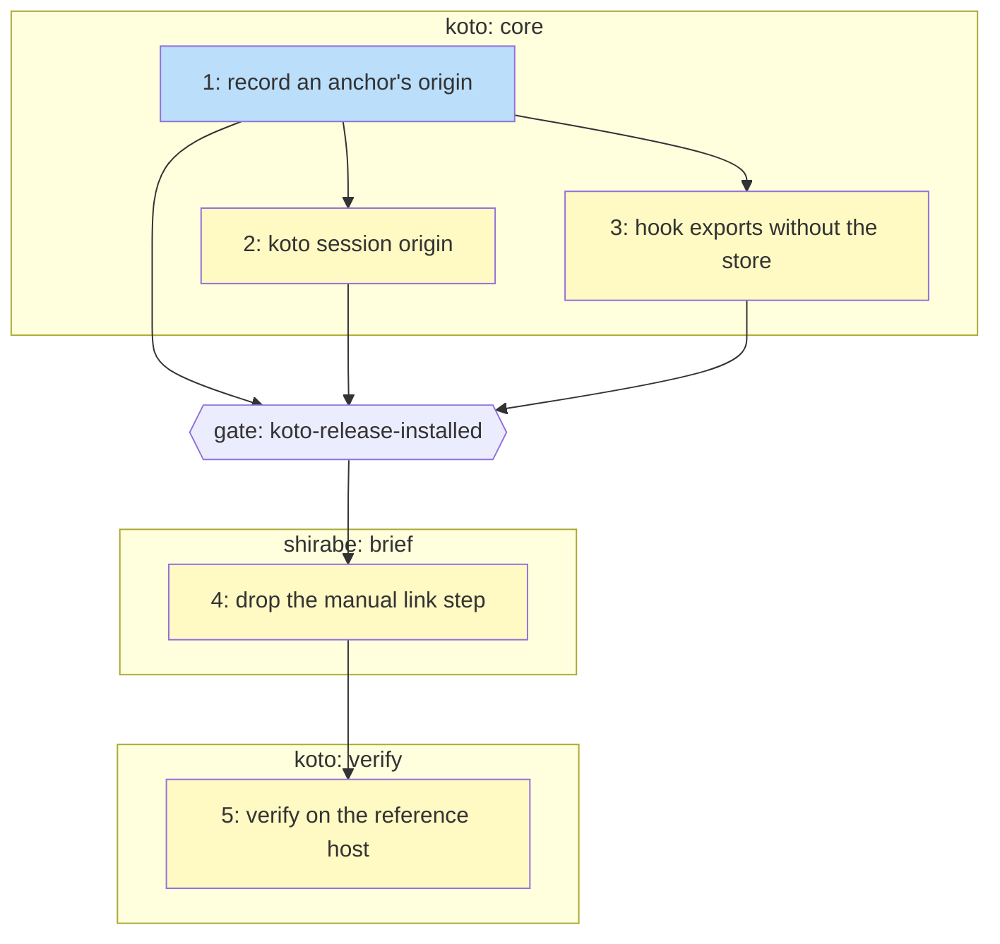

# PLAN: Where a session came from

## Status

Active

## Scope Summary

Make every session record which session dispatched it, whether or not a
launcher started it, without the agent writing anything new. koto records the
origin on the event that creates an anchor and reports it through a read-only
verb; the koto-skills start hook exports the dispatcher's name without waiting
on the store; shirabe's coordinator brief then stops asking the agent to
record the link by hand. A reviewer closes the work by checking the three
acceptance checks on real hosts.

## Decomposition Strategy

Horizontal decomposition, grouped into three pull requests across two
repositories behind one release gate.

The origin record comes first because both other koto changes build on it.
The design's second decision puts the origin on the `anchor_started` event
that creates an anchor and makes the open never refuse over the dispatcher
value, so the verb (Issue 2) has something to read and the hook (Issue 3) can
pass any inherited value without risking the open. The verb and the hook are
independent once the record exists and run in parallel. All three land in one
koto pull request (group `core`) because the design ships Phases 1 and 2 in
the same koto release: a hook that passes `--dispatched-by` against a koto
that still refuses a malformed value would break opens.

The shirabe change (Issue 4) waits on that release being installed. The
design's fourth decision retires the manual link step only once the hook
writes the link on its own; dropping the step earlier would leave dispatched
workers with no link at all while the old koto is still on the host. The
release gate below carries that ordering, and it also fixes when the before
reads for the cost check must be taken.

Verification (Issue 5) is the design's fourth phase: no code, run by a
reviewer once the koto release and the shirabe change are both installed. It
is its own group so the koto pull request does not wait on it.

## Issue Outlines

### Issue 1: feat(session): record an anchor's origin when it is created

**Repo**: tsukumogami/koto

**Group**: core

**Goal**: `koto session anchor open` writes the anchor's origin (dispatched, none, or unrecorded with a reason) on the `anchor_started` event that creates it, and never refuses the open over the dispatcher value.

**Acceptance Criteria**:
- [ ] An anchor opened with `--dispatched-by` has an `origin` object on its `anchor_started` line in the session log, and a session log written before the change, with no `origin` and no `origin_unrecorded` line, still loads and replays.
- [ ] An open with a valid `--dispatched-by` records `dispatched` with that name; an empty or absent value records `none`; a malformed value creates the anchor and records `unrecorded` with `malformed: not an anchor name`; a value naming the anchor itself records `unrecorded` with `self: names this anchor`.
- [ ] Origin is written on every `anchor_started` that creates a session (new, reopened, successor) and not when a live anchor is continued.
- [ ] When the dispatched-by link write fails, the open appends at most one `origin_unrecorded` event with `link write failed: store error`, prints `origin=unrecorded` and its `anchor=` line, and exits 0 (AC4, first test).
- [ ] A test passes a store error carrying a marker string through the link writer and checks the marker appears in no event.
- [ ] Values over 256 bytes are refused as malformed; `named` keeps a bounded preview with control characters replaced, or a SHA-256 prefix and length for values outside the plain-name set; the legacy `dispatched_by` field is set only for a valid value.
- [ ] `cargo fmt --check`, `cargo clippy --all-targets -- -D warnings` and the unit tests pass.

**Dependencies**: None

**Type**: code

### Issue 2: feat(cli): add `koto session origin`

**Repo**: tsukumogami/koto

**Group**: core

**Goal**: one read-only call reports any session's origin as JSON, for an anchor directly or for a workflow session through its own link or its opening anchor.

**Acceptance Criteria**:
- [ ] `koto session origin <name>` prints `{"session", "via", "origin": {...}}` with `state` one of `dispatched`, `none`, `unrecorded`, plus `dispatcher` and `dispatcher_kind` (`anchor` or `workflow`) when dispatched and `named` and `reason` when unrecorded; it exits 0 for all three (AC6).
- [ ] A workflow session with a dispatched-by link of its own reports it with `dispatcher_kind: workflow`; otherwise the verb follows the held-by link written when the session was opened; a held-by anchor that doesn't exist reports `unrecorded` with `anchor not found`; neither link reports `none`.
- [ ] A creating event that names a dispatcher with no dispatched-by link beside it reports `unrecorded` (`link not found` unless an `origin_unrecorded` event gives the reason) (AC4, on the anchor and on a workflow session it holds).
- [ ] After an open whose link write failed with a store error carrying a marker string, the verb's output for that anchor reports `unrecorded` and contains no part of the marker.
- [ ] An anchor with no `origin` field reports `dispatched` when its event names a dispatcher, else `unrecorded` with `recorded before koto tracked origin`.
- [ ] The verb reads through the configured store backend, as `koto status` does, and writes nothing; a test runs it against a non-local backend double.
- [ ] Its reference documents the `origin` field and says `dispatched` is an unauthenticated claim; the koto-user skill gains the verb and the open's `origin=` line; `cargo test --test doc_names` passes.

**Dependencies**: Blocked by <<ISSUE:1>>

**Type**: code

### Issue 3: fix(koto-skills): export the dispatcher name without waiting on the store

**Repo**: tsukumogami/koto

**Group**: core

**Goal**: the start hook gives its shells `KOTO_ANCHOR` and `KOTO_DISPATCHER_ANCHOR` from the printed anchor, or from `anchor-<session id>` when the open was cut off, so a slow store no longer erases the dispatcher.

**Acceptance Criteria**:
- [ ] The hook keeps `anchor` (printed) and `exported` (printed, else derived, else empty on a refusal) apart; only an empty `exported` writes the `unset` line; the watchers and the additionalContext fallback read `anchor` only.
- [ ] With a koto test double whose open sleeps five seconds past `KOTO_LIMIT`, the hook returns within the limit, the env file exports the derived name, and a session whose hook runs with that environment passes it as `--dispatched-by` (AC2).
- [ ] `KOTO_LIMIT` is unchanged and the slow case returns within it (AC9).
- [ ] Any non-empty inherited value, cut to 256 bytes, is passed in `--flag=value` form; when the open exits 2 with no `anchor=` line and the value missed the anchor pattern, the hook opens again without it.
- [ ] A hostile session id (quotes, `$(...)`, a newline) produces no export line.
- [ ] `hooks/test/session-start.test.sh` passes, with the hook still exiting 0 and printing nothing on stderr.

**Dependencies**: Blocked by <<ISSUE:1>>

**Type**: code

**Files**: `plugins/koto-skills/hooks/session-start.sh`

### Gate: koto-release-installed

**After**: Issue 1, Issue 2, Issue 3

**Before**: Issue 4

**Condition**: a koto release carrying Issues 1 to 3 is installed on the reference host with its koto-skills plugin, and the three before reads for the cost check were taken on the earlier koto before it was installed.

### Issue 4: feat(coordinate): drop the manual dispatcher link step from worker briefs

**Repo**: tsukumogami/shirabe

**Group**: brief

**Goal**: the brief the coordinator renders for a dispatched worker no longer tells the agent to record its dispatcher.

**Acceptance Criteria**:
- [ ] The brief template and its renderer emit no link step, and the golden briefs drop it (AC8, golden half).
- [ ] A brief rendered with a dispatcher name supplied, and one rendered with that input empty or absent, both carry no link step and no mention of `link-dispatcher.sh`; neither render fails.
- [ ] Each golden brief differs from its pre-change version only by the removed link step: a diff of old against new golden shows no other added or removed line.
- [ ] `link-dispatcher.sh` stays callable so briefs already in flight keep working: with valid arguments it writes the link as before, and with a missing or malformed session or dispatcher argument it exits with the same code and prints the same message as it did before the change.
- [ ] A search of koto, the koto-skills plugin and shirabe finds no read of a launcher-defined variable used to learn the dispatcher (AC5).
- [ ] The renderer's and dispatch scripts' tests pass.

**Dependencies**: None

**Type**: code

### Issue 5: chore: verify dispatcher origin on the reference host

**Repo**: tsukumogami/koto

**Group**: verify

**Goal**: a reviewer confirms the three acceptance checks on real hosts after the koto release and the shirabe change are installed.

**Acceptance Criteria**:
- [ ] Ten workers dispatched in a row from one coordinator through the launcher, with the cloud store in use and briefs carrying no link step, each report the coordinator's anchor from `koto session origin` on the workflow session and on the anchor (AC1).
- [ ] On a machine with koto and shirabe and no launcher, a shirabe session started from a plain directory reports `none` on its workflow session and on its anchor, with no error, warning or install prompt in the hook output, command output or transcript (AC3).
- [ ] Three measured runs of one worker task after the change, against the three before runs, show the same count of agent koto calls and a median cost inside the before range, and a case-insensitive search of each after transcript for `dispatched-by`, `link-dispatcher` and `dispatcher_session` finds nothing (AC7, AC8).

**Dependencies**: Blocked by <<ISSUE:4>>

**Type**: task

## Dependency Graph

**Legend**: Green = done, Blue = ready, Yellow = blocked, Purple = needsDesign, Light blue = needsPrd, Red = needsSpike, Lavender = needsDecision, Orange = tracksDesign/tracksPlan

## Implementation Sequence

**Critical path**: Issue 1, then Issue 2 or Issue 3, then the release gate,
then Issue 4, then Issue 5.

**Parallel work**: Issues 2 and 3 can be built at the same time once Issue 1
is in; they touch different files and share nothing beyond the record.

**Merge order**: the koto `core` pull request (Issues 1 to 3) merges and
ships in a koto release; once that release and its koto-skills plugin are
installed on the reference host, after the before reads are taken, the
shirabe `brief` pull request (Issue 4) merges; Issue 5 runs last, on the
reference host and on a machine with no launcher.
