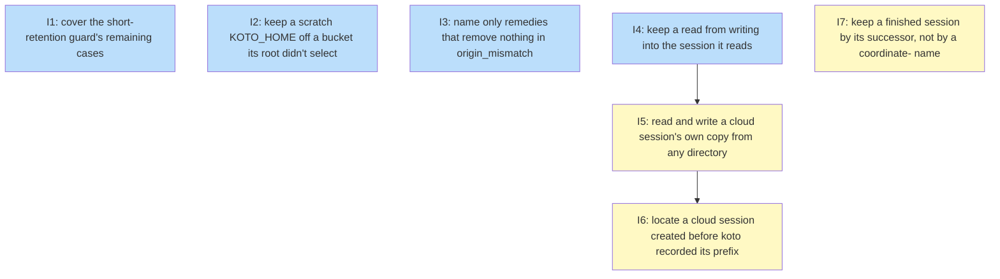

# PLAN: Removal a lineage can trust

## Status

Active

## Scope Summary

The work left to make koto's removals and reads trustworthy on a host that
shares one store and one bucket: tests for the delivered short-retention
guard, fail-closed isolation under `KOTO_HOME`, refusal text that names no
removal, reads that write nothing, one per-session home prefix for every
cloud read, write and delete (with a fallback for sessions older than the
recorded prefix), and prune's `coordinate-` name rule replaced by the
continues relation. The guard itself (koto#470), the `KOTO_HOME` resolver
(koto#471), the cross-directory refusal (koto#463), lossless sync (koto#480)
and the relation on the local backend (koto#481) are already on main.

## Decomposition Strategy

**Horizontal decomposition.** The design's seven phases are independent
changes to separate parts of koto, so each becomes one issue and one pull
request, with no end-to-end flow to build as a skeleton:

- Issue 1 only adds tests, because the design kept koto#470's guard as
  shipped (Decision 1) and the remaining gap is coverage.
- Issue 2 puts the `KOTO_HOME` rule in `load_config`, where every verb and
  every koto a tick starts reads its config (Decision 2), so it touches
  nothing else.
- Issue 3 is wording only, since `execution_anchor_mismatch` already names no
  removal and needs only a pinning test (Decision 5).
- Issue 4 comes before issue 5 because the resolver's cross-directory
  byte-identity check is only meaningful once a read already writes nothing
  into the session (Decision 5 before Decision 3).
- Issues 5 and 6 split Decision 3 in two: the resolver from the recorded
  prefix, including the pull-time `session_id` check, serves every session
  created since koto recorded the prefix; the anchor-and-stamp fallback
  serves only older sessions and can be dropped if none are left.
- Issue 7 is last because Decision 4 removes the name rule only once the
  continues relation works on the cloud backend; its own cloud test is the
  merge gate.

Issues 1 to 6 can be built now, before the continues relation's cloud
support lands. Issue 7 has to wait for it.

## Issue Outlines

### Issue 1: test(session): cover the short-retention guard's remaining cases

**Goal**: Prove that the short-retention guard koto#470 shipped meets every guard requirement, by adding the tests the shipped suite lacks. No source change is expected.

**Acceptance Criteria**:
- [ ] On the cloud backend (in-process stand-in), `koto session prune --apply` with `KOTO_RETENTION_KEEP=1s` and each of `--all`, `--execution-dir <dir>` and `--older-than 1s`, with no plan, exits 2 with `prune_short_retention`; the error names `retention.keep`, `1s`, its source, the backend, the bucket, the store path and the would-remove count.
- [ ] For each of those refusals, the local session directories and the stand-in's object listing are identical before and after.
- [ ] `KOTO_RETENTION_KEEP=1h` with `--all`, and `KOTO_RETENTION_KEEP=1s` with `--older-than 1h`, don't refuse.
- [ ] `--apply --plan <token>`, the same command on the local backend, and `--apply --all` with `KOTO_RETENTION_KEEP=1s` on a store where nothing would be removed, don't refuse.
- [ ] With `--confirm-short-retention`, on a store holding finished unpinned sessions past retention, a pinned finished session and a finished session whose hierarchy has a running member, exactly the first group is removed, locally and in the bucket; the other two remain in both.
- [ ] In a confirmed run, stderr carries `koto session prune: removing from` before any removal takes place (the line precedes the first removed session's local and bucket deletes).
- [ ] Every new test clears every `KOTO_SESSION_*` variable, `KOTO_SESSIONS_BASE` and `KOTO_HOME` from the commands it spawns and sets its own backend, as `tests/support/koto_command.rs` does.

**Dependencies**: None

**Complexity**: testable

**Type**: code

### Issue 2: feat(cli): keep a scratch KOTO_HOME off a bucket its root didn't select

**Goal**: Under `KOTO_HOME`, only the root's own `config.toml` can select the cloud backend, and `koto session dir --json` reports the root, the backend, where it came from and the bucket, so a scratch run can't reach a bucket its root didn't select.

**Acceptance Criteria**:
- [ ] With `HOME` at a sentinel directory holding a populated `.koto` (sessions, `requests/`, `config.toml`), `KOTO_HOME` at a scratch directory, and `KOTO_SESSION_BACKEND=cloud` plus the cloud variables pointing at the stand-in, a run of `koto init`, a tick, `koto session prune --apply --all --confirm-short-retention` and `koto session cleanup` makes no request to the stand-in, leaves the sentinel `.koto` hashing the same before and after, and prints one warning naming `KOTO_SESSION_BACKEND` and no value.
- [ ] The same run with `session.backend = "cloud"` in `$KOTO_HOME/config.toml` reaches the stand-in; with that setting only in a project `.koto/config.toml`, it doesn't.
- [ ] Under that setup `koto session dir --json` prints `root` under scratch, `backend` `local`, `backend_source` `default` and `backend_ignored` naming `KOTO_SESSION_BACKEND`; with the root's config selecting cloud it prints `backend` `cloud`, `backend_source` `user-config` and the bucket, and no credential or endpoint userinfo. Neither run adds a file under scratch or an entry to the stand-in's request log.
- [ ] Bare `koto session dir` with no name prints the root alone, as before.
- [ ] A gate command in a tick under a scratch `KOTO_HOME` runs `koto session dir --json` and prints the same `root`, `backend` and `bucket` as the ticking koto does.
- [ ] With `KOTO_HOME` unset, backend selection and every existing test are unchanged.
- [ ] `tests/koto_home_test.rs` (or a sibling) carries these cases and spawns its commands with the cloud variables deliberately left in place for the isolation case.
- [ ] `docs/guides/cli-usage.md` documents the rule, the one-line opt-in, that credentials stay in the environment and don't belong in the root's file, and the `--json` fields; the koto-user command reference documents `KOTO_HOME` and `koto session dir --json` (the docs half of koto#472).

**Dependencies**: None

**Complexity**: testable

**Type**: code

### Issue 3: fix(cli): name only remedies that remove nothing in origin_mismatch

**Goal**: Neither `origin_mismatch` nor `execution_anchor_mismatch` names a removal as the remedy; each names a way forward that removes nothing, pinned by tests and matched by the docs.

**Acceptance Criteria**:
- [ ] `koto init --attach-live` against a running session started in another worktree exits 2 with `origin_mismatch`; the session's files hash the same before and after; the message names another session name and the directory the session belongs to.
- [ ] Against a running session whose header has no origin record, the message names another session name and finishing it with the koto version that started it.
- [ ] A test asserts that both `origin_mismatch` messages and the `execution_anchor_mismatch` message contain none of `session cleanup`, `--cleanup`, `session prune` and `workspace prune`; the assertion in `tests/init_entry_flags.rs` that pinned the cleanup text is flipped.
- [ ] `docs/guides/cli-usage.md`, `docs/guides/custom-skill-authoring.md`, `docs/reference/error-codes.md` and the koto-user skill's references give the new remedies for both codes and contain none of those strings in their entries for either code.
- [ ] `cargo test --test doc_names` passes.

**Dependencies**: None

**Complexity**: simple

**Type**: code

### Issue 4: fix(session): keep a read from writing into the session it reads

**Goal**: Outside a session's own tick, a read leaves the session's state log, context key files and bucket objects byte-identical, and a value a lost store write left behind is still returned, served from the log.

**Acceptance Criteria**:
- [ ] For a finished session and for a running one, the state log, every context key file and (on the cloud backend, from the session's own directory) every bucket object hash the same before and after `koto context get`, `koto context exists`, `koto context list` and `koto status`, run with `KOTO_ANCHOR` unset and with it set to an anchor that holds the session.
- [ ] With `KOTO_ANCHOR` set to an existing anchor that doesn't hold the session, the read is logged in that anchor and the read session's files hash the same.
- [ ] A gate in S's own tick that runs `koto context get S k` still logs a `context_read` event in S.
- [ ] With the store write of a transition's assigned key made to fail (the fault the koto#204 tests inject), `koto context get S <key>`, `exists` and `list` from another process report the assigned value, and S's files hash the same before and after; S's next tick leaves the key in its store.
- [ ] `restore_assigned` no longer calls `reconcile`; the unit tests in `src/cli/context.rs` that pinned the write-back assert instead that the store is untouched and the answer is the assigned value.
- [ ] The run journal still counts a driver's out-of-tick reads (from the spool or the anchor), checked by an existing or new run-journal test.
- [ ] The koto-user skill's references and the session retention guide say that a read outside a session's own tick writes nothing into it.

**Dependencies**: None

**Complexity**: testable

**Type**: code

### Issue 5: feat(session): read and write a cloud session's own copy from any directory

**Goal**: Under the cloud backend, every session-scoped read, write and delete uses the session's own copy, the one under the prefix recorded when it was created (`origin.store.prefix`), from any working directory.

**Acceptance Criteria**:
- [ ] Session S is created on the cloud backend in directory A. From an unrelated directory B, `koto context get S k` prints `v1`; a process in A then sets k to `v2`; the same read from B prints `v2`.
- [ ] `koto status S`, `koto context list S` and `koto context exists S k` from B print the same as from A.
- [ ] From B, `koto context add S k2 v`, `koto context remove S k2` and a rebind's header rewrite go to S's own copy: A reads the results, and the stand-in holds no object for S under B's prefix.
- [ ] `koto next S` from a subdirectory of S's anchor leaves no object for S under the subdirectory's prefix, and a read from A sees the tick's event.
- [ ] With the stand-in failing the listing, and separately failing a GET after a good listing, `koto context get S k` from B exits non-zero and prints no value; from A it prints the local value and a warning. `koto context exists S k` from B under a failed listing exits non-zero rather than answering "absent".
- [ ] With the host's sync stamp left naming another prefix's state key, a read of S from B fetches S's own copy instead of skipping the fetch as fresh.
- [ ] `koto next S` from a directory outside its anchor exits 2 with `execution_anchor_mismatch`.
- [ ] After `koto session rebind S --to C`, the stand-in's keys for S are the same as before, and a write from C adds no object under C's prefix.
- [ ] A finished session's state log, context key files and bucket objects hash the same before and after `koto context get`, `exists`, `list` and `koto status` run from B.
- [ ] On a second store with no local copy of S, a read of S from a directory whose prefix isn't S's exits 2 with `session_unlocated` naming S and the reason, and prints no value.
- [ ] A session with a recorded `origin.store.prefix` whose copy at that prefix is missing, and separately one whose copy there carries another `session_id`, read from B exits non-zero with `session_unlocated` (reason `recorded_copy_mismatch`), prints no value, and leaves every local file of the session hashing the same.
- [ ] A local header whose `origin.store.prefix` is not 16 lowercase hex is treated as missing: read from B it refuses with `session_unlocated` until issue 6 lands, and from its own directory it reads as before.
- [ ] `koto session prune --apply` run from B removes S's copy under S's own prefix; when the copy there carries another `session_id`, prune deletes neither copy and reports S as skipped.
- [ ] A push from B to a home whose bucket copy carries another `session_id` refuses with `session conflict` and replaces nothing.
- [ ] With the same cache state on both sides (cold, then warm), the stand-in's request log for `koto context get S k` from B has no more entries than from A.
- [ ] The existing tests for sessions without `origin.store.prefix`, read from their own directory, pass unchanged.
- [ ] The cloud sync guide and the koto-user error tables document `session_unlocated` and that named-session commands work from any directory for sessions with a recorded prefix.

**Dependencies**: Blocked by <<ISSUE:4>>

**Complexity**: critical

**Type**: code

### Issue 6: feat(session): locate a cloud session created before koto recorded its prefix

**Goal**: A cloud session created before koto recorded `origin.store.prefix` is read from any directory once one candidate location is confirmed by `session_id`, and refuses with a reason otherwise.

**Acceptance Criteria**:
- [ ] A session with no `origin.store.prefix`, whose copy under its anchor's prefix carries the matching `session_id`, reads from an unrelated directory B.
- [ ] With that copy missing, or carrying another `session_id`, the read from B exits non-zero with `session_unlocated`, names the session and the reason, prints no value and changes no local file.
- [ ] With matching copies under both candidate prefixes, the read from B refuses and names both.
- [ ] When the anchor's prefix and the sync stamp's prefix are the same, one listing is made and the read from B succeeds rather than refusing as ambiguous.
- [ ] With no copy under the anchor's prefix and a matching copy under the prefix the sync stamp names, the read from B uses the latter.
- [ ] The stand-in's request log shows one listing per distinct candidate (at most two) beyond the same read from the session's own directory.
- [ ] The same session read from its own directory behaves exactly as before.

**Dependencies**: Blocked by <<ISSUE:5>>

**Complexity**: testable

**Type**: code

### Issue 7: feat(session): keep a finished session by its successor, not by a coordinate- name

**Goal**: Prune stops keeping a session because its name starts with `coordinate-` and keeps a finished session because a later session continues it, naming that successor, on both backends. It merges only after the continues relation works on the cloud backend (the bucket-walk change that follows koto#481); its cloud test fails until then, which is the merge gate.

**Acceptance Criteria**:
- [ ] A finished `coordinate-x` with no keeper is removed by `koto session prune --apply` once retention passes, on both backends, and its entry names no keeper.
- [ ] A finished `coordinate-y` that is pinned, and one with a running hierarchy member, are kept and their entries name the pin or the member.
- [ ] A finished session whose successor holds a continues relation to it and is running is kept by `koto session prune --apply --all` and by `koto workspace prune`, on the local and the cloud backend, with `relation_keepers` naming the successor in JSON and `kept: continued by <successor>` in text.
- [ ] Once that successor finishes and its retention passes, the next prune removes both.
- [ ] `docs/guides/cli-usage.md`, `docs/guides/session-retention.md` and the koto-user command reference no longer describe a `coordinate-` name rule; the retention guide's paragraph on the change names `koto session prune` without `--apply` as the preview, and `koto session pin` and `koto session link --continues` as the ways to keep one before upgrading.
- [ ] The pull request body carries a release-notes paragraph saying the same.

**Dependencies**: None

**Complexity**: testable

**Type**: code

## Dependency Graph

**Legend**: Green = done, Blue = ready, Yellow = blocked

Issue 7 is shown blocked by the continues relation's cloud support, which is
outside this plan.

## Implementation Sequence

**Critical path:** Issue 4 -> Issue 5 -> Issue 6 (3 pull requests, merged in
that order).

**Can start now, before the continues relation's cloud support:** issues 1,
2, 3 and 4 in parallel, then 5 after 4 and 6 after 5. Issue 5 touches the
cloud backend files the relation's bucket walk also changes; landing it first
lets the walk call `home_prefix` instead of building its own prefix handling.

**Waits for the continues relation's cloud support:** issue 7. Its cloud test
fails until that support is on main, and it must not merge before then.
