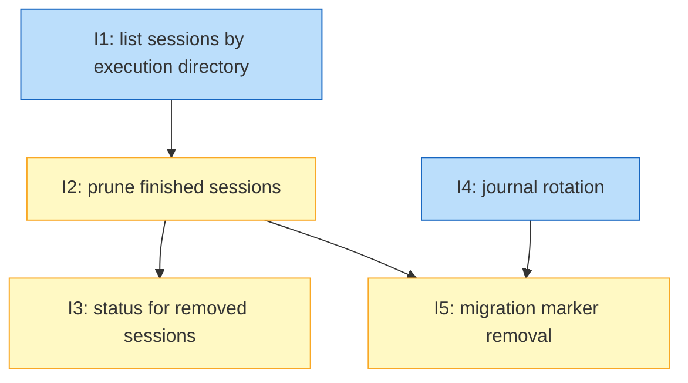

# PLAN: session-hygiene

## Status

Active

## Scope Summary

This plan implements `docs/designs/DESIGN-session-hygiene.md` against the
requirements in `docs/prds/PRD-session-hygiene.md`. It adds
`koto session list --execution-dir/--state` and a new `koto session prune`.
koto writes a finished record before it removes a session itself, so
`koto status` can answer for it. The run journal gets rename-based rotation
and reader-aware retention, and `--migrated-from` removes migration markers
from a source workspace's bucket prefix.

## Decomposition Strategy

Horizontal, one outline per PR group. The design's parts meet at two stable
seams: the inspection helper the listing introduces, which the prune reuses,
and the prune verb, which the finished records and the marker mode extend.
So the listing lands first, then the prune, then the two extensions of the
prune. Journal rotation shares no code with the session verbs and runs in
parallel with them. Marker removal waits for rotation only because both add
settings to `src/config`.

Every outline lands with end-to-end tests that create sessions with real
koto commands. They run under a scratch HOME or `KOTO_SESSIONS_BASE`, never
the real `$HOME/.koto`, and the cloud cases run on koto's fake S3 harness. Each
outline also updates the koto-user skill wherever it adds agent-visible
surface.

## Issue Outlines

### Issue 1: feat(session): list sessions by execution directory with their state

**Repo**: tsukumogami/koto

**Group**: listing

**Goal**: `koto session list` gains `--execution-dir <dir>` and `--state`, built on a shared session-inspection helper, so a session can be attributed to the directory it ran in without reading its files (PRD R1 to R4, R30 for listing; koto#308).

**Acceptance Criteria**:
- [ ] A new `src/cli/session_inventory.rs` provides `inspect(base, name, &mut TemplateCache)` returning name, session id, execution dir, parent, status (`running`, `terminal`, `cancelled`, `unreadable`), state, failure flag and `finished_at`, reading header, log and a per-run cached compiled template. A cancel followed by a transition or rewind is `running`. A symlinked session directory or an unparseable header is `unreadable`.
- [ ] Every `koto session list` row gains `execution_dir` and `session_id`. Cloud placeholder rows carry null. All existing fields keep their values (golden comparison against the pre-change output for an unchanged store).
- [ ] `--state` adds `state`, `status`, `failure` and `finished_at`.
- [ ] `--execution-dir <dir>` implies `--state`, matches by whole path components (`/x/a/b` matches `/x/a/b` and `/x/a/b/c`, not `/x/a/bc`), ignores trailing slashes, canonicalizes an argument that resolves (a symlink to the dir gives the same result), matches a non-existent argument as given, and treats `/` as matching everything. The output is `{"sessions": [...], "excluded_remote_only": N}`.
- [ ] Under the fake S3 harness, a bucket-only session is absent from filtered output and counted in `excluded_remote_only`.
- [ ] One test each produces `running`, `terminal` (success and failure terminals), `cancelled` and `unreadable`.
- [ ] Timing over 1,000 koto-created sessions (each log at least 20 events) for `--execution-dir` with state is under 2 seconds on the development machine, and the number is recorded in the pull request body.
- [ ] The koto-user skill's command reference names `--execution-dir` and `--state`, and `docs/guides/cli-usage.md` documents both.

**Dependencies**: None

**Type**: code
**Files**: `src/cli/session_inventory.rs`, `src/cli/session.rs`, `src/cli/mod.rs`, `src/session/mod.rs`, `src/session/local.rs`, `src/session/cloud.rs`, `tests/session_list_test.rs`, `docs/guides/cli-usage.md`, `plugins/koto-skills/skills/koto-user/references/command-reference.md`

### Issue 2: feat(session): prune finished sessions as a previewed set

**Repo**: tsukumogami/koto

**Group**: prune

**Goal**: A new `koto session prune` previews and removes finished sessions as a set. Rules a to g keep running and unreadable sessions, referenced and referencing sessions, malformed references, sessions bound to a waiting leg, `coordinate-` sessions, and sessions whose cloud copy may be newer. It applies a stored preview exactly or, unattended, a recomputed set (PRD R5 to R11, R30 for the prune; koto#162).

**Acceptance Criteria**:
- [ ] `src/cli/session_prune.rs` enumerates the local base directly (not `Backend::list`), inspects every session, builds the reference map from `parent_workflow` and the local `chain/parent` context key, and evaluates rules a to g in order, reporting each kept session's first rule and a detail.
- [ ] The preview prints the JSON shape the design gives, stores its would-remove list at `<sessions base>/.prune-plans/<token>.json` (0600 file, 0700 directory), and removes stored plans older than a day. The token is the first 32 hex digits of SHA-256 over sorted `<kind>\t<name>\t<session_id>` lines, and is unchanged when a session outside the list changes.
- [ ] `--apply --plan <token>` removes exactly the previewed list. A stale token removes nothing, prints `added` and `dropped`, and exits 4. An unknown plan exits 4 saying so. A malformed token exits 2. A successful apply deletes its stored plan.
- [ ] `--apply` without `--plan` requires `--execution-dir`, `--older-than` or `--all` (usage error otherwise), removes the recomputed set, and prints it.
- [ ] The same store of one protected session per rule (below) run through `--apply --all` with no plan leaves every protected session's directory on disk, and so does `--apply --plan` with a token from a preview of that store; only the unprotected finished sessions are gone.
- [ ] Tests show each rule keeping its session, named in the preview. The list: a running session and an unreadable one (a); a finished parent with a running child, and a finished parent whose cancelled chain left running children referencing it through `chain/parent` (b); a finished child of a running parent by header, and a finished session whose `chain/parent` names a running session (c); a malformed `chain/parent` (d); a waiting leg and an unreadable leg (e); a `coordinate-` session (f); and, on the fake S3 harness, a session whose remote `version.json` is ahead (g). A session matching two rules reports the first.
- [ ] `--execution-dir` and `--older-than` filter together. A session excluded by a filter is absent from the preview but still protects what it references. The age boundary is tested just inside and just past the duration.
- [ ] Apply removes each session under `lock_state_file` after re-inspecting it. A rewound session, a session recreated under the same name, and a locked session each land in `skipped` with exit 0. An empty set previews and applies successfully.
- [ ] Under the cloud backend, removal deletes remote objects first (except `migrated.json`) through a variant of `sync_delete_session` that returns failures, then the local directory. A failed remote delete is reported under `failed` and the run exits 3. A bucket-only session is never considered.
- [ ] After a prune the run journal is byte-identical, and pruned directories (sidecars included) are gone.
- [ ] Preview timing over 1,000 koto-created sessions is under 2 seconds on the development machine, and the number is recorded in the pull request body.
- [ ] `docs/workspace-layout.md` names `koto session prune` and `.prune-plans`. `docs/guides/cli-usage.md` documents the verb, its rules and exit codes. The koto-user skill names `koto session prune`.

**Dependencies**: Blocked by <<ISSUE:1>>

**Type**: code
**Files**: `src/cli/session_prune.rs`, `src/cli/mod.rs`, `src/cli/workspace.rs`, `src/session/cloud.rs`, `tests/session_prune_test.rs`, `docs/workspace-layout.md`, `docs/guides/cli-usage.md`, `plugins/koto-skills/skills/koto-user/SKILL.md`, `plugins/koto-skills/skills/koto-user/references/command-reference.md`

### Issue 3: feat(status): answer for a session koto removed at its terminal

**Repo**: tsukumogami/koto

**Group**: finished-records

**Goal**: koto writes a finished record before it removes a session itself (at the session's own terminal tick or in a parent's sweep). `koto status` answers from that record instead of `not found`, and the prune lists and removes records (PRD R12 to R17; koto#234).

**Acceptance Criteria**:
- [ ] `src/session/finished.rs` writes `<sessions base>/.finished/<name>.json` atomically (0600, 0700 directory, lstat-checked, no symlinks), with `v`, `name`, `session_id`, `execution_dir`, `state`, `status`, `failure`, `result`, `finished_at` and `removed_by`. A result over the 64 KiB cap is reduced to status and summary with `truncated: true`. A read refuses a record whose `name` differs from its file name.
- [ ] `finish_terminal_tick` writes the record after the journal's terminal record and immediately before `sweep_if_parent` and `cleanup`, only on the branch that removes. A test hook between the record write and the removal shows the record exists first, and the journal's `terminal` line precedes it.
- [ ] `sweep_children` writes a record for each kept child it removes, with `removed_by: "parent"` and the child's result (with the `resolve_terminal_result` fallback). A cancelled child gets `status: "cancelled"` and a null result.
- [ ] A record write made to fail prints one warning and the session is still removed.
- [ ] `koto status <name>` for a removed session exits 0 with `current_state`, `is_terminal: true`, `result`, `removed: true`, `finished_at`, `session_id` and `execution_dir`. For an identical run kept with `--no-cleanup`, `current_state`, `is_terminal` and `result` are equal. A never-created name, and a name whose record was pruned, exit 2 with `not found`.
- [ ] A session kept at a failure terminal or with `--no-cleanup`, and one removed by `koto cancel --cleanup` or `koto session cleanup`, writes no record.
- [ ] `koto init` (through `LocalBackend::init_state_file`) deletes the name's record. `koto session list` and `koto workflows` never show a record.
- [ ] `koto session prune` lists matching records as `kind: "record"` entries under the same filters (execution dir and age from the record), includes them in the token, removes them with no protections, and skips a record replaced between preview and apply.
- [ ] `docs/workspace-layout.md` lists `.finished` as derived and safe to delete. The koto-user skill's error-handling reference describes the removed-session status answer.

**Dependencies**: Blocked by <<ISSUE:2>>

**Type**: code
**Files**: `src/session/finished.rs`, `src/session/mod.rs`, `src/session/local.rs`, `src/cli/mod.rs`, `src/cli/workspace.rs`, `src/cli/session_prune.rs`, `tests/finished_record_test.rs`, `docs/workspace-layout.md`, `plugins/koto-skills/skills/koto-user/references/error-handling.md`

### Issue 4: feat(run-journal): rotate the journal without losing a reader's line

**Repo**: tsukumogami/koto

**Group**: journal-rotation

**Goal**: When an operator configures a size bound (rotation is off by default), the run journal rotates on append once it reaches that bound. It moves to `_run_journal.NNNNNNNNNN.jsonl` without replacing anything, writers re-check the file's identity after locking, and rotated files are removed only past the retention bound and only when no reader's recorded position needs them. Record kinds are untouched (PRD R18 to R24).

**Acceptance Criteria**:
- [ ] `run_journal::write` appends through a new `src/run_journal/rotate.rs`, backed by an identity-checked variant of `engine::jsonl_append`'s helper. It opens with `O_APPEND|O_CREAT|O_NOFOLLOW`, takes `flock`, and retries when the descriptor's `(dev, ino)` differs from the path's (at most eight attempts). It rotates under the lock when the size is at or over the bound: newline-terminate a partial last line, `link` to the next ten-digit name, `unlink` the old path, run retention, retry. A failed link or unlink warns once and appends to the unrotated file. `run_journal::write` keeps its signature, and when one locked append carries several lines (a batch), a test shows rotation lands before or after the batch, never between its lines.
- [ ] A journal one byte under the bound doesn't rotate on the next append. One at the bound does, leaving the old content under the next name and a fresh `_run_journal.jsonl`. Ten or more rotations order correctly by name.
- [ ] Eight concurrent koto processes writing across rotations produce every expected line exactly once, none torn, and none in a rotated file after its rename.
- [ ] A test reader implementing the documented offset rule (identity by `(dev, inode)`, open then `fstat`) stops mid-file. After a rotation done by an ordinary koto command, it finishes the old file and reads the new one from byte 0 with no line lost or repeated.
- [ ] Retention reads only `_run_journal.readers/*.json` positions (lstat-checked, at most 4 KiB, strict parse) and file metadata, never journal records. A journal of non-JSON lines rotates and retains exactly like a valid one.
- [ ] A rotated file older than `retain_days` is removed at the next rotation, and one inside the bound is kept. A file a fresh position points into is kept past the bound, and a position at or past a rotated file's end releases that file. With two readers the lagging one keeps its file. A position older than `reader_stale_days`, or unparseable, protects nothing and is named in a warning.
- [ ] `run_journal.rotate_bytes` (default 0: rotation off), `run_journal.retain_days` (30) and `run_journal.reader_stale_days` (90) are settable with `koto config set`. `koto config get` prints the defaults when nothing is set. Settings resolve once per process. With nothing configured, a journal far past any size never rotates (test), and the rotation tests set a size bound explicitly.
- [ ] A redirected store (`KOTO_SESSIONS_BASE`) rotates its own journal, and `koto session list`, `koto workflows` and the layout migration ignore rotated files and the readers directory.
- [ ] No journal record kind is added or changed, and the `run-journal.json` sidecar is untouched.
- [ ] `docs/reference/run-journal.md` states the naming rule, the reader rules for an offset reader and for a reader that copies the live file by exact name on an interval (which must also list rotated files), the optional position file's directory and format, the three defaults, and that rotation is off by default until consumers list rotated files, replacing "koto doesn't rotate or prune it yet". `docs/workspace-layout.md` lists the rotated files and the readers directory.

**Dependencies**: None

**Type**: code
**Files**: `src/run_journal/rotate.rs`, `src/run_journal/mod.rs`, `src/engine/jsonl_append.rs`, `src/config/mod.rs`, `src/config/resolve.rs`, `tests/run_journal_rotation_test.rs`, `docs/reference/run-journal.md`, `docs/workspace-layout.md`

### Issue 5: feat(session): remove migration markers left by imports

**Repo**: tsukumogami/koto

**Group**: marker-cleanup

**Goal**: `koto session prune --migrated-from <workspace-path>` previews and removes migration markers under a source workspace's bucket prefix. A marker is removable only when its target is present, and then by age or with `--source-retired`. Removal deletes the source's whole prefix with the marker last (PRD R25 to R29).

**Acceptance Criteria**:
- [ ] Under the cloud backend, the preview lists each marker under `<prefix>/` (trailing-slash prefixes throughout) with its session name, target, age from `migrated_at`, target status (`migrated`, `present` when the target header's `session_id` matches, `replaced`, `absent`, `unknown`) and removability with its reason. Under the local backend the flag exits 2.
- [ ] Each target status is produced by a test on the fake S3 harness, including sibling names `foo` and `foo-2` that must not cross-match.
- [ ] A marker with a `present` target is removable once older than `session.cloud.marker_retain_days` (default 30, settable), or inside the bound only with `--source-retired`. A marker whose target is `migrated`, `replaced`, `absent` or `unknown` is kept at any age and with or without the flag, and the preview names the target status as the reason. A marker whose body doesn't parse is kept.
- [ ] With sources `foo` (removable) and `foo-2` (kept) under the same prefix, applying removes every object under `<prefix>/foo/` and leaves every object under `<prefix>/foo-2/` byte-identical in the fake bucket; every kept marker's objects are untouched, checked by listing the bucket before and after.
- [ ] Apply re-reads each marker and re-evaluates its rule, then deletes every object under `<prefix>/<name>/`, the marker last. With a delete failure injected part way, the marker is still there, the old name still refuses with `session_migrated`, the run exits 3, and a retry completes the removal.
- [ ] The marker token and stored plan behave as the session ones do: unchanged applies, stale refuses with exit 4.
- [ ] Marker mode removes nothing from the local store.
- [ ] `docs/guides/cloud-sync-setup.md` documents the marker removal and its rule. `docs/workspace-layout.md` notes markers can now be removed, and the PR body states that cloud behavior was tested on the fake S3 harness.

**Dependencies**: Blocked by <<ISSUE:2>>, <<ISSUE:4>>

**Type**: code
**Files**: `src/session/cloud.rs`, `src/cli/session_prune.rs`, `src/cli/mod.rs`, `src/config/mod.rs`, `src/config/resolve.rs`, `tests/session_prune_markers_test.rs`, `docs/guides/cloud-sync-setup.md`, `docs/workspace-layout.md`

## Dependency Graph

Legend: `ready` can start now; `blocked` waits on the outlines above it.

## Implementation Sequence

Open with Issue 1 and Issue 4 in parallel; they share no files. Issue 2
follows Issue 1, because the prune is built on the inspection helper.
Issues 3 and 5 both follow Issue 2, and Issue 5 also follows Issue 4 for its
`src/config` changes. Issue 4 changes the run journal's append path, which
concurrent work adding journal record kinds also touches. Its pull request
is merged one after that work's, not together with it, and it adds no record
kind of its own.
