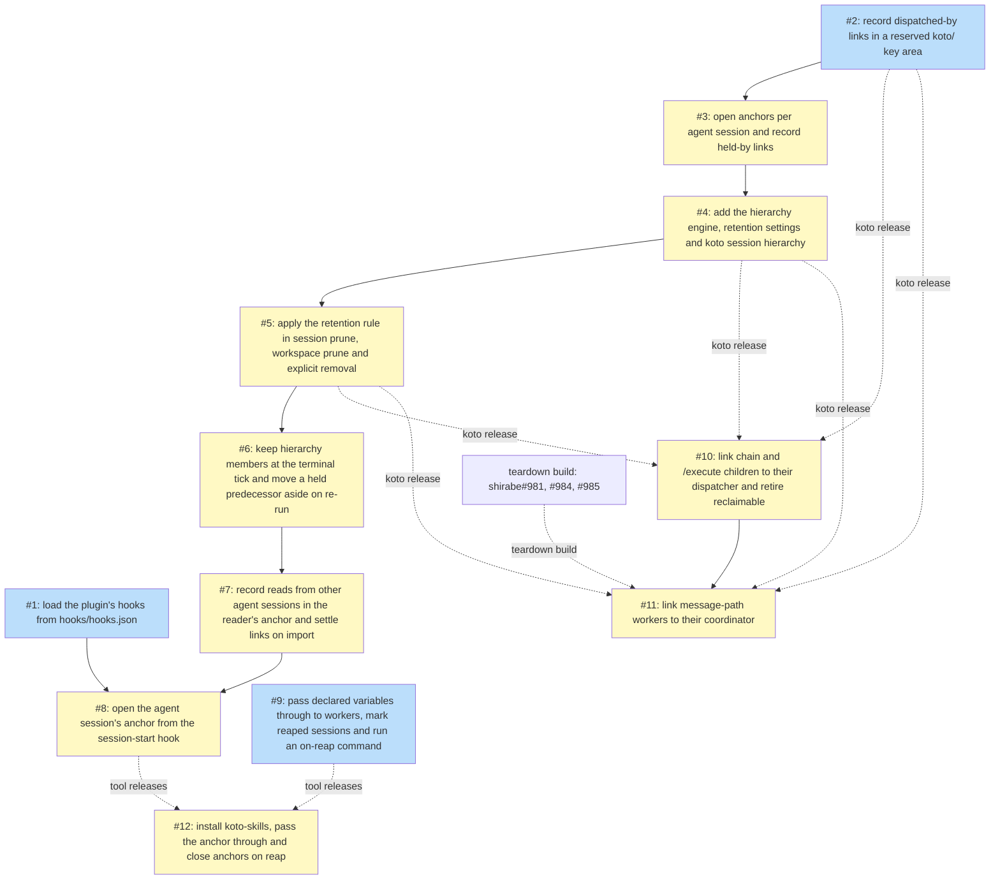

# PLAN: Session retention across the dispatch hierarchy

## Status

Active

## Scope Summary

Keep a koto session readable while any session in its dispatch hierarchy is
alive: koto-owned links each session keeps about itself, an anchor per agent
session opened by the koto-skills plugin, one retention engine that every
removal by rule or subtree consults and that `koto session hierarchy` exposes,
reads from another agent session recorded in the reader's anchor, and import
that settles a moved session's own held-by links. Outside koto: niwa's generic
pass-through, reap key and on-reap command, shirabe's link calls and the
retirement of its own reclaimable rule, and the workspace configuration that
wires them together.

## Decomposition Strategy

Horizontal decomposition, one pull request per design phase. The order follows
from the design's decisions. Links (Decision 1) are the data everything else
reads, so they come first, and held-by links need anchors to exist (Decision
2), so they land with the anchors. The engine (Decision 3) needs both kinds of
link and the anchors' close records; it lands with its query and settings
before any removal point uses it. Each removal-point unit then wires the same
verdict into its call sites, and the units whose end-to-end scenarios observe
prune outcomes (the terminal tick and re-run, then reads and import, then the
anchor hook) follow the prune unit so their criteria can pass when they merge.
niwa's unit (Issue 9, Decision 7) is independent of koto. shirabe's link
calls (Decision 8) and the workspace configuration wait on releases, which the
gates below declare.

## Issue Outlines

### Issue 1: fix(koto-skills): load the plugin's hooks from hooks/hooks.json

**Repo**: tsukumogami/koto

**Group**: hooks-load

**Complexity**: simple

**Goal**: Make the koto-skills plugin's hooks load by moving them from `plugins/koto-skills/hooks.json` to `plugins/koto-skills/hooks/hooks.json` in Claude Code's matcher-group shape, with a test that guards the shape.

**Acceptance Criteria**:

- [ ] `plugins/koto-skills/hooks/hooks.json` exists and maps each event (`SessionStart`, `Stop`) to a list of matcher groups, each with a `hooks` list of `{"type": "command", "command": ...}` entries.
- [ ] The SessionStart group still runs `bash "${CLAUDE_PLUGIN_ROOT}/hooks/session-start-workflows.sh"`, and the Stop hook keeps its current command text unchanged.
- [ ] The root file `plugins/koto-skills/hooks.json` is deleted, and no file in the repository still refers to that path.
- [ ] `.github/workflows/validate-plugins.yml` reads the Stop hook command from `plugins/koto-skills/hooks/hooks.json` (as `.hooks.Stop[0].hooks[0].command`) in both smoke-test steps, and both steps still pass: reminder text with an active workflow, silence with none.
- [ ] A test in the repository fails when `plugins/koto-skills/hooks/hooks.json` is missing, when it isn't valid JSON, or when it is in the old flat shape (an event whose list entries carry `type`/`command` directly instead of a `hooks` list). Run it with `cargo test`; the test file is named in the PR.
- [ ] The shape test passes against the new file and fails against the old flat one (confirmed once while writing it).
- [ ] The koto-skills plugin's documentation or README mentions no stale `hooks.json` path; if the plugin has no such docs, nothing is added.
- [ ] Changelog: `CHANGELOG.md` gets an entry saying that loading the hooks also turns on the plugin's existing, until now dormant, /workflows and Stop hooks for every koto-skills user.
- [ ] Must deliver: `plugins/koto-skills/hooks/hooks.json` in matcher-group shape with the SessionStart and Stop groups (required by <<ISSUE:8>>)

**Dependencies**: None

### Issue 2: feat(session): record dispatched-by links in a reserved koto/ key area

**Repo**: tsukumogami/koto

**Group**: links

**Complexity**: testable

**Goal**: Add a reserved `koto/` key area in each session's context, a link store that writes dispatched-by links there, and the writers that record them: `koto session link`, `koto init --dispatched-by`, `koto init --koto-leg` and a self-run `koto request attach`.

**Acceptance Criteria**:

- [ ] A new `src/session/links.rs` defines the reserved prefix and link kinds, `write_link(store, session, kind, peer, hints)` (written through `add_with_writer(WRITER_KOTO)` plus a `context_added` event, following `workflows_surface/discover.rs`) and `read_links` for a session. The dispatched-by key is `koto/links/dispatched-by/<peer>`; the held-by and closes kinds are left for later work, but the key layout and function signatures accept a kind so they can be added without reshaping the API.
- [ ] Each link body is one JSON object `{"v":1,"session":"<peer>","session_id":"<peer's id or null>","workspace":"<path or null>","at":"<rfc3339>"}`. `session_id` is filled in when the peer's session exists and is `null` otherwise.
- [ ] Writing a link that already exists changes nothing: the session's files are byte-identical afterwards and the command exits 0.
- [ ] A peer name that fails the context-key component grammar (including `~`) or the session-name rule is refused and no link is written.
- [ ] **Reserved-area refusal.** `koto context add` and `koto context remove` refuse any key under `koto/` with exit 2, naming the prefix. The refusal sits in the context store's write path for the agent writer, not only in the `Add` and `Remove` arms in `src/cli/mod.rs`, and compares case-insensitively, so `KOTO/links/...` is refused on a case-insensitive filesystem. koto's own writer is not affected.
- [ ] **Leg-bound link.** `koto init B --koto-leg <request>:<leg>`, on a request whose `requested_by` is A, leaves a dispatched-by link naming A in B. A self-run `koto request attach` does the same. An attach naming another session writes nothing into it. A request whose `requested_by` fails the session-name rule leaves no link. The value comes from the request view's `requested_by`, already read by `precheck_attach` in `src/engine/request_store/attach.rs`.
- [ ] **Link verb.** `koto session link <session> --dispatched-by <name>` (in `src/cli/session.rs`) and `koto init --dispatched-by <name>` (in `Command::Init`, `InitArgs`, `init_entry::create` and `handle_init`) each record one dispatched-by link. Running the command again leaves the session byte-identical and exits 0. An invalid dispatcher name exits non-zero and writes nothing.
- [ ] **Single writer.** In every scenario above, each session other than the one the command opened or linked is byte-identical before and after, including the dispatcher; and `koto context add` into the link area is refused.
- [ ] Unit tests for the link store and the reserved-prefix check, and CLI-level tests for the verb, the init flag, the leg-bound link and the self attach, run under `cargo test`.
- [ ] The CLI reference documents `koto session link` and the `--dispatched-by` flag on `koto init`, and notes that keys under `koto/` are reserved and refused by `koto context add` and `koto context remove`.
- [ ] Must deliver: the link store API and the `koto/links/<kind>/<peer>` key layout, with the kind as a parameter (required by <<ISSUE:3>>)
- [ ] Must deliver: the link body format, including the `session_id` hint (required by <<ISSUE:4>>)
- [ ] Must deliver: the `koto session link <session> --dispatched-by <name>` verb and the `koto init --dispatched-by` flag in a released koto (required by <<ISSUE:10>>)
- [ ] Must deliver: the `koto session link` verb and the `koto init --dispatched-by` flag in a released koto (required by <<ISSUE:11>>)

**Dependencies**: None

### Issue 3: feat(session): open anchors per agent session and record held-by links

**Repo**: tsukumogami/koto

**Group**: anchors

**Complexity**: critical

**Goal**: Open one anchor session per agent session through a koto-owned `koto session anchor` verb group, record held-by links and throttled activity events from `KOTO_ANCHOR` at init and tick, and keep anchors and close sessions out of every workflow view.

**Acceptance Criteria**:

- [ ] Two templates are embedded with `include_str!` (`src/session/anchor_template.md`, one state that never finishes; `src/session/anchor_close_template.md`, initial state terminal) and compiled into the session directory without the template cache or the plugin path.
- [ ] The session header gains an optional string `kind` (`anchor`, `anchor-close`), serde-defaulted; logs without it read unchanged, and an unknown kind reads as an ordinary session. A header test covers all three.
- [ ] `anchor_started` is added to the event types with `source`, `harness_session`, `process` (a SHA-256 prefix of the token, never the host or pid in clear text), `workspace`, a digest of the payload's transcript path when one is given, and `predecessor`, `reason`, `dispatched_by` when present; `anchor_activity` is added beside it; `docs/reference/session-feed.md` documents both.
- [ ] `koto session anchor open --harness-session <id> --source <startup|resume|compact|clear|other> [--process <token>] [--dispatched-by <name>] [--observed-key <value>] [--workspace <dir>]` runs under the session lock, ignores `KOTO_ANCHOR` in its own environment, refuses a name held by a non-anchor session, refuses a harness id ending in `-closed`, and prints `anchor=<name>`, `opened=new|continued|reopened|successor`, `observed=yes|no`, plus `previous=<name>` and `inherit_until=<rfc3339>` after a clear. On failure it prints no `anchor=` line.
- [ ] One anchor per agent session, Rust-tested branch by branch: a first open creates `anchor-<S>` (`new`); a repeat with the same id continues it (`continued`) and opens no second anchor; an idle-closed anchor reads open again after the new start event; a removed anchor reopens under the same name (`reopened`); an observed-closed anchor stays closed and gets the next free successor `anchor-<S>-s2`, `-s3` and so on, each holding a dispatched-by link to the one before it, with "current" being the highest contiguous suffix whose link names its predecessor; a migrated anchor met at a start is treated the same way and gets a linked successor.
- [ ] Resume under a new id: a `resume` start whose session id has no anchor looks for a predecessor through hints only, an anchor whose `anchor_started` recorded the same transcript path digest, or whose harness id equals the stem of the payload's transcript path. On a match it opens a successor holding a dispatched-by link to it and copies its observed marker; with no match it opens a fresh anchor. The hint join only adds a link and never replaces the name match. Tests cover a digest match, a stem match and no match.
- [ ] Hand-cleaned anchor: when `anchor-<S>` was removed by hand and reopened, its next close writes a fresh close session; a stale `anchor-<S>-closed` whose recorded anchor id doesn't match the reopened anchor's header id is replaced. A test covers it.
- [ ] Write rules on open: the dispatched-by link is written only when an anchor is created (new, reopened, successor, post-clear) and on a continue the inherited value goes into the event only; the observed marker is written from `--observed-key` only when the anchor has none.
- [ ] `/clear` handling: a new id opens a new `anchor-<S'>` linked by dispatched-by to its predecessor, found by listing `anchor-*` sessions whose log changed since the process start in the token, reading them newest first, and taking the first whose `anchor_started` carries the same token. Tests cover a match (link written, marker copied), no match (unlinked anchor, no error), and a foreign token (no link). A test bounds the scan under 250 ms on a store of 2,000 sessions plus 400 anchors.
- [ ] `koto session anchor observe --anchor <name> --key=<value>` and `observe --anchor <name> --inherit` write only into the named anchor, require `kind: "anchor"`, are idempotent, and refuse an empty or malformed key; `--inherit` copies the marker from the predecessor its own `anchor_started` recorded (marker inheritance test).
- [ ] Close record: `koto session anchor close --key=<value> --harness-session=<id>` records the `kind: "anchor"` session whose `anchor_started` recorded that harness id, and the successors reached from it through `predecessor` (after `/clear`, compaction or a resume under a new id), each only when its observed marker matches, in a separate `<anchor>-closed` session (header `kind: "anchor-close"`), at the current time with no caller-supplied time, leaves the anchor byte-identical, refuses an empty or malformed key or harness id, prints `closed=<n>` with the number of anchors it recorded, and exits 0 with no change when run again or when no anchor matches (`closed=0`); an anchor whose marker differs stays open.
- [ ] Close binding: a child anchor whose `anchor_started` records the removed session's anchor as its dispatcher and whose marker equals the key stays open, on the first close and on a repeat; a successor opened after `/clear` closes with its predecessor; a successor opened because its predecessor already read closed stays open on a repeated close. A test covers each.
- [ ] The close session is written atomically: koto stages `<anchor>-closed` under a reserved `.koto-staging-` prefix in the session directory and renames it into place, so a reader never sees a partial close session; listing, prune and the manifest ignore the staging prefix, and the next close sweeps a leftover one. An existing valid close session makes the close an idempotent success, and replacing a stale one is a single rename over it. Tests: an interrupted write leaves the anchor open and the next close succeeds; a leftover staging entry is invisible to `koto session list` and prune and is swept; two closes run at once both exit 0 and leave one valid close session.
- [ ] The shared close check exists as one function: `<anchor>-closed` counts only when its header has `kind: "anchor-close"`, its name is `<anchor>-closed`, its `anchor_session_id` equals the anchor's header id, its key equals the anchor's observed marker, and the manifest lists it. Tests cover each failing condition (all taint and read as not closed).
- [ ] Held-by: `koto init` and `koto next` read `KOTO_ANCHOR`; when it names an existing anchor other than the session being opened or ticked and no `koto/links/held-by/<it>` exists, they write one. A second tick under the same anchor adds nothing; a tick under a second anchor adds a second link; an anchor holds no held-by link.
- [ ] Activity events: each such `koto init` and `koto next` also appends an `anchor_activity` event to the caller's own anchor, at most one per tenth of the idle period (the throttle reads the anchor's last event and keeps no other state). With a 10-second idle period, ticks every 200 ms for 3 seconds leave at most one activity event per second in the anchor. A value that names no anchor writes nothing.
- [ ] koto reads only `KOTO_ANCHOR` as the caller's anchor, never `KOTO_DISPATCHER_ANCHOR`: with only `KOTO_DISPATCHER_ANCHOR` set, `koto init` and `koto next` write no held-by link and no activity event, and every anchor is byte-identical before and after.
- [ ] Successor rule: when `KOTO_ANCHOR` names an anchor that reads closed by an observed close and has a successor, init and tick also write a held-by link to the current successor.
- [ ] No anchor named: `koto init` with no `KOTO_ANCHOR`, or one naming no anchor, succeeds with nothing on stderr and records no held-by link.
- [ ] Single writer: in the held-by and anchor scenarios, every session other than the one opened or ticked and the running agent session's own anchor is byte-identical before and after.
- [ ] `koto next` on an anchor or a close session is refused with a clear error.
- [ ] Anchors and close sessions are absent from `koto workflows`, the /workflows materializer and the dashboard's workflow views, and `koto session list` shows them with their kind. Tests cover each surface.
- [ ] Docs: the CLI reference lists `koto session anchor open|observe|close`, their flags and output lines, and the `KOTO_ANCHOR` held-by and activity behaviour of `init` and `next`.
- [ ] Must deliver: the header `kind`, the shared close check, close sessions and the observed marker (required by <<ISSUE:4>>)
- [ ] Must deliver: the `open` and `observe` verbs with their documented output lines (required by <<ISSUE:8>>)
- [ ] Must deliver: the `close` verb in a form a guarded command can call (required by <<ISSUE:12>>)

**Dependencies**: <<ISSUE:2>>

### Issue 4: feat(session): add the hierarchy engine, retention settings and koto session hierarchy

**Repo**: tsukumogami/koto

**Group**: engine

**Complexity**: critical

**Goal**: Move the inventory primitives into `src/session`, add the two-level hierarchy engine in `src/session/hierarchy.rs`, the three retention settings and `koto session hierarchy`, with the cost test and the full-read equivalence test, changing no removal point.

**Acceptance Criteria**:

Engine placement and reading
- [ ] `inspect_full`, its status types and the template cache live in `src/session/inventory.rs` and `parse_age` lives in `src/session/duration.rs`; `src/session` imports nothing from `src/cli`, and existing callers compile through re-exports with unchanged behavior (the existing suite passes).
- [ ] `inspect_full` reports `stopped_at`: the timestamp of the event that made the session terminal, or of the trailing cancel, not the last event.
- [ ] `src/session/hierarchy.rs` provides `SessionFacts::read`, `Graph::scan`, `Judge`, `Verdict`, `Scope`, `RetentionSettings` and `edge_of`. Facts are read from the header's first line, the `koto/` manifest entries plus unlisted non-empty files under `ctx/koto/links/`, each link body and `ctx/chain/parent`, directly from the local sessions directory and never through the cloud backend.
- [ ] `Graph::scan` builds the undirected edge list once per command from links, `parent_workflow` (with the epoch-branch rule for a moved-aside predecessor) and well-formed `chain/parent`, plus the migrated set and a union-find. Absent and migrated names are leaf members that never join two sessions; a link naming a migrated source resolves to the local copy whose `koto/imported-from` names it, and a link whose session-id hint names a moved-aside predecessor joins it too.
- [ ] A koto session is alive while running or unreadable; a close session is never alive and stops at its record's `at`. An anchor's last activity is computed from the anchor's own log only: its `anchor_started` events, its `anchor_activity` events and its own read records. Events other processes write into a member it holds never count.
- [ ] Idle close applies only to an anchor with no observed marker (unobserved, or imported): it reads closed once the idle period has passed since its last activity. An observed anchor never idle-closes. Its candidates are a valid observed close (final) and a lineage close: past last activity plus the observed backstop it is reported `stale`, naming it, and it reads closed with kind `lineage` only when every direct neighbour through dispatched-by and held-by links, in either direction (the sessions its own links name and the sessions whose links name it, not their neighbours in turn), is confirmed gone (absent from the store, or an anchor with a valid observed close). The lineage close instant is the later of its last activity plus the observed backstop and the latest observed-close time among the confirming anchors (a removed peer contributes no time); tests cover a removed peer only, a confirming anchor closed after the backstop, and a gone neighbour whose own neighbour is alive (still a lineage close). koto's parent-child lineage and `chain/parent` play no part in that test. An anchor reads closed when any candidate has passed, and its stop is the earliest.
- [ ] `Verdict` is `Keep { keepers, retention, unreadable }` or `Release { release }`, with `Keeper { name, kind, observed }` (a keeper anchor past its backstop also carries `stale: true`) and `retention = { release: { at, member, close_kind }, passes_at }`, where `close_kind` is `terminal`, `cancelled`, `observed`, `idle` or `lineage`, and nothing else. One serializer and one text renderer produce the reason text, and both strip control characters from names, hints and reasons.

Validation and hardening
- [ ] Reading uses `lstat` and treats a symlinked session directory, a symlinked `ctx/koto/` directory, or any symlink or non-regular file under `ctx/koto/` as unreadable; caps a link body at 4 KiB; accepts an unlisted link file only for dispatched-by and held-by, never for `closes`; parses `kind` as a string so an unknown kind reads as an ordinary session; and reads a link body with an unknown version as an edge by its `session` name when that parses.
- [ ] A close record counts only when its session header has `kind: "anchor-close"`, its name is `<anchor>-closed`, its `anchor_session_id` equals the anchor's header id, its `key` equals the anchor's observed marker, and the manifest lists it; anything else taints the component and keeps it.
- [ ] A session counts as migrated only when a local copy's `koto/imported-from` names it with `from_session_id` equal to its header id, the copy's log holds the matching `session_imported` event, and the session's last event is no later than that event.
- [ ] Every instant read from disk is clamped to `now` for activity and stop computations and the query reports the clamp; a component holding a timestamp more than five minutes in the future is tainted, kept and named. One `now` is taken per command.

Criteria from the PRD
- [ ] **Settings.** With no configuration the query reports a retention of 7 days, an idle period of 7 days and an observed backstop of 30 days (`retention.keep`, `retention.idle_period`, `retention.observed_backstop`). Each takes a user setting, a project setting over it, and `KOTO_RETENTION_KEEP`, `KOTO_RETENTION_IDLE_PERIOD` or `KOTO_RETENTION_OBSERVED_BACKSTOP` over both, and `koto config list` reports them with origins. Seconds, minutes, hours and days are accepted. A backstop of 7 days with a retention of 7 days (including when one comes from the environment and the other from user configuration) and a value of `7x` are each refused with a message naming the setting and a non-zero exit. The settings are outside the `KOTO_SESSION_*` family, and the terminal tick never reads them.
- [ ] **Reasons.** For a session kept by a live anchor, the hierarchy query's JSON names the anchor, its kind and whether it is observed; for a session inside its retention it names the member and close kind the release instant came from and the time the retention passes; the human-readable output carries the same facts.
- [ ] **Co-parent.** C is dispatched by both A and B; A finishes, B stays alive, D (dispatched by A only) finishes. The verdict for A, C and D is Keep, naming B as keeper for each.
- [ ] **Release instant.** With a retention of 20 seconds, A and B (A dispatched B) finish 12 seconds apart and nothing else is alive: the verdict 22 seconds after the first finish is Keep naming the later member and the time the retention passes, and 40 seconds after it is Release. The same holds when the later member was cancelled instead of finishing.
- [ ] **Two finished sessions.** A dispatched B, both finished, nothing else alive: after the retention the verdict for both is Release.
- [ ] **Whole hierarchy (verdict level).** With two hierarchies that share no edge, one past its retention and one with a live member, every member of the first is Release and every member of the second is Keep.
- [ ] **Absent peer.** B's dispatched-by link names A, which `koto session cleanup` removed; after the retention from B's finish the verdict for B is Release.
- [ ] **Migrated link (verdict level).** A link naming a migrated session resolves to the moved copy in the same store, a migrated anchor keeps nothing, and with no moved copy in the store the migrated peer counts as absent and contributes no stop instant.
- [ ] **Activity extends the idle period.** An unobserved anchor holds a session the agent session ticks every 5 seconds for 30 seconds, with a 10-second idle period: each tick records at most one activity event per second in the anchor, the anchor stays open throughout and reads closed 10 seconds after the last tick.
- [ ] **What isn't activity.** With a 10-second idle period, every 3 seconds another agent session reads the anchor and its held session and ticks a session the anchor doesn't hold, a bare shell runs `koto context get` on the held session, a koto child of the held session reaches its terminal step and so writes its completion record, and `koto context add` from a bare shell writes a key into the held session; none of these extends the anchor, which still closes 10 seconds after its own last activity.
- [ ] **Observed anchors never idle-close (verdict level).** An observed anchor whose close command never runs stays open past the idle period and past the observed backstop while it holds B, so B's verdict is Keep; past the backstop the hierarchy query reports the anchor `stale`, naming it. Once every direct neighbour through dispatched-by and held-by links is confirmed gone (B absent, its dispatcher's anchor closed by an observed close), it reads closed with kind `lineage`. An idle dispatcher's anchor never counts as confirmed gone, and a link reached only through koto lineage or `chain/parent` is not followed. Tests cover each of these.
- [ ] **Close records last.** After an observed close, the anchor reads closed with kind `observed` while the close session exists, and removing the close session alone makes the anchor read open again. This is the read half only; the prune-apply half is checked in <<ISSUE:5>>.
- [ ] **No lineage needed.** Finished child, Grandchild and Co-parent verdicts hold with the request store directory removed and no koto lineage between A and B.
- [ ] **Fail toward keeping (verdict level).** With one member's log unreadable, a link file truncated, or a close record malformed, every member of that hierarchy is Keep and the reason names the item; an unreadable header, manifest or links directory taints every component; with the sessions directory unlistable `Graph::scan` fails (and `edge_of` answers "edge"), and `koto session hierarchy` exits non-zero.
- [ ] **Configuration untouched.** Across the whole test suite, not only the new tests, koto's user configuration file is byte-identical before and after, and none of the tests runs with a cloud backend set.
- [ ] **Cost.** `tests/retention_cost.rs` builds a generated store of 2,000 sessions in 200 hierarchies of 10 sessions at most 4 deep, with anchors carrying large logs of read records; in release mode the hierarchy query for one session answers within 1 second and a full prune-preview-shaped scan and judgment of the store within 10 seconds. A release-mode job on `ubuntu-latest` in the CI workflow runs it.
- [ ] A property test checks that the two-level verdict (whole-store edge scan plus per-component inspection) equals a full-read reference that inspects every session in full, over generated stores that include anchors, close sessions, absent and migrated peers and tainted members.

Command and docs
- [ ] `koto session hierarchy <name> [--json]` prints kept or not, keepers (a stale observed anchor flagged as such) or the release instant and when the retention passes, unreadable items, each member with kind, liveness, stop instant, absent or migrated flags and the edge that joined it, and the three settings with their origins; it writes nothing, and it lists or reads no other session's data through the cloud backend.
- [ ] No removal point changes: `session prune`, `workspace prune`, cleanup, cancel, the terminal tick, the sweep and the replace behave as before.
- [ ] The CLI reference documents `koto session hierarchy` and the three retention settings with their environment variables, and the config reference lists the new keys.
- [ ] Must deliver: `Graph::scan`, `edge_of`, `Judge`, `Verdict`, `Scope` and the shared renderer in `src/session/hierarchy.rs` (required by <<ISSUE:5>>, <<ISSUE:6>> and <<ISSUE:7>>).
- [ ] Must deliver: the `koto session hierarchy` command with the output the shirabe convention names (required by <<ISSUE:10>>).

**Dependencies**: <<ISSUE:3>>

### Issue 5: feat(session): apply the retention rule in session prune, workspace prune and explicit removal

**Repo**: tsukumogami/koto

**Group**: prunes

**Complexity**: critical

**Goal**: Make `koto session prune`, `koto workspace prune --root` and the explicit removals (`koto session cleanup`, `koto cancel --cleanup`) apply the hierarchy retention rule from the engine, re-judging each component at apply time and reporting what a person's removal broke.

**Acceptance Criteria**:

Session prune (`src/cli/session_prune.rs`, `src/cli/session_prune/`):
- [ ] Rule a ("alive") is decided by the engine; rules b and c are replaced by rule `h` (hierarchy), whose `detail` is the rendered verdict and which carries a structured `hierarchy` object equal to the JSON of `koto session hierarchy`. Rules d, e, f and g behave as before.
- [ ] Filters narrow candidates only: B, finished, is dispatched by A, alive in another execution directory. `koto session prune --apply --execution-dir <B's directory>` and `--older-than` filters that select B but not A still keep B and name A. Filters never change which sessions count as members of a hierarchy.
- [ ] `--older-than` measures age from the stop instant the engine reports for the hierarchy, not from the last event.
- [ ] Whole hierarchy: with two hierarchies that share no edge, one released past its retention and one with a live member, prune removes every member of the first and nothing of the second. A dispatched B with both finished and nothing alive is removed in full after the retention, and kept (naming the later member and the time the retention passes) before it.
- [ ] Prune race: a session the preview listed for removal gains a live member before `--apply`; apply skips it, lists it with its reason, and exits 0.
- [ ] Apply takes one fresh scan, re-judges each component as a unit immediately before removing it, and removes each member under its own lock after a status and session-id check. Anchors are removed before their close sessions.
- [ ] **Close records last** (prune-apply half; the read half is checked in <<ISSUE:4>>). After an observed close, a prune apply inside the retention leaves the close session in place, and `koto session hierarchy` reports the anchor closed with kind `observed`. A prune apply after the release removes the anchor and its close session in the same apply, the anchor first. No rule removes a close session while its anchor remains.
- [ ] `--apply --plan <token>` still refuses with exit 4 when the fresh judgment would remove something the plan did not name; a fresh judgment that only keeps more than the plan is not a refusal.
- [ ] Future timestamps keep the component: a component holding a timestamp more than five minutes ahead of `now` is kept, named in the reason, and not removed by prune.
- [ ] Fail toward keeping: with one member's log made unreadable, a link file truncated, or a close record malformed, prune keeps every member of that hierarchy and the reason names the item.
- [ ] Fail toward keeping: with the sessions directory unreadable (graph scan fails), prune removes nothing and exits non-zero, in preview and in apply.
- [ ] A malformed retention setting makes prune refuse, naming the setting.

Workspace prune (`src/cli/workspace.rs`, `tests/cli_workspace_prune.rs`):
- [ ] `koto workspace prune --root X` judges each subtree member except X with only the lineage between X and its direct children dropped, and X with every edge. Released members are removed deepest first and X last; the rest are listed with their reasons.
- [ ] Workspace prune: a subtree under X holds one member whose hierarchy is released past the retention and one whose dispatcher is alive; `koto workspace prune --root X --yes` removes the first, keeps the second, and lists the second with its reason. A grandchild under a kept parent stays kept, and no kept child is left naming a removed parent.
- [ ] `--force` does not override the rule.

Explicit removal (`src/cli/session.rs`, `src/cli/mod.rs`):
- [ ] `koto session cleanup B` while A is alive removes B and names A in `live_members: [{name, kind, observed}]`.
- [ ] `koto cancel --cleanup C` on a live C with a live dispatcher removes C and names the dispatcher in `live_members`.
- [ ] `koto session cleanup` of a session nothing keeps outputs an empty `live_members`. The removed session itself is never named.

Tests and docs:
- [ ] Tests for every case above in `tests/session_prune_test.rs`, `tests/cli_workspace_prune.rs` and a new cleanup and cancel test file; existing prune tests updated for rule `h`.
- [ ] `docs/guides/cli-usage.md` updated: the `session prune` section (rule `h`, filters narrow candidates only, `--older-than` from the stop instant, the apply re-check and skipped-and-listed entries, the `--plan` contract), `workspace prune` (subtree scope, listed reasons), and `session cleanup` and `cancel --cleanup` (`live_members`).
- [ ] `cargo test` and `cargo clippy` pass.
- [ ] Single writer over the prune and explicit-removal scenarios: during each prune preview and apply, `koto workspace prune --root`, `koto session cleanup` and `koto cancel --cleanup` step of Whole hierarchy, Two finished sessions, Workspace prune, Filters narrow candidates only, Prune race, Explicit removal, Close records last and Fail toward keeping, every session that is not removed (the kept sessions, the live dispatcher and every anchor included) hashes the same before and after the step.

**Dependencies**: <<ISSUE:4>>

### Issue 6: feat(cli): keep hierarchy members at the terminal tick and move a held predecessor aside on re-run

**Repo**: tsukumogami/koto

**Group**: removal-points

**Complexity**: critical

**Goal**: Make the terminal tick and the parent sweep keep sessions that have a link or lineage, and make a same-name replace move a held predecessor's subtree aside instead of deleting it.

**Acceptance Criteria**:

Terminal tick and sweep (Decision 3 wiring, `src/cli/`):
- [ ] Both `terminal_retention` call sites decide in this order before the answer prints: `FailureTerminal`, then `edge_of`, then `NoCleanup`, else removal as today. `edge_of` returns the new `RetentionReason::Hierarchy`, serialized as `"hierarchy"`, and it applies with or without `--no-cleanup`.
- [ ] `edge_of` checks the session's own `koto/links/`, `parent_workflow`, `chain/parent` and child signals, then makes one pass that stops at the first inbound hit. It evaluates no retention and reads no settings.
- [ ] Lone session: a session with no edge, ticked to a success terminal without `--no-cleanup` from a bare shell, is removed at that tick exactly as today, at the cost of one header-level pass.
- [ ] Inbound only: a session that holds no link but is named by another session's dispatched-by link is kept at its terminal step, and the tick's answer carries reason `hierarchy`.
- [ ] Terminal keeps regardless: a session with a link is kept at its terminal step with reason `hierarchy` both with and without `--no-cleanup`, and also when every other member of its hierarchy was released past the retention before the tick.
- [ ] Finished parent: with A dispatching B and C, B finished and C alive, A reaching its terminal step without `--no-cleanup` is kept. The parent sweep at that tick removes nothing and lists each terminal child with its reason in a new `kept_children: [{name, reason}]` field beside `retention`. Over the full removal set S, A's log and keys stay readable from C, and the prune names C as why A and B are kept.
- [ ] Finished child: B, dispatched by A and also a koto child of X, finishes while A is alive. Over the full removal set S (B's terminal step, X's terminal step so the parent sweep runs, `koto session prune --apply --all`, and `koto workspace prune --root X --yes` where X reached its terminal step with `--no-cleanup`), B's log and keys stay readable from A, and the prune, the sweep listing and the workspace prune listing all name A as why B is kept.
- [ ] Grandchild: with A alive, B dispatched by A finished, and C dispatched by B reaching its terminal step without `--no-cleanup`, C's and B's session data stay readable from A. Over the full removal set S, nothing in A, B or C is removed at either tick, C's keys read from A, and the prune names A as why B and C are kept.
- [ ] The sweep still removes, by the rule, when a released replace removes a predecessor's descendants.
- [ ] Delivery unchanged: a kept child's completion still reaches its parent, and a leg-bound session's result still reaches its leg.

End-to-end removal outcomes (checked over the removal set S with prune preview and apply, the reasons named; <<ISSUE:4>> checks these scenarios at the verdict level, and this unit checks what is actually removed or kept):
- [ ] Co-parent: C is dispatched by both A and B. A finishes, B stays alive, and D (dispatched by A only) finishes. Over S, the prune keeps A, C and D and names B as why for each.
- [ ] No lineage needed: Finished child, Grandchild and Co-parent pass over S with the request store directory removed and no koto lineage between A and B.
- [ ] Release instant, prune halves: with a retention of 20 seconds, A and B (A dispatched B) finish 12 seconds apart and nothing else is alive. A prune at 22 seconds keeps both, naming the later member and the time the retention passes. A prune at 40 seconds removes both. The same holds when the later member was cancelled instead of finishing.
- [ ] Absent peer: B's dispatched-by link names A, which `koto session cleanup` has removed. After the retention from B's finish, the prune removes B.
- [ ] Observed anchors never idle-close: an observed anchor whose close command never runs stays open past the idle period and past the observed backstop while it holds B, so the prune keeps B, and past the backstop the hierarchy query and the prune report the anchor as stale. Once every direct neighbour through dispatched-by and held-by links is confirmed gone (B removed with `koto session cleanup`, its dispatcher's anchor closed by an observed close), it reads closed with kind `lineage` at the later of its last activity plus the observed backstop and the latest observed-close time among the confirming anchors (a removed peer contributes no time), and the prune removes it only once the retention has passed from that instant. An idle dispatcher's anchor never counts as gone.
- [ ] Single writer over the retention scenarios: during each removal and tick step (terminal ticks, the sweep, prune preview and apply, workspace prune, the re-run's replace) of the scenarios above, of Finished child, Finished parent and Grandchild, and of Lone session, Inbound only, Terminal keeps regardless and Re-run, every session other than the one the command opened, ticked, linked or imported, and other than the running agent session's own anchor, hashes the same before and after the step. The dispatcher and every other anchor are included. For Re-run, the moved subtree's renames and header rewrites are exempt, and A and every session outside the subtree hash the same. Readability of another session in these scenarios is checked with commands that record no read (`koto session hierarchy`, `koto context list`); the byte-identical check on cross-session `context get` reads belongs to <<ISSUE:7>>.

Same-name replace (Decision 4):
- [ ] The descendant walk is one helper in `src/cli/workspace.rs` shared by the sweep and the replace, using the guarded walk (visited set, depth cap, lineage by `parent_workflow` whatever the names). The lineage rule, including a `parent_workflow` that splits at its last `~` into `
` and digits and isn't itself a session, is defined once in `src/session/hierarchy.rs` and shared by the walk, `Graph::scan`, `edge_of` and `derive_superseded_branches`, whose private `starts_with` copy is removed.
- [ ] Where the sweep skips a branch the move refuses, so no part of the subtree is left under the old names. The move re-reads each descendant's status just before moving it and treats an unreadable descendant as live.
- [ ] Any running descendant, or one waiting to promote its result to a leg, makes the replace refuse with `replace_held_live`, naming them.
- [ ] Otherwise the predecessor becomes `<name>_r<N>`, with N the lowest value leaving every target name free (checked against the local store too). Descendants named `<name>.` or `<name>~` rename to the same suffix under `<name>_r<N>`, deepest first, through a checked `relocate`. Descendants with other names keep them.
- [ ] Every session in the subtree has `parent_workflow` set explicitly with `rewrite_header` by the prefix-swap rule: an original parent equal to `<name>` or starting with `<name>.` or `<name>~` gets that prefix replaced by `<name>_r<N>`, and the predecessor keeps its original parent. Nothing is left to `relocate`'s derivation from a dotted name.
- [ ] Re-run: re-running B's topic while A is alive gives an answer that names the predecessor's new name. The earlier run's log and keys read from A under that name with links unchanged, and the new run holds the original name with no children. A second re-run gives a third, distinct name. With nothing alive and the retention passed, a re-run replaces the predecessor as today.
- [ ] A malformed retention setting at a replace counts as "keep" and moves the subtree aside with a warning. The released case replaces as today.
- [ ] The replace answer gains `moved_to`, `replaced_result` is unchanged, and the held case in `init_entry.rs::create` no longer calls the descendant sweep or `backend.cleanup(name)`.
- [ ] A failure partway through the local move moves everything back with the original header values restored, not re-derived, and the replace refuses with `replace_failed`. The move-back's local-only rename is a narrow new backend method, not a reach into `LocalBackend` from the CLI.
- [ ] Cloud backend step 1 (check names): a candidate `_r<N>` name is free only when a checked listing of its remote prefix, ending in `/` so `_r1` doesn't match `_r10`, finds no object at all (a migrated marker included). A failed listing refuses the replace.
- [ ] Cloud backend step 2 (copy and re-point): a checked relocate variant copies each renamed session's objects without deleting the old ones and fails on any skipped copy. Every renamed session, the predecessor included, gets a strict `ensure_pushed` under its new name because the state log's object name embeds the session name. Each `rewrite_header` is followed by `ensure_pushed`, and a failed push counts as a failed rewrite. Any failure here moves back by local-only rename, re-pushes every restored header (a kept-name descendant's included) with `ensure_pushed`, and deletes the new prefixes with the checked remote delete.
- [ ] Cloud backend step 3 (delete old prefixes): only after every copy and header push succeeded are the old remote prefixes deleted with the checked delete, before the new run is created. From the first delete on, a failure rolls forward: moved sessions keep their new names, the replace reports the old prefixes it couldn't empty, and the new run is still created with a warning.
- [ ] If the move-back itself fails, sessions already renamed stay readable under their new names with lineage re-pointed, and the next replace picks a fresh N.
- [ ] Log events, keys and links in moved sessions are untouched, and the replace writes no context key in any session.
- [ ] Tests: add or extend cases in `tests/child_retention_test.rs`, `tests/cli_workspace_prune.rs` and unit tests beside the walk helper and the backend methods. They cover each refusal and each failure point of the local and cloud procedures (using a fake backend that fails at a chosen step), the prefix-swap cases (`<name>`, `<name>.x`, `<name>~K.x`, unrelated parent), the `_r1` versus `_r10` listing, and `cargo test` plus `cargo clippy` pass.
- [ ] Changelog: `CHANGELOG.md` gets an entry for the release stating that end-of-run removal no longer removes a session with a link or lineage and that prune reclaims it later.
- [ ] Docs: `docs/guides/cli-usage.md` documents the `hierarchy` retention reason, `kept_children`, `moved_to` and the `replace_held_live` and `replace_failed` errors, and `docs/reference/error-codes.md` lists the two new error codes.
- [ ] Must deliver: `edge_of`, `RetentionReason::Hierarchy`, and the shared lineage rule and guarded walk helper that the removal paths use (required by <<ISSUE:7>>).

**Dependencies**: <<ISSUE:5>>

### Issue 7: feat(session): record reads from other agent sessions in the reader's anchor and settle links on import

**Repo**: tsukumogami/koto

**Group**: reads-import

**Complexity**: critical

**Goal**: Record `context get` and `context exists` reads made from another agent session in the reader's anchor, and settle held-by links, reserved keys and the anchor marker when `stage_import` moves a session.

**Acceptance Criteria**:

Reader-anchor recording (`src/cli/context.rs`, `src/run_journal/context_reads.rs`, `docs/reference/session-feed.md`):
- [ ] Read from another agent session: with `KOTO_ANCHOR` naming an existing anchor that does not hold the read session B, `koto context get` and `koto context exists` leave B's files byte-identical and append one `context_read` event to the reader's anchor, carrying a `session` field that names B and the key.
- [ ] Read from another agent session (no side effects): `koto context list`, `koto status`, `koto session list`, `koto session hierarchy` and a prune preview leave B, the reader's anchor and every other session unchanged (hash comparison).
- [ ] Own read: when the reader's anchor is the read session or holds it through `koto/links/held-by/<anchor>`, `context get` and `context exists` still append the `context_read` event to the read session, including a gate read inside B's own tick.
- [ ] No reader anchor: with `KOTO_ANCHOR` unset, or naming no existing anchor, `context get` from a bare shell appends the `context_read` event to the read session as today.
- [ ] A failure to append to the reader's anchor prints a warning on stderr and never fails the read; a test covers it.
- [ ] A read record counts as activity of the reader's anchor and never of the read session or of any anchor holding it: the idle computation treats it as reader-anchor activity (checked through the hierarchy query's last-activity figure for both anchors).
- [ ] Read consumers: after A (whose anchor does not hold B) reads B during one of B's visits, B's run journal records no context read for that read, and A's anchor's log holds a `context_read` event naming B and the key. The run journal's `context_reads` records (`src/run_journal/context_reads.rs`) attribute an anchor's read record to the session its `session` field names, so the read shows up against B; a test covers it.
- [ ] A session archive that ships logs off the host reads the same `session` field and attributes the record to the session it names; the feed spec states this for any such consumer, and that it treats the field as an untrusted name (no path resolution, control characters stripped) and ships names, never context values.
- [ ] The anchorless row (a read with no reader anchor still logs in the read session) is documented as a known cross-session writer, citing koto#412.
- [ ] The event-feed spec in `docs/reference/session-feed.md` documents the optional `session` field, `src/cli/validate_feed.rs` accepts it, and a feed validation test covers an event with and without it.

Import settlement (`src/session/cloud.rs`, `stage_import` and `read_source_manifest`):
- [ ] Import: after `stage_import` verifies each key against the manifest and before it writes the staged manifest, the copy's `koto/links/held-by/*` keys are settled using the importing command's `KOTO_ANCHOR`. A moved copy of A reaches its terminal step without `--no-cleanup`; a prune names the importing agent session's anchor as why both the new copy and a finished B are kept; the migrated source keeps nothing and refuses reads; the reviewer can read B's log and keys from the new copy.
- [ ] Import keeps a held-by: a held-by link is kept when the anchor's name resolves in the local store to an anchor that is open and not migrated; its header's `execution_dir` is a hint only and never decides the outcome (a test keeps a link whose anchor's `execution_dir` differs from the importing workspace). Importing an anchor and then a session it holds into the same workspace leaves the moved session's held-by naming that anchor.
- [ ] Import keeps a held-by (rewrite): when the anchor imported first is closed, or is migrated, the moved session's held-by is rewritten to `koto/links/held-by/<importer's anchor>` with `"was"` holding the old name. In each case the source changes only by koto's migrated mark.
- [ ] Import with no anchor: importing a finished B from a bare shell drops its held-by link, leaves its dispatched-by links unchanged, and a later prune removes it once the retention from its finish passes (B's original anchor stays open in this case).
- [ ] Imported anchor (the koto side): importing an anchor and then B into another workspace from a bare shell keeps B's held-by naming the anchor, and the anchor reads there. The imported anchor has no `koto/anchor/observed` marker, and its last activity is the `session_imported` event import already appends. Inside the idle period counted from the import the prune keeps B and names the imported anchor; after it the anchor reads closed (idle); a prune inside the retention after that close still keeps B; a prune after the retention removes B, naming the idle close.
- [ ] `read_source_manifest` drops `koto/anchor/observed`, `koto/anchor-close` and every `koto/links/closes/*` key alongside the host-local keys, and refuses a source whose header has `kind: "anchor-close"` with a clear error.
- [ ] Every link body kept on import is validated; a malformed one is dropped and reported on stderr, and a test covers a hostile bucket carrying one.
- [ ] Every import writes `koto/imported-from` (`{from_session, from_session_id}`) into the copy, replacing any value the source carried, and the staged manifest is re-serialised for the changed keys so verification still passes.
- [ ] The import tests run on one host with per-command cloud configuration in the environment only (`KOTO_SESSION_*`, never `~/.koto/config.toml`), against the repository's fake S3 harness where one exists (extend `tests/same_host_import_test.rs` and `tests/cloud_integration_test.rs` rather than adding a new harness).
- [ ] No cloud: the reader-anchor criteria above pass with no cloud backend configured; only the four import criteria need one.
- [ ] Docs: the CLI reference and `docs/reference/session-feed.md` describe the reader-anchor behavior of `context get` and `context exists` and what import now settles, drops and records.
- [ ] Cross-session reads in the retention scenarios: re-running the read steps of Finished child, Finished parent and Grandchild (from <<ISSUE:6>>) with the reader's anchor named, each `koto context get` and `koto context exists` of another agent session's session leaves that session's files hashing the same and adds the read record to the reader's anchor.

**Dependencies**: <<ISSUE:6>>

### Issue 8: feat(koto-skills): open the agent session's anchor from the session-start hook

**Repo**: tsukumogami/koto

**Group**: anchor-hook

**Complexity**: critical

**Goal**: Ship `plugins/koto-skills/hooks/session-start.sh` so every agent session with the plugin opens its own anchor, exports `KOTO_ANCHOR` and `KOTO_DISPATCHER_ANCHOR` (both naming its own anchor) to its shells and records niwa's reap marker when it appears, and document the new verbs, settings and guarded close form for users.

**Acceptance Criteria**:

Hook behavior (`plugins/koto-skills/hooks/session-start.sh`, registered in `plugins/koto-skills/hooks/hooks.json` next to the existing workflows script):
- [ ] The script traps `exit 0`, exits 0 silently when `koto` is not on the PATH, reads `session_id` and `source` with `jq` only (no grep fallback for any value that reaches the env file), and gives up silently unless `session_id` matches `^[A-Za-z0-9_-]{1,128}$`.
- [ ] It computes the process token `<host>:<pid>:<epoch-start>` by walking up from `$PPID` past shells, with the start time from `/proc/<pid>/stat` or `LC_ALL=C ps -o lstart=`, and passes the token to `koto session anchor open`. When no token can be computed, `/clear` opens an unlinked anchor and the hook still exits 0.
- [ ] It captures the dispatcher as `${KOTO_DISPATCHER_ANCHOR:-${KOTO_ANCHOR:-}}` (a niwa worker gets the first through niwa's pass-through; a `claude -p` child inherits both from its parent's shell) and `NIWA_REAP_KEY` before calling koto, then calls `koto session anchor open` under `env -u KOTO_ANCHOR -u KOTO_DISPATCHER_ANCHOR -u CLAUDE_CODE_SESSION_ID`, passing the captured dispatcher as `--dispatched-by`, the key as `--observed-key`, and the payload's transcript path for the resume hints.
- [ ] When `CLAUDE_ENV_FILE` is a regular file (not a symlink) in a directory named after the payload's session id, the hook replaces only the block between `# >>> koto-skills` and `# <<< koto-skills` through a temporary file in the same directory and `mv`. The block holds `export KOTO_ANCHOR='<own>'` and `export KOTO_DISPATCHER_ANCHOR='<own>'` (both naming the session's own anchor, single-quoted, written only after the name matches `^anchor-[A-Za-z0-9_-]+(-s[0-9]+)?$`), or `unset KOTO_ANCHOR KOTO_DISPATCHER_ANCHOR` when open printed no valid `anchor=` line, so a failed hook never leaves the dispatcher's anchor in the shells; always `unset NIWA_REAP_KEY`; and a final `:` so the sourced chain exits 0. Lines outside the block are left byte-identical.
- [ ] When `CLAUDE_ENV_FILE` is unset, is a symlink, or sits in another session's directory, nothing is written to it and the hook emits only the single `KOTO_ANCHOR` export line as `additionalContext` instead.
- [ ] On `startup` with no key, the hook detaches a watcher (`setsid` or `nohup`, all descriptors redirected) that every 2 seconds for 180 seconds reads, and never sources, the sibling `sessionstart-hook-*.sh` files for an `export NIWA_REAP_KEY=` line, strips the single quotes niwa writes around the value, accepts the value only when it then matches `^[A-Za-z0-9_-]{1,128}$`, and runs `koto session anchor observe --anchor <own> --key=<v>`.
- [ ] On `clear` with `observed=no` and `previous=` set, the hook detaches a watcher that loops `koto session anchor observe --anchor <own> --inherit` until `inherit_until`, never longer than 180 seconds.
- [ ] Both watchers run with `KOTO_ANCHOR` and `KOTO_SESSION_*` unset, are fully detached (a new session, every descriptor redirected), name their own anchor explicitly, and exit early when the claude process in the token is gone.
- [ ] The hook always exits 0 whatever koto prints. A test in the plugin workflow bounds its synchronous part (the anchor open plus the env-file write) at a 95th percentile under 300 ms on the CI runner, and the watcher adds nothing to that time because it is fully detached.

Tests (a bash suite such as `plugins/koto-skills/hooks/test/session-start.test.sh`, run in the plugin workflow, using a temp `KOTO_SESSIONS_BASE` and a temp `~/.claude/session-env` tree):
- [ ] Hooks load (live): checked by hand in a live Claude Code session with koto-skills enabled, the session-start hook runs and an anchor opens for that session. The shape test for `hooks.json` itself comes from <<ISSUE:1>>.
- [ ] One anchor per agent session: with synthetic start, resume, compact and clear payloads for one agent session, the env file names the same anchor after resume and compaction and no second anchor opens; after clear, a session dispatched before it is still kept by the anchor the environment names. A resume whose anchor was idle-closed leaves it reading open; one whose anchor was removed reopens it under the same name; one whose anchor reads closed by an observed close, or is migrated, opens a successor holding a dispatched-by link to the old one. A resume under a session id with no anchor, given a transcript path or prior id that names an existing anchor, opens a successor holding a dispatched-by link to it. A live session confirms the same by hand.
- [ ] No koto: with koto absent from the PATH, the hook exits 0 with nothing on stderr and the close command in its guarded form exits 0; with a koto stand-in on the PATH that exits 1 for every call, the hook still exits 0 and leaves `unset KOTO_ANCHOR KOTO_DISPATCHER_ANCHOR` in the block rather than the dispatcher's anchor.
- [ ] Late observed marker: when `export NIWA_REAP_KEY='<value>'` is written, single-quoted as niwa writes it, to a sibling env file 30 seconds after the hook starts, the anchor carries the observed marker, holding the unquoted value, within three minutes of the start; when it is never written, the anchor carries none and a `claude -p` child's shell sees no niwa variable.
- [ ] Inherited key ignored by a child: a hook started with both `KOTO_ANCHOR` and `NIWA_REAP_KEY` in its inherited environment (a process launched from an agent session's shell) opens its anchor with no observed marker and starts no watcher; with `NIWA_REAP_KEY` and no `KOTO_ANCHOR` (a niwa worker) it records the marker.
- [ ] First dispatch: an agent session with koto-skills that dispatches B before any koto call of its own gives B's anchor a dispatched-by link to the dispatcher's anchor, taken from the inherited variable, with no name typed, and B's own commands name B's own anchor. B finishes. Inside the dispatcher's idle period a prune keeps B and names the dispatcher's anchor, and the reviewer reads B's keys from the dispatching agent session, with B's files hashing the same before and after (reader-anchor recording comes from <<ISSUE:7>>).
- [ ] Idle close: on a host with no niwa, an agent session with koto-skills dispatches B and B finishes. The agent session ticks a koto session of its own every half idle period until its terminal step, more than one idle period after the anchor opened, and B is kept throughout. Then the agent session is left idle and never deleted. Inside the idle period S runs, B is kept, and the prune names the anchor. After the idle period the anchor is closed; a prune inside the retention keeps B; a prune after it removes B and names the idle close.
- [ ] Bare shell: a run from a bare shell with no koto-skills and so no anchor, which dispatches B, keeps B while the dispatcher's session is open and for the retention after it finishes, then removes it.
- [ ] No niwa: on a host with no niwa installed, the Finished child, Finished parent, Grandchild, Idle close and First dispatch criteria pass with the hook's anchor in place, and reads from A leave B byte-identical (reader-anchor recording comes from <<ISSUE:7>>).
- [ ] Injection and cross-anchor cases: payloads with a `session_id` containing quotes, `$(...)`, newlines or over 128 characters leave the env file untouched; a watcher never writes to an anchor other than its own and never sources the sibling env files.

Live hand checks, each recorded on the pull request with the Claude Code version and what was observed:
- [ ] Plugin hooks get `CLAUDE_ENV_FILE` in the per-index layout (`~/.claude/session-env/<session id>/sessionstart-hook-<index>.sh`).
- [ ] `/clear` mints a new session id and the payload carries no link to the old one.
- [ ] Where a resume hook's env file points (the directory of the session being left or the resumed one), and whether the directory-name check in the block-writing step holds.
- [ ] Whether resume keeps the session id, or starts under a new one that the transcript-path hints must bridge.
- [ ] The detached watcher survives after the hook returns; if it does not, the carrier becomes a second SessionStart entry with `"async": true`.
- [ ] A worker dispatched by `niwa dispatch` sees the `--settings` environment at its first hook.
- [ ] If any assumption fails, the design's stated fallback is applied in this pull request and the hand-check note says so.

Documentation:
- [ ] `docs/guides/cli-usage.md` and the koto-user skill's `plugins/koto-skills/skills/koto-user/references/command-reference.md` each document `koto session anchor open`, `observe` and `close` (flags, the `anchor=`, `opened=`, `observed=`, `previous=` and `inherit_until=` output lines, the refusals), `koto session link` and the `--dispatched-by` flag on `koto init` if they are not yet covered, `koto session hierarchy`, and the three retention settings, each with a runnable example.
- [ ] Both documents give the guarded on-reap close form, `[ -n "$NIWA_REAP_KEY" ] || exit 0; command -v koto >/dev/null 2>&1 || exit 0; koto session anchor close --help >/dev/null 2>&1 || exit 0; exec koto session anchor close --key="$NIWA_REAP_KEY" --harness-session="$NIWA_SESSION_ID"`, explaining that the `--help` check lets an older koto without the verb exit 0 quietly; and they say to declare only `KOTO_DISPATCHER_ANCHOR` for niwa's pass-through and `KOTO_ANCHOR` for niwa's removal list.
- [ ] Both documents correct the inaccurate `workspace prune` text to match the behavior shipped for workspace prune.
- [ ] The koto-user `SKILL.md` gains at most one line (the plugin's hook opens the anchor, so don't run anchor verbs, and ask `koto session hierarchy` why a session is kept).
- [ ] The changelog (`CHANGELOG.md`) notes that an older koto without the anchor verbs opens no anchor and the hook unsets `KOTO_ANCHOR` and `KOTO_DISPATCHER_ANCHOR`.
- [ ] Must deliver: a released hook that exports `KOTO_ANCHOR` and `KOTO_DISPATCHER_ANCHOR` into each shell and records the observed marker from niwa's environment file (required by <<ISSUE:12>>).

**Dependencies**: <<ISSUE:1>>, <<ISSUE:7>>

### Issue 9: feat(dispatch): pass declared variables through to workers, mark reaped sessions and run an on-reap command

**Repo**: tsukumogami/niwa

**Group**: session-hooks

**Complexity**: critical

**Goal**: Let a workspace declare, in a `[session.dispatch_env]` table niwa reads at dispatch, variables to copy from niwa's environment into a worker's settings and launch environment (`passthrough`) and variables to remove from its launch environment (`unset`); give every dispatched and hook-started session a reap key in its environment; and run a workspace-declared on-reap command, bounded and never fatal, at each place niwa removes a session, repeated at later reaps until it succeeds.

**Acceptance Criteria**:

- [ ] A `[session.dispatch_env]` table accepts `passthrough = ["NAME", ...]` and `unset = ["NAME", ...]`; it lives beside the agent-neutral tables in `internal/config/session.go`, niwa reads it at dispatch rather than at apply, and a config without it loads exactly as before. The struct comment says it is dispatch-time, unlike `[session.env]`, which is written at apply.
- [ ] Config load refuses, in either list and with an error naming the offending entry: a name starting `NIWA_` or `CLAUDE_`, the name `OTEL_RESOURCE_ATTRIBUTES`, a duplicate entry, a name niwa itself sets in that settings `env` block, and a name also declared in `[session.env]` `vars` or `promote`.
- [ ] Config load also refuses, in either list and in any letter case, names that look like credentials (ending `_KEY`, `_APIKEY`, `_SECRET`, `_TOKEN`, `_PAT`, `_PASSWORD`, `_PASSWD` or `_CREDENTIALS`, or starting `AWS_`), with one test case per suffix and prefix, including `API_TOKEN` and the lowercase `gh_pat`.
- [ ] Pass-through. With `FOO` declared and set in niwa's environment, a worker launched by `niwa dispatch --detach` has `FOO` in its settings `env` object next to the variables niwa already sets (including the lineage `OTEL_RESOURCE_ATTRIBUTES`), and in its launch process environment. With `FOO` declared but unset, `FOO` is absent from both and the dispatch succeeds with no error or warning.
- [ ] Unset. With `BAR` declared in `unset` and set in niwa's own environment, a worker launched by `niwa dispatch` (detached or not) has no `BAR` in its launch process environment or its settings `env`; with `BAR` absent from niwa's environment, the dispatch succeeds unchanged.
- [ ] First dispatch, detached (niwa side). With a neutral non-credential name declared for pass-through and set, and a second neutral name declared in `unset` and set, the first reaches a `--detach` worker's settings environment and the second is absent from its launch environment; the test uses neutral names so it does not depend on any other tool. The koto-side form, with `KOTO_DISPATCHER_ANCHOR` passed through and `KOTO_ANCHOR` removed, is checked in <<ISSUE:12>>.
- [ ] The settings `env` value type becomes a small ordered map that merges the pass-through entries with the lineage `OTEL_RESOURCE_ATTRIBUTES`, documented in `dispatch_settings.go` by widening its first named exception (the lineage `env` key) to the constant-values rule, and the existing settings tests still pass.
- [ ] Codex workers receive the declared variables in the process environment only, and the `unset` names are removed from it too; there is a test that no settings document is produced for them.
- [ ] The dispatch-time lists count toward neither `SessionEnvConfig.IsEmpty()` nor any apply-time materializer: a workspace that declares only `passthrough` or `unset` produces no env blocks at apply (test in `internal/config/session_test.go` and the materializer tests).
- [ ] **Reap variable.** A session `niwa dispatch` launches has `NIWA_REAP_KEY` set to the dispatch id in both its `--settings` environment and its launch process environment before its first command, and this holds when the workspace declares no lineage value. Any `NIWA_REAP_KEY` inherited from niwa's own environment is replaced in the worker's process environment, and removed when niwa has no valid key to set (tests in `internal/cli/dispatch_settings_test.go` and the dispatch tests, including one with an inherited value).
- [ ] **Reap variable.** `niwa instance from-hook` writes a plain, single-quoted `export NIWA_REAP_KEY='<session id>'` line to the hook's `CLAUDE_ENV_FILE`, and only when the session id matches `^[A-Za-z0-9_-]{1,128}$` (test in `internal/cli/instance_from_hook_test.go`, covering a matching id and one that is refused).
- [ ] niwa sets or writes the variable only when the value matches `^[A-Za-z0-9_-]{1,128}$`; a value that does not match is left unset and the step still succeeds. At reap, the key is recomputed from the session mapping (the dispatch id when present, else the session id). The only new `SessionMapping` field is the count of failed on-reap runs that the ten-run limit reads, and a mapping written before this change loads with a count of zero.
- [ ] A `[session.on_reap]` table with `command`, `timeout` (default `10s`) and `env = ["NAME", ...]` loads from the workspace configuration; an unparsable or non-positive timeout is refused at load, and `env` gets the same refusals as the `[session.dispatch_env]` lists.
- [ ] **On-reap runs.** With a declared command that records its environment, `niwa reap`, the reap run by `niwa dispatch`, by `niwa create` and by `niwa watch`, the idle-grace reclaim, `niwa destroy` (in `removeOwningSessions`, when it removes a session or finds it already gone) and `niwa watch`'s discard of a staged review whose session is gone each run the command once per removed session. The recorded environment holds `NIWA_REAP_KEY`, `NIWA_SESSION_ID`, `NIWA_INSTANCE_PATH`, `PATH`, `HOME` and each name listed in `[session.on_reap] env` that is set in niwa's environment, and nothing else from niwa (a name declared only for pass-through is absent): the test compares the recorded environment with that exact list after removing only the variables `sh` sets itself (`PWD`, `SHLVL`, `_`).
- [ ] At reap the recomputed key is checked against `^[A-Za-z0-9_-]{1,128}$` again; a mapping whose stored value fails it (a test writes one holding shell metacharacters) gets no command run, one warning line, and the reap still succeeds.
- [ ] A command whose grandchild keeps stdout open, and one whose grandchild calls `setsid`, still end within the timeout plus one second, and the step does not wait on the grandchild's descriptors.
- [ ] The command runs as `sh -c` from the workspace root, in its own process group, which is killed whole on timeout.
- [ ] **Destroy order.** In `niwa destroy` the command runs after the session's removal succeeded, from the workspace root whether or not the instance directory still exists, and `removeOwningSessions` deletes the mapping only once the command succeeds; a failed or timed-out run keeps the mapping, and the next reap runs the command again. A destroy whose session removal fails runs no command and keeps the mapping. Tests alongside `internal/cli/destroy_session_test.go` cover a successful run, a failed run followed by a reap that succeeds, and a failed removal.
- [ ] **Unreadable configuration.** A reap or destroy that can't load the workspace configuration's `[session.on_reap]` treats each removed session's run as failed: it prints the warning line and keeps the mapping.
- [ ] **Review launches.** `niwa watch`'s review launch, which calls the launcher directly with `os.Environ()`, applies the same pass-through, removal list and reap key as `niwa dispatch`, because the shaping lives in the launch-request path both use; a test launches a review with a declared pass-through name, an `unset` name and an inherited `NIWA_REAP_KEY`.
- [ ] **On-reap doesn't run.** `niwa reset`, `niwa destroy --keep-session`, the reap of an instance with no session mapping and a failed dispatch's rollback each run no on-reap command (tests alongside `internal/cli/reap_backstop_test.go` and `internal/cli/destroy_session_test.go`).
- [ ] **Close command failure.** A command that exits 1, and one that sleeps past its timeout, each leave the step's exit code and outcome unchanged, end within the timeout plus one second, and print exactly one `niwa: warning: on-reap for session <id>: <reason>` line, with the reason truncated and stripped of control characters; checked at dispatch, `niwa create`, `niwa reap`, `niwa destroy` and `niwa watch`'s discard.
- [ ] **Close command failure.** A configured timeout of 2 seconds is honoured. With five sessions removed in one reap and a command that sleeps 10 seconds, the reap's on-reap runs end within 31 seconds of wall time, and each session whose run timed out or was skipped for lack of budget gets one warning line.
- [ ] **Close command failure (repeat).** A session whose on-reap run failed, timed out or was skipped keeps its mapping, and the next reap that finds the session gone runs the command again for it; a run that then succeeds drops the mapping. After ten failed runs niwa drops the mapping with a final warning line (tests alongside `internal/cli/reap_backstop_test.go`).
- [ ] **Kept mappings.** A mapping kept because its session was still running, kept by `niwa destroy --keep-session`, or left behind when an instance was deleted by hand is reaped like any other once its session is gone: the next reap runs the on-reap command for it once. Reap walks the stored session mappings as well as the instances on disk, so a mapping whose instance and session are both gone is found and its command run. A test covers each of the three, and one covers a mapping with no instance and no session.
- [ ] **No koto.** With the declared command missing from the PATH, the reap still succeeds and prints one warning line; a command that exits 0 on finding its tool absent prints nothing.
- [ ] **niwa names no koto.** A case-insensitive search of niwa's non-test Go source and embedded strings for `koto` finds nothing new from this change, and the pass-through, reap-key and on-reap tests use names and commands unrelated to it.
- [ ] Tests live in `internal/config/session_test.go`, `internal/cli/dispatch_settings_test.go`, `dispatch_test.go`, `instance_from_hook_test.go`, `reap_backstop_test.go` and `destroy_session_test.go`; `go test ./...` passes.
- [ ] Docs: a niwa guide (new `docs/guides/session-env-passthrough.md`, or the nearest existing dispatch guide) documents `[session.dispatch_env]`, that it is read at dispatch only, the refusals, that pass-through values appear on the worker's command line, where other users of the host can read them in a process listing, and that a workspace should declare only the variables it needs, never credentials. The workspace configuration guide (and the CLI reference for `niwa reap`, `niwa destroy` and `niwa dispatch` where they describe session removal) documents `NIWA_REAP_KEY`, the `[session.on_reap]` table, the fixed environment plus its `env` list, the timeout and budget, the warning line, the repeat at later reaps and the ten-run limit, and the places the command does not run.
- [ ] Must deliver: a released niwa that accepts `[session.dispatch_env]`, sets `NIWA_REAP_KEY` and honours `[session.on_reap]` (required by <<ISSUE:12>>)

**Dependencies**: None

### Issue 10: feat(skill-session): link chain and /execute children to their dispatcher and retire reclaimable

**Repo**: tsukumogami/shirabe

**Group**: links

**Complexity**: testable

**Goal**: Make shirabe record who dispatched each chain child, /execute child and directly opened worker session through koto's link verb, and remove the `skill-session.sh reclaimable` rule that koto's hierarchy query replaces.

**Acceptance Criteria**:

- [ ] **shirabe links (chain child).** When `skill-session.sh adopt` matches exactly one chain parent, it runs `koto session link <child> --dispatched-by <parent>` after writing `chain/parent`; when no parent or several parents match, it runs no link. A failing link command is retried once; if it fails again, `adopt` prints `warning=link-failed` naming the parent, records `warning=link-failed` in a koto context key in the child's own session, and still exits successfully. A link that fails once and succeeds on retry prints no warning and records no key. Covered by new cases in `scripts/skill-session_test.sh`, using a stubbed koto that records its arguments.
- [ ] **shirabe links (/execute child).** `skills/execute/references/step-agent-handoff.md` shows the step agent's `koto init` for the /work-on child with `--dispatched-by execute-<slug>`, and any eval or fixture that asserts that command is updated to match.
- [ ] If /execute renders the step agent's `koto init` command (in a script or template rather than prose), `--dispatched-by execute-<slug>` goes into that rendered command, not into prose telling the step agent to add it, and a test asserts the rendered command carries the flag.
- [ ] `scripts/skill-session.sh open` and `skills/work-on/scripts/work-on-open.sh` (PLAN mode) accept `--dispatched-by <name>`. After opening the session they run the koto link command naming that dispatcher from the opened session, with the same retry and `warning=link-failed` record as `adopt`; opening without the flag writes no link and behaves as before. Tests in `scripts/skill-session_test.sh` and the work-on opener's tests cover a link, a retry that succeeds and two failures.
- [ ] **No shirabe retention rule.** `skill-session.sh reclaimable` exits as an unknown subcommand (usage error); its `cmd_reclaimable` function, dispatch entry, header text, usage string and tests in `scripts/skill-session_test.sh` are removed; and `.github/workflows/check-skill-session.yml` no longer references it.
- [ ] `references/skill-session-convention.md` drops its reclaimable section and names `koto session hierarchy` as the way to ask whether a session may be reclaimed and why. Mentions in `docs/designs/current/DESIGN-resume-convention.md`, `docs/prds/PRD-resume-convention.md` and the leaf-skills docs are updated only where the document is a living one; historical text is left as written.
- [ ] **No launch in a tick.** A new guard test in the shirabe suite scans every koto template's gate and default-action commands, and the scripts those commands run, and fails when one launches `niwa dispatch` or `claude` without unsetting `KOTO_SESSION_*`. The test passes on the current tree, and a deliberately added offending command makes it fail (checked in the test with a fixture template).
- [ ] The koto floor in `scripts/skill-session.sh` (and the value `scripts/assert-koto-floor.sh` reports, with the tests that pin it) rises to the koto release that ships `koto session link` and `koto session hierarchy`.
- [ ] Documentation: the `adopt` and `open` header text in `scripts/skill-session.sh`, the work-on opener's usage text and the session convention describe the link step, `--dispatched-by` and the `warning=link-failed` record.
- [ ] Must deliver: `skill-session.sh open --dispatched-by` with its retry and warning record (required by <<ISSUE:11>>)

**Dependencies**: None

### Issue 11: feat(coordinate): link message-path workers to their coordinator

**Repo**: tsukumogami/shirabe

**Group**: coordinate-links

**Complexity**: testable

**Goal**: Make every message-path worker that `/coordinate` dispatches hold a dispatched-by link naming its coordinator's session, written when the worker opens its own session from the exact opener invocation its brief carries, with one retry and a recorded warning when the link fails.

**Acceptance Criteria**:

- [ ] **shirabe links (/coordinate half).** The brief that `skills/coordinate/scripts/render-brief.sh` renders for a message-path worker contains the dispatcher's session name as `dispatcher_session`, and `skills/coordinate/scripts/render-brief_test.sh` asserts it.
- [ ] `skills/coordinate/scripts/coordinate-open.sh` accepts `--dispatched-by <name>` and, after opening the worker's session, runs the koto link command naming that dispatcher, so the link is written from the worker's own session; `skill-session.sh open` and the work-on opener already accept it (<<ISSUE:10>>).
- [ ] **Recycled coordinator.** When `coordinate-open.sh` opens a new coordinator run that carries an earlier run's record forward, it links the new run to the old one with a dispatched-by link written in the new run's session. `references/koto-session-retention.md` describes this, and says that after a re-brief `dispatcher_session` names the coordinator run that rendered the new brief. A test in `coordinate-open_engine_test.sh` covers the carry.
- [ ] **Invocation in the brief.** `render-brief.sh` puts the exact opener invocation, with `--dispatched-by <dispatcher_session>` already filled in, into the brief's Goal. No entry point's `SKILL.md` (explore, decision, release, coordinate, `/work-on` PLAN mode) adds a step that passes the flag itself. A test in `render-brief_test.sh` asserts the rendered brief's invocation carries the flag with the dispatcher's name.
- [ ] A worker that moves later to the message path (the re-brief, `send_execution` hand-off of execution, and the reconcile path for a leg found unwatchable) is given a re-rendered brief that still carries the filled-in invocation; tests in `skills/coordinate/scripts/` (for example `handover_engine_test.sh` and `legs-move_engine_test.sh`) cover each of the three paths.
- [ ] **Failed link warns.** With the link command made to fail, the opener retries once, then prints `warning=link-failed` naming the dispatcher, records `warning=link-failed` in a koto context key in the worker's own session, opens the worker's session anyway, and exits successfully. A test in `skills/coordinate/scripts/coordinate-open_engine_test.sh` covers both a first-attempt failure that succeeds on retry (no warning, no key) and two failures (warning printed and key recorded).
- [ ] The worker's result renderer reads the recorded warning from the worker's own session and carries it into the result; nothing in skill text asks the worker to carry it. A test confirms the rendered result carries the warning when the opener recorded one and omits it otherwise.
- [ ] Opening without `--dispatched-by` behaves as before and writes no link.
- [ ] **Sequencing.** The pull request for this change lands inside or after the coordinator-record teardown build's changes to the brief renderer, the openers and the worker dispatch (shirabe#981, #984 and #985), never before them, and any `dispatch-worker.sh` change it needs goes in with it. The plan's gate checks this; no test does.
- [ ] Docs updated: `skills/coordinate/references/brief-template.md`, `references/koto-session-retention.md` and `coordinate-open.sh`'s usage text describe `--dispatched-by`, the invocation the brief carries, and `warning=link-failed` with the context key it is recorded in.

**Dependencies**: <<ISSUE:10>>

### Issue 12: chore(workspace): install koto-skills, pass the anchor through and close anchors on reap

**Repo**: tsukumogami/dot-niwa

**Group**: config

**Complexity**: testable

**Goal**: Declare the session-retention settings in the dot-niwa workspace configuration: the dispatcher's anchor variable passed through to workers, the caller's anchor variable removed from their launch environment, and a guarded close command that niwa runs when it reaps a session.

**Acceptance Criteria**:

- [ ] `.niwa/workspace.toml` still declares `koto-skills@koto` in `[claude] plugins` and `tsukumogami/koto` in `[claude] marketplaces`; the pull request notes that no change was needed there.
- [ ] `.niwa/workspace.toml` gains a `[session.dispatch_env]` table with `passthrough = ["KOTO_DISPATCHER_ANCHOR"]` and `unset = ["KOTO_ANCHOR"]`, and nothing else in either list.
- [ ] `.niwa/workspace.toml` gains a `[session.on_reap]` table with `command = "[ -n \"$NIWA_REAP_KEY\" ] || exit 0; command -v koto >/dev/null 2>&1 || exit 0; koto session anchor close --help >/dev/null 2>&1 || exit 0; exec koto session anchor close --key=\"$NIWA_REAP_KEY\" --harness-session=\"$NIWA_SESSION_ID\""` and `timeout = "10s"`, so a session with no reap key, a host with no koto, or an older koto without the verb exits 0 quietly.
- [ ] The file loads under a released niwa build without a load-time refusal, and the unit's own change adds no other table or key.
- [ ] The pull request records the end-to-end scenarios below, each run against released koto and niwa builds through the repository's own harness or a disposable test workspace. No build is installed onto the host, and the configuration is not applied to the host's live workspace. Each entry names the builds used and the observed result.
- [ ] Anchor kept while resumable: an agent session launched by `niwa dispatch` into an ephemeral instance niwa reaps, with koto-skills installed and the declared close command as the on-reap command, runs no koto session besides its anchor and dispatches B, which finishes. The agent session's process is ended and left resumable, not deleted, for longer than both the idle period and the retention. B is still readable and the prune names the anchor.
- [ ] Anchor closed by the reap: continuing that scenario, the agent session is deleted and `niwa reap` runs, then no koto command before the prune. A prune inside the retention keeps B and names the anchor's observed close; a prune after it removes B.
- [ ] Idle worker: the same two checks pass for a worker that finished its own koto run and sits idle.
- [ ] from-hook session: the same two checks pass for a session `niwa instance from-hook` set up in an ephemeral instance niwa reaps.
- [ ] Reap by create: the anchor-closed check passes with the reap done by a later `niwa create` instead of `niwa reap`.
- [ ] Child of a reaped worker: a worker launched by `niwa dispatch` dispatches B, and B finishes and its anchor closes. The worker launches a `claude -p` child through its shell and keeps it active. The worker is deleted and reaped. The close records only the worker's own anchor, and the active child's session is not closed by it. After the reap the child's anchor has no observed marker and holds a dispatched-by link to the worker's anchor. While the child is active a prune keeps B and names the child's anchor, not the worker's. After the child idles past the idle period, a prune inside the retention keeps B, and a prune after it removes B, naming the child's idle close.
- [ ] First dispatch, detached: with `[session.dispatch_env]` `passthrough = ["KOTO_DISPATCHER_ANCHOR"]` and `unset = ["KOTO_ANCHOR"]` declared, a dispatcher with an open anchor runs `niwa dispatch --detach`. The worker's launch environment holds no `KOTO_ANCHOR`. The worker's anchor holds `koto/links/dispatched-by/<dispatcher's anchor>`, written with no name typed. The worker's B finishes. A prune inside the dispatcher's idle period keeps B and names the dispatcher's anchor.
- [ ] Kept session: a worker launched by `niwa dispatch` dispatches B, and B finishes. `niwa destroy --keep-session` on the worker's instance runs no on-reap command and leaves the anchor open; a prune after the retention from the destroy keeps B and names that anchor. Once the kept session is deleted, the next `niwa reap` runs the on-reap command for it, and the anchor reads closed with kind `observed`.
- [ ] Hand-deleted instance: a worker's instance directory is deleted by hand and its session is then deleted. The next `niwa reap` runs the on-reap command for the leftover mapping, and the anchor reads closed with kind `observed`.
- [ ] Destroy runs the close: `niwa destroy` without `--keep-session`, on an instance whose session it removes, runs the declared on-reap command once for that session, and the anchor then reads closed with kind `observed`.
- [ ] Session id binding: for a worker launched by `niwa dispatch`, whose reap key is the dispatch id, the mapping's session id equals the `harness_session` the worker's anchor recorded, and the reap's close prints `closed=1` and closes that anchor; the pull request records both values.
- [ ] No koto (end to end): on a host with niwa and no koto installed, `niwa dispatch` from a workspace carrying this configuration succeeds, the worker runs, its session start shows no failed koto hook, and niwa prints no error or warning. Reaping that instance runs the close command, which finds no koto and exits 0, and niwa prints no error or warning. With the declared command missing from the PATH, the reap still succeeds.
- [ ] The scenarios run against koto releases carrying <<ISSUE:3>> to <<ISSUE:8>> and a niwa release carrying <<ISSUE:9>>.
- [ ] If the repository's README documents the workspace settings, it gains a short note on the anchor pass-through and the on-reap command; otherwise the pull request states why no doc change applies.

**Dependencies**: None

### Gate: koto-release-links

**After**: Issue 2, Issue 4, Issue 5

**Before**: Issue 10, Issue 11

**Condition**: a koto release carrying Issues 2, 4 and 5 is published, so shirabe never points at `koto session hierarchy` while prune still ignores its verdict.

### Gate: coordinator-record-teardown

**After**: Issue 10

**Before**: Issue 11

**Condition**: the coordinator-record teardown build's brief-renderer, opener and worker-dispatch changes (shirabe#981, #984 and #985) have merged. Those pull requests are outside this plan; the gate names Issue 10 as its in-plan predecessor because a gate's After line must name an outline.

### Gate: tool-releases

**After**: Issue 3, Issue 4, Issue 5, Issue 6, Issue 7, Issue 8, Issue 9

**Before**: Issue 12

**Condition**: a koto release carrying Issues 3 to 8 and a niwa release carrying Issue 9 are published.

## Dependency Graph

**Legend**: Green = done, Blue = ready, Yellow = blocked

Dashed edges are release or build gates, not issue dependencies.

## Implementation Sequence

**Critical path:** the koto chain, Issues 2, 3, 4, 5, 6, 7 and 8, then the
tool-releases gate and Issue 12. The niwa and shirabe units are off it: Issue 9
can land any time before the gate, Issue 10 waits only on a koto release
carrying Issues 2, 4 and 5, and Issue 11 waits on Issue 10 and its teardown
gate. That holds only while the teardown build (shirabe#985, which depends
on #984 and on #978 to #983) lands before Issue 8; if it lands later,
Issue 11 finishes last and the teardown build is the critical path.

**Parallel work:** Issues 1 and 9 can start at once, alongside Issue 2.
Issue 10 starts once a koto release carries Issues 2, 4 and 5, and Issue 11 after
Issue 10 and the teardown build's changes it depends on.

**Recommended order:** 1 and 2 (koto) with 9 (niwa); then 3, 4, 5, 6, 7, 8;
after the koto release, 10, then 11 behind its gate; after the koto and niwa
releases, 12.
